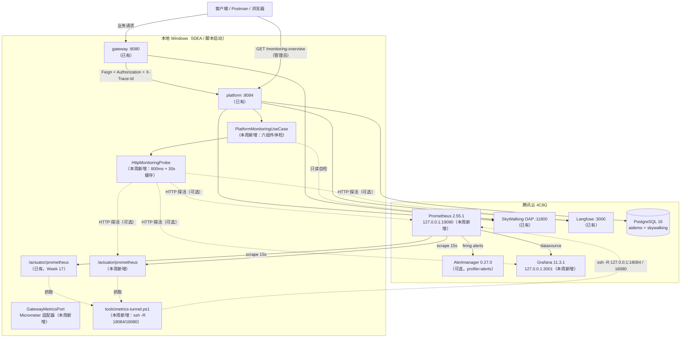
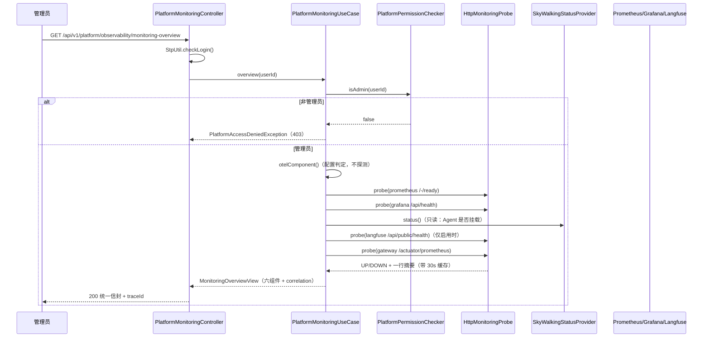
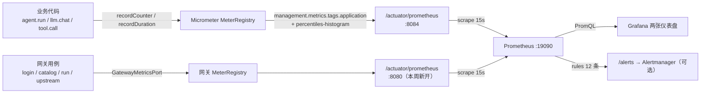
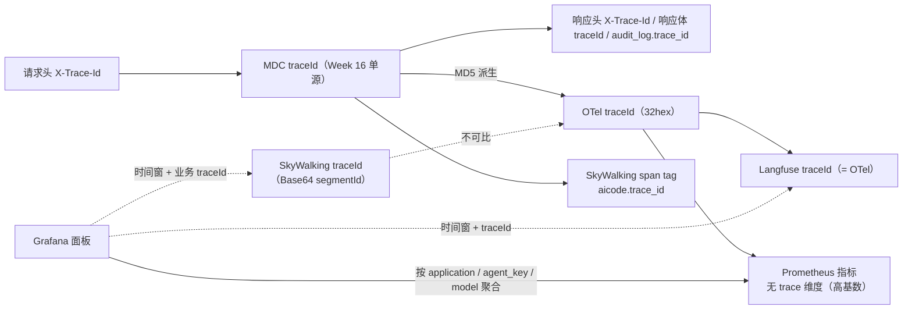

# Architecture: Week 20 — 完整监控体系（Prometheus + Grafana + 四后端收口）

> 只画本周**新增 / 改动**节点；标「已有」的节点本周不改契约。

## 1. 包结构（新增 / 改动）

```
apps/spring-ai-alibaba-agent/                                  ← 平台（8084）改动
  observability/domain/MonitoringStatus.java                   ← 新增（UP/DOWN/DISABLED/UNKNOWN）
  observability/domain/MonitoringComponent.java                ← 新增（单组件体检结果）
  observability/domain/MonitoringProbeResult.java              ← 新增（探测结果，无正文）
  observability/domain/MonitoringProbePort.java                ← 新增（HTTP 健康探测端口）
  observability/domain/MonitoringOverviewView.java             ← 新增（概览 + 跨后端关联）
  observability/domain/MonitoringMetricNames.java              ← 新增（7 个指标名常量，契约测试锁死）
  observability/infrastructure/MonitoringProperties.java       ← 新增（monitoring.* 配置 + 默认值）
  observability/infrastructure/HttpMonitoringProbe.java        ← 新增（JDK HttpClient + 超时 + TTL 缓存）
  observability/infrastructure/MonitoringConfiguration.java    ← 新增（注册探测端口）
  observability/application/PlatformMonitoringUseCase.java     ← 新增（六组件体检 + 关联块 + 管理员校验）
  observability/dto/MonitoringOverviewResponse.java            ← 新增（对外 JSON 契约）
  observability/controller/PlatformMonitoringController.java   ← 新增（GET /monitoring-overview）
  observability/infrastructure/MicrometerObservabilityAdapter.java ← 改动（token 指标名改用常量）
  observability/infrastructure/ObservableChatModelAdapter.java ← 改动（llm.* 指标名改用常量）
  observability/infrastructure/ObservableToolPort.java         ← 改动（tool.* 指标名改用常量）
  observability/infrastructure/LangfuseGenerationSupport.java  ← 改动（cost 指标名改用常量）
  platform/application/PlatformExecutionUseCase.java           ← 改动（agent.* 指标名改用常量）
  application.yml                                              ← 改动（monitoring.*、指标公共标签、直方图桶）

apps/agent-gateway/                                            ← 网关（8080）改动
  domain/model/GatewayMetricNames.java                         ← 新增（4 个指标 + 标签常量）
  domain/port/GatewayMetricsPort.java                          ← 新增（指标端口 + NOOP）
  infrastructure/observability/MicrometerGatewayMetricsAdapter.java ← 新增（Micrometer 实现）
  application/GatewaySessionUseCase.java                       ← 改动（登录成功/失败打点，保留旧构造器）
  application/GatewayAgentUseCase.java                         ← 改动（缓存命中/回源、执行/上游失败打点）
  pom.xml                                                      ← 改动（+micrometer-registry-prometheus）
  application.yml                                              ← 改动（prometheus 出口、公共标签、直方图桶）

deploy/monitoring/                                             ← 全新部署物
  docker-compose.yml                                           ← Prometheus + Grafana + 可选 Alertmanager（host 网络）
  .env.example                                                 ← Grafana 管理员密码等占位
  prometheus/prometheus.yml                                    ← 3 个抓取目标（自身 / 平台 18084 / 网关 18080）
  prometheus/alerts.yml                                        ← 12 条告警规则（可用性 / SLO / 成本 / 网关 / 监控自身）
  alertmanager/alertmanager.yml                                ← 可选通知模板（空 receiver + 抑制规则）
  grafana/provisioning/datasources/prometheus.yml              ← 数据源 uid=aicode-prometheus
  grafana/provisioning/dashboards/dashboards.yml               ← 仪表盘自动加载
  grafana/dashboards/aicode-platform-overview.json             ← Platform 业务与 LLM 概览
  grafana/dashboards/aicode-gateway-overview.json              ← Gateway 入口概览

tools/                                                         ← 运维脚本（新增 / 改动）
  metrics-tunnel.ps1                                           ← 新增：云端 -> 本地反向隧道（18084/18080）
  run-local-gateway.ps1                                        ← 新增：本地起网关做验收
  cloud-accept-monitoring.sh                                   ← 新增：云端监控栈验收（容器/目标/规则/仪表盘）
  tunnel.ps1 / tunnel-daemon.ps1                               ← 改动：增加 19090(Prometheus) / 3001(Grafana) 本地转发
  pull-images.sh                                               ← 改动：增加监控三镜像（三级镜像源回退）
  cloud-bootstrap.sh                                           ← 改动：可选启动 monitoring 栈并生成 .env

docs/                                                          ← 本周交付
  specs/week-20.md / architecture/week-20-architecture.md / api/week-20-api.md
  deploy/week-20-monitoring.md
  postman/week-20.postman_collection.json
notes/impl-logs/week-20.md / notes/week-20-prometheus-grafana.md

libs/ai-core                                                   ← 无变更（Port 契约零改动）
apps/patient-agent / enterprise-knowledge-agent / spring-ai-demo ← 无变更
```

## 2. 本周增量拓扑



要点：

- **业务流量与监控流量是两条独立通道**：业务走 `tunnel.ps1`（本地 `-L`），指标抓取走
  `metrics-tunnel.ps1`（云端 `-R`）。任何一条断掉都不会让另一条失败。
- **监控栈自身故障不影响业务**：指标只在本地注册表，导出失败由 Prometheus 侧表现为 target down；
  概览接口把对应组件标 `DOWN`，不抛异常。
- **四后端各司其职**：Prometheus 负责「量」（速率/耗时/错误/成本），SkyWalking 负责「拓扑与慢调用」，
  Langfuse 负责「单次 LLM 的 Prompt/token/成本」，OTel 是 span 语义与导出底座。

## 3. 一次「监控体检」请求（sequence）



状态判定表（与单测一一对应）：

| 条件 | enabled | status | 参与 allHealthy |
|------|---------|--------|------------------|
| 配置关闭 / 地址为空 | false | `DISABLED` | 否 |
| 配置开启 + 探测 2xx/3xx | true | `UP` | 是 |
| 配置开启 + 探测失败 | true | `DOWN` | 是（→ 整体不健康） |
| SkyWalking 配置开但 Toolkit 不可用 | true | `DOWN` | 是 |

## 4. 指标从应用到仪表盘（数据流）



**命名契约**（Micrometer → Prometheus 导出名）由 `MonitoringMetricsContractTest` 用真实
`PrometheusMeterRegistry` 抓文本锁死：

| Micrometer | Prometheus | 标签（导出后） |
|------------|------------|----------------|
| `agent.run.count` | `agent_run_count_total` | `agent_key` / `execution_status` / `application` |
| `agent.run.duration` | `agent_run_duration_seconds_{count,sum,bucket}` | 同上 |
| `llm.call.count` | `llm_call_count_total` | `gen_ai_request_model` / `llm_outcome` |
| `llm.call.duration` | `llm_call_duration_seconds_*` | 同上 |
| `llm.tokens.total` | `llm_tokens_total` | `token_type`（prompt/completion） |
| `llm.cost.usd` | `llm_cost_usd_total` | `gen_ai_request_model` |
| `tool.call.count` | `tool_call_count_total` | `tool_name` / `tool_outcome` |
| `gateway.session.login.count` | `gateway_session_login_count_total` | `outcome` |
| `gateway.catalog.lookup.count` | `gateway_catalog_lookup_count_total` | `cache_hit` |
| `gateway.agent.run.count` | `gateway_agent_run_count_total` | `outcome` |
| `gateway.agent.run.duration` | `gateway_agent_run_duration_seconds_*` | `outcome` |
| `gateway.upstream.error.count` | `gateway_upstream_error_count_total` | `error_code` |

> **直方图桶必须显式开**：Micrometer 默认只导出 `_count` / `_sum`；不配
> `management.metrics.distribution.percentiles-histogram.*`，`histogram_quantile` 与 P95 面板
> 会永久为空（本周真机踩到，见实现日志 10.2）。

## 5. 跨后端关联模型（四个系统、三种 ID）



概览接口的 `correlation.queryHints` 直接给出五个检索提示，避免运维凭记忆：

| key | 提示值示例 |
|-----|-----------|
| `logs` | `traceId=week20-e2e` |
| `audit` | `audit_log.trace_id=week20-e2e` |
| `skywalking` | `aicode.trace_id = week20-e2e` |
| `langfuse` | `traceId = <otelTraceId>` |
| `prometheus` | `指标无 trace 维度，按 application / agent_key / gen_ai_request_model 聚合` |

## 6. ADR（本周）

| 决策 | 选项 | 选择 | 理由 |
|------|------|------|------|
| 监控栈部署位置 | 本地 Docker / 云端 | **云端** | 本机未装 Docker；云端已有 10 个容器，4C8G 余量 3.1 GB，新增 2 个约 250 MB；且与 SkyWalking/Langfuse 同机便于统一验收 |
| 容器网络 | bridge + ports / host | **host 网络** | 反向隧道只绑云端回环，bridge 容器看不到；host 网络零 sshd 改动、零公网暴露。代价是端口不再由 Docker 映射，靠「只监听 127.0.0.1 + 安全组」保证安全 |
| Prometheus 端口 | 9090（默认） / 19090 | **19090** | 9090/9091 都被 Langfuse 的 MinIO 占用（S3 API + 控制台）；`curl 9090` 返回 S3 XML，Prometheus 绑定失败循环重启 |
| 本地应用指标抓取 | 暴露公网 / 反向 SSH | **反向 SSH**（`tools\metrics-tunnel.ps1`） | 指标端点无鉴权，暴露公网不可接受；反向隧道零安全组改动 |
| 统一自检的权限 | 登录用户 / 管理员 | **管理员** | 会暴露内部地址、拓扑与组件开关；普通用户没有排障需求 |
| 探测策略 | 每次实时 / 缓存 | **800ms 超时 + 30s 缓存** | 三个探针串行最坏 2.4s；缓存与 Prometheus 15s 抓取同量级，避免自检把后端打爆 |
| 指标名管理 | 字符串散落 / 常量 + 契约测试 | **常量 + 真实注册表契约测试** | 改名会让 Grafana 静默变空；契约测试在 CI 阶段就失败 |
| 网关指标实现 | 直接注入 MeterRegistry / Port | **Port + Micrometer 适配器** | 规范 3.3 禁止框架类型进 application 层；旧构造器默认 NOOP，第 19 周测试零改动 |
| 告警通知 | 内置 webhook / 模板 | **只给模板，Alertmanager 可选** | 通知渠道与密钥属于团队配置，写进仓库会泄密且不可移植 |
| 直方图桶 | 默认 / 显式配置 | **显式开启** | 默认无 `_bucket`，P95 面板与 `histogram_quantile` 永远为空（真机验证） |

## 7. YAGNI 陈述

- 不引 Loki/ELK：本周要解决的是「指标与告警缺失」，日志已有 traceId 单源，集中式日志是另一条独立链路。
- 不引 Grafana SSO/OAuth：单管理员演示环境没有多用户需求，接入 IdP 会引入外部依赖。
- 不做 trace exemplars：需要 OpenMetrics + 客户端配合，收益是「从指标跳到单条 trace」；
  当前用「时间窗 + 业务 traceId」已能定位，先不引入格式兼容风险。
- 不做 K8s/Operator：应用还在本地，监控栈 3 个容器用 compose 足够。
- 不给 8082/8083 补指标出口：第 21 周收敛到 8084 时统一，避免现在维护四份配置。

## 8. 与既有模块关系

| 模块 | 变更 |
|------|------|
| `apps/spring-ai-alibaba-agent` | 新增统一监控概览（Port/Adapter/UseCase/Controller/DTO/配置）；指标名常量化；指标公共标签与直方图桶 |
| `apps/agent-gateway` | 新增指标端口与 4 个网关指标；打通 `/actuator/prometheus`；公共标签与直方图桶 |
| `libs/ai-core` | **无变更**（`AgentObservabilityPort` 契约零改动） |
| `patient-agent` / `enterprise-knowledge-agent` / `spring-ai-demo` | 无变更 |
| Week 16–19（信封 / 审计 / OTel / Langfuse / SkyWalking / 网关） | 契约与行为零改动；统一概览只读既有状态 |
