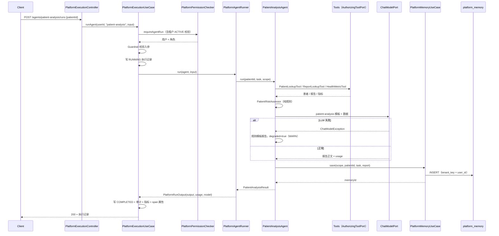
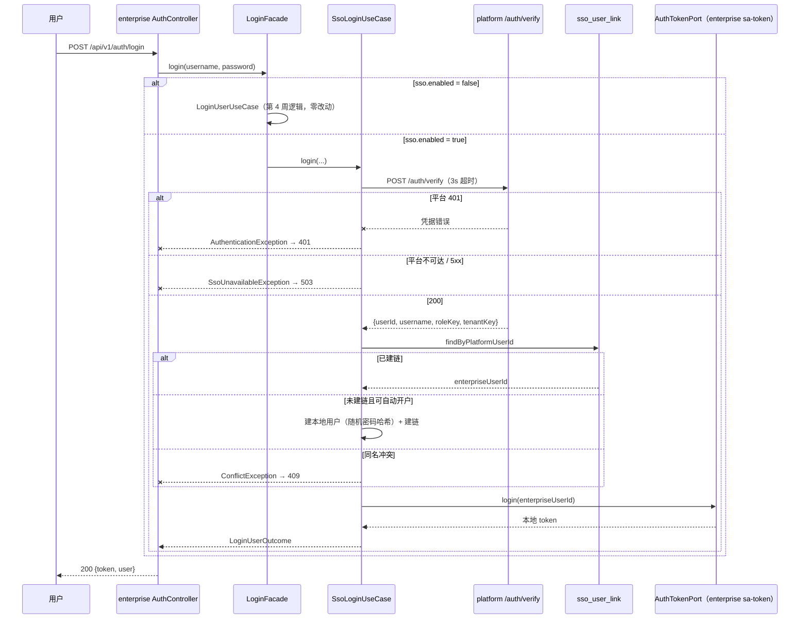
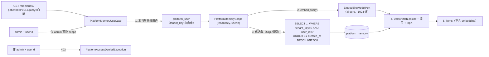

# Architecture: Week 21 — 医疗 SaaS 起步（租户 / SSO / 患者分析 Agent / 记忆隔离）

> 只画本周**新增 / 改动**节点；标「已有」的节点本周不改契约。
> 配套：Spec `docs/specs/week-21.md`｜接口 `docs/api/week-21-api.md`

## 1. 包结构（新增 / 改动）

```
apps/spring-ai-alibaba-agent/                                            ← 平台（8084）
  platform/domain/model/PlatformTenant.java                              ← 新增（租户模型）
  platform/domain/model/TenantStatus.java                                ← 新增（ACTIVE / SUSPENDED）
  platform/domain/model/PlatformUser.java                               ← 改动（+tenantKey，保留 4 参构造器）
  platform/domain/model/PlatformMemoryRecord.java                        ← 新增（记忆记录）
  platform/domain/model/PlatformMemoryHit.java                           ← 新增（记忆命中 + score）
  platform/domain/model/PlatformMemoryScope.java                         ← 新增（tenantKey + userId 值对象，必填）
  platform/domain/port/PlatformTenantPort.java                           ← 新增（租户读写）
  platform/domain/port/PlatformMemoryPort.java                           ← 新增（save / search / listRecent，scope 必填）
  platform/domain/port/PlatformRunScopePort.java                         ← 新增（当前 Run 的租户+用户，供 Agent 写记忆）
  platform/domain/service/PlatformPermissionChecker.java                 ← 改动（requireAgentRun 返回用户；旧构造器保留）
  platform/application/PlatformTenantUseCase.java                        ← 新增（列表 / 当前租户 / 停用校验）
  platform/application/PlatformMemoryUseCase.java                        ← 新增（scope 推导 + 向量化 + 阈值排序）
  platform/application/PlatformAuthUseCase.java                          ← 改动（verify 用例 + 租户停用校验，旧构造器保留）
  platform/infrastructure/persistence/InMemoryPlatformTenantAdapter.java ← 新增
  platform/infrastructure/persistence/JdbcPlatformTenantAdapter.java     ← 新增
  platform/infrastructure/persistence/InMemoryPlatformMemoryAdapter.java ← 新增
  platform/infrastructure/persistence/JdbcPlatformMemoryAdapter.java     ← 新增（scope 进 SQL 谓词）
  platform/infrastructure/persistence/JdbcPlatformUserAdapter.java       ← 改动（读写 tenant_key）
  platform/infrastructure/seed/PlatformTenantSeedInitializer.java         ← 新增（默认租户 + hospital-b，逐 key 判空）
  platform/infrastructure/seed/PlatformHospitalBSeedInitializer.java     ← 新增（第二租户演示用户，逐 id 判空）
  platform/infrastructure/seed/PlatformRbacPermissionUpgradeInitializer.java ← 新增（operator 权限并集升级，不覆盖手工撤销）
  platform/infrastructure/seed/PlatformRbacSeedInitializer.java          ← 改动（operator 增 agent/tool；用户带租户）
  platform/infrastructure/seed/PlatformSeedDataInitializer.java          ← 改动（+patient-analysis Agent / +ReportLookupTool）
  platform/infrastructure/security/SecurityContextRunScopeAdapter.java   ← 新增（从 PlatformSecurityContext + 用户记录推导 scope）
  platform/controller/PlatformTenantController.java                      ← 新增（GET /tenants，管理员）
  platform/controller/PlatformMemoryController.java                      ← 新增（GET /memories）
  platform/dto/PlatformTenantResponse.java / PlatformMemoryResponse.java ← 新增（对外契约）
  platform/dto/PlatformAuthResponse.java / PlatformMeResponse.java       ← 改动（+tenantKey / tenantName）
  platform/dto/PlatformVerifyRequestResponse.java                        ← 新增（POST /auth/verify）
  platform/controller/PlatformAuthController.java                        ← 改动（新增 verify 端点）
  platform/domain/service/PlatformAgentRunner.java                       ← 改动（PATIENT_ANALYSIS 分支，旧构造器保留）
  platform/domain/model/AgentType.java                                   ← 改动（+PATIENT_ANALYSIS）
  framework/analysis/application/PatientAnalysisUseCase.java             ← 新增（校验 + 编排入口）
  framework/analysis/application/PatientAnalysisRuntimeConfig.java       ← 新增（模型/温度/maxTokens/步数上限）
  framework/analysis/domain/PatientAnalysisAgent.java                    ← 新增（工具 → 规则 → LLM → 记忆）
  framework/analysis/domain/PatientAnalysisReportComposer.java           ← 新增（降级报告模板，纯函数）
  framework/analysis/domain/model/PatientAnalysisResult.java             ← 新增
  framework/analysis/domain/model/PatientAnalysisStep.java               ← 新增
  framework/infrastructure/tool/ReportLookupTool.java                    ← 新增（检查报告，演示数据）
  resources/db/migration/V4__platform_tenant.sql                         ← 新增
  resources/db/migration/V5__platform_memory.sql                         ← 新增
  resources/prompts/patient-analysis-v1.txt                              ← 新增
  resources/application.yml                                              ← 改动（platform.memory.*、guardrail、llm 参数）

apps/enterprise-knowledge-agent/                                         ← enterprise（8081）
  domain/model/PlatformIdentity.java                                     ← 新增（平台身份：userId/username/roleKey/tenantKey）
  domain/port/PlatformIdentityPort.java                                  ← 新增（委托平台校验凭据）
  domain/port/SsoUserLinkPort.java                                       ← 新增（平台用户 ↔ 本地用户映射）
  domain/exception/SsoUnavailableException.java                          ← 新增（平台不可达 → 503）
  application/LoginFacade.java                                           ← 新增（按 sso.enabled 路由本地/SSO）
  application/SsoLoginUseCase.java                                       ← 新增（委托校验 → 建链/开户 → 本地会话）
  infrastructure/sso/SsoProperties.java                                  ← 新增（sso.enabled / base-url / timeout）
  infrastructure/sso/HttpPlatformIdentityAdapter.java                    ← 新增（JDK HttpClient + Jackson）
  infrastructure/persistence/JdbcSsoUserLinkAdapter.java                 ← 新增（JdbcTemplate）
  controller/AuthController.java                                         ← 改动（改用 LoginFacade）
  controller/GlobalExceptionHandler.java                                 ← 改动（+503 SSO 不可达映射）
  resources/db/migration/V7__sso_user_link.sql                           ← 新增
  resources/application.yml                                              ← 改动（sso.* 默认关）
  .env.example                                                           ← 改动（SSO_* 占位）

apps/patient-agent/                                                      ← patient（8083，deprecated）
  infrastructure/deprecation/DeprecatedApiFilter.java                    ← 新增（三个响应头）
  infrastructure/deprecation/DeprecationAnnouncer.java                   ← 新增（启动 WARN）
  resources/application.yml                                              ← 改动（server.deprecated.* 占位说明）

docs/  specs/week-21.md｜architecture/week-21-architecture.md｜api/week-21-api.md｜postman/week-21.postman_collection.json
notes/impl-logs/week-21.md

libs/ai-core：**零改动**（复用 EmbeddingModelPort / VectorMath / PasswordHasher / AuthTokenPort，不改任何 Port 契约）
apps/agent-gateway、spring-ai-demo：**零改动**
```

## 2. 本周增量拓扑

```mermaid
flowchart TB
    subgraph ENTERPRISE["enterprise :8081（已有，本周改动）"]
        AC["AuthController<br/>（已有，改走 Facade）"]
        LF["LoginFacade<br/>（本周新增：sso 开关路由）"]
        LUC["LoginUserUseCase<br/>（已有，零改动）"]
        SUC["SsoLoginUseCase<br/>（本周新增）"]
        HIP["HttpPlatformIdentityAdapter<br/>（本周新增）"]
        LINK[("sso_user_link<br/>（本周新增 V7）")]
    end

    subgraph PLATFORM["platform :8084（已有，本周扩展）"]
        PVC["POST /auth/verify<br/>（本周新增）"]
        AUC["PlatformAuthUseCase<br/>（已有，+verify +租户校验）"]
        TU["PlatformTenantUseCase<br/>（本周新增）"]
        MU["PlatformMemoryUseCase<br/>（本周新增）"]
        MC["PlatformMemoryController<br/>（本周新增）"]
        PA["PatientAnalysisAgent<br/>（本周新增）"]
        RUN["PlatformAgentRunner<br/>（已有，+PATIENT_ANALYSIS）"]
        EX["PlatformExecutionUseCase<br/>（已有，零改动）"]
        RS["PlatformRunScopePort<br/>（本周新增）"]
        TOOLS["PatientLookupTool / HealthMetricTool<br/>（已有）<br/>ReportLookupTool（本周新增）"]
        MEM[("platform_memory<br/>（本周新增 V5）")]
        TEN[(  "platform_tenant<br/>（本周新增 V4）")]
        USER[(  "platform_user + tenant_key<br/>（本周改动）")]
    end

    subgraph LEGACY["patient-agent :8083（已有，本周标注弃用）"]
        PA3["/api/v1/agents/runs"]
        DF["DeprecatedApiFilter<br/>（本周新增）"]
    end

    AC --> LF
    LF -->|"sso.enabled=false"| LUC
    LF -->|"sso.enabled=true"| SUC
    SUC --> HIP
    SUC --> LINK
    HIP -->|"POST /auth/verify"| PVC
    PVC --> AUC
    AUC --> USER
    AUC --> TEN

    MU --> MEM
    MU --> RS
    MC --> MU
    EX --> RUN
    RUN --> PA
    PA --> TOOLS
    PA -->|"写记忆（scope 必填）"| MU
    PA -->|"规则风险评估（Week 9）"| EX
    RS --> USER

    DF -. "Deprecation / Sunset / Link 响应头" .-> PA3
```

要点：

- **企业侧不持有平台 token**：`/auth/verify` 只校验凭据并返回身份，不建平台会话，
  因此 enterprise 登录多次也不会在平台堆积孤儿 session（对比「复用 /auth/login 拿 token 再丢掉」）；
- **记忆的 scope 由服务端推导**：`PlatformRunScopePort` 读的是 `PlatformSecurityContext`（平台执行时写入）
  与 `platform_user.tenant_key`，请求体里没有也不接受 tenant/user 字段；
- **平台执行链路一行未改**：`PlatformExecutionUseCase` 仍是 RBAC → Guardrail → Runner → 执行记录 → 审计 →
  指标 → span，患者分析只是 `PlatformAgentRunner` 多了一个分支。

## 3. 患者分析 Agent 时序（一条 Run 内发生什么）



## 4. SSO 登录时序（enterprise → platform）



## 5. 记忆隔离数据流



## 6. 新增类型清单

| 类型 | 名称 | 职责 |
|------|------|------|
| Port | `PlatformTenantPort` | 租户读（findByKey / listAll）与写（save，幂等） |
| Port | `PlatformMemoryPort` | 记忆写 + 两种读，**scope 必填**（无无参读入口） |
| Port | `PlatformRunScopePort` | 当前 Run 的 `PlatformMemoryScope`，无则空 |
| Port | `PlatformIdentityPort`（enterprise） | 委托平台校验凭据，返回身份（不含 token） |
| Port | `SsoUserLinkPort`（enterprise） | 平台用户 ↔ 本地用户映射 |
| Adapter | `JdbcPlatformTenantAdapter` / `InMemoryPlatformTenantAdapter` | 租户落库 / 进程内 |
| Adapter | `JdbcPlatformMemoryAdapter` / `InMemoryPlatformMemoryAdapter` | 记忆落库（scope 进 SQL）/ 进程内 |
| Adapter | `SecurityContextRunScopeAdapter` | 从运行上下文 + 用户记录推导 scope |
| Adapter | `HttpPlatformIdentityAdapter`（enterprise） | JDK HttpClient + Jackson + 超时 |
| Adapter | `JdbcSsoUserLinkAdapter`（enterprise） | 映射表落库 |
| UseCase | `PlatformTenantUseCase` | 租户列表（管理员）、停用校验 |
| UseCase | `PlatformMemoryUseCase` | scope 推导、向量化、阈值排序、admin 换 scope |
| UseCase | `PatientAnalysisUseCase` | 入参校验 + 编排入口 + 写记忆 |
| UseCase | `SsoLoginUseCase` / `LoginFacade`（enterprise） | SSO 登录与路由 |
| 初始化器 | `PlatformTenantSeedInitializer` / `PlatformHospitalBSeedInitializer` / `PlatformRbacPermissionUpgradeInitializer` | 逐 key/id 判空的 seed 与权限并集升级（真机缺陷 #7 的修法） |
| 领域服务 | `PatientAnalysisAgent` | 工具 → 规则 → LLM（降级）→ 记忆 |
| 纯函数 | `PatientAnalysisReportComposer` | 降级报告模板（可单测，不依赖 LLM） |
| Tool | `ReportLookupTool` | 检查报告查询（演示数据，确定性） |
| Filter | `DeprecatedApiFilter`（patient-agent） | 三个弃用响应头 |
| Test | `PlatformTenantUseCaseTest` / `JdbcPlatformTenantAdapterTest` | 租户语义与落库 |
| Test | `PlatformMemoryUseCaseTest` / `JdbcPlatformMemoryAdapterTest` | 隔离（同租户他人 / 跨租户）、阈值、admin |
| Test | `PatientAnalysisUseCaseTest` / `PatientAnalysisAgentTest` / `PatientAnalysisReportComposerTest` | Agent 主链路、降级、steps |
| Test | `ReportLookupToolTest` | 工具契约（缺参 / 正常） |
| Test | `PlatformAuthTenantTest` / `PlatformTenantControllerTest` | 登录带租户、停用、管理员权限 |
| Test | `SsoLoginUseCaseTest` / `LoginFacadeTest` / `HttpPlatformIdentityAdapterTest` | SSO 开户/建链/409/503/关闭回退 |
| Test | `DeprecatedApiFilterTest` | 8083 三个响应头 |

## 7. YAGNI：为什么不采用更复杂的方案

1. **不做共用用户表**：只需一张映射表就能让两个模块共享身份；合并表要动 `app_user` 的外键与 Flyway 历史，
   换来的只是少一张表（三行内说清：迁移风险 > 表的数量）。
2. **不做 pgvector**：单用户记忆最多几百条，Java 余弦够用；`PlatformMemoryPort` 已隔离存储，
   换实现只换适配器（详见 Spec 七）。
3. **不给网关加路由**：本周新增接口都可由客户端直连平台；网关透传在第 19 周已证明与鉴权链存在二次写出问题，
   没有真实需求就不碰。
4. **不删 patient-agent**：删掉会失去第 5–7 周的 19 个回归用例；弃用标记 + Sunset 头达成本周目标。
5. **不把租户放进请求头**：由服务端从用户记录推导，客户端无法越权指定租户（安全 > 灵活）。

## 8. ADR（本周）

| 决策 | 选项 | 选择 | 理由 |
|------|------|------|------|
| 身份源 | 双写两套账号 / 平台唯一 | 平台唯一（`/auth/verify`） | 两套密码 = 两套过期策略 + 两套泄露面 |
| verify vs login 复用 | 复用 `/auth/login` 拿 token 再丢弃 / 新增 `/auth/verify` | 新增 verify | 不产生孤儿会话；语义清晰（校验 ≠ 登录） |
| SSO 用户映射 | 共用 `platform_user` / 映射表 | 映射表 `sso_user_link` | 迁移风险、Flyway 历史表、`app_user` 外键依赖 |
| SSO 失败语义 | 一律 401 / 区分 503 | 401 凭据错、503 身份源不可用 | 把「平台挂了」报成「密码错」会误导排查（第 19 周同类教训） |
| 自动开户 | 关闭 / 开启（默认） | 开启 + 同名冲突 409 | 新员工零运维；同名不自动合并，避免张冠李戴 |
| 患者分析入口 | 直连 `/multi-agent/runs` / 平台 Agent | 平台 Agent（`PATIENT_ANALYSIS`） | 一次拿到 RBAC/审计/执行记录/指标/span |
| 风险判断 | 让 LLM 判 / 复用规则 | 复用 `PatientRiskAssessor` | 规则可解释、可单测、不烧 token；LLM 只写报告 |
| LLM 失败 | 整单失败 / 降级出规则报告 | 降级 + `degraded=true` | 报告是「可解释模板」，且明确标记不冒充模型输出 |
| 记忆隔离位置 | 用例层过滤 / SQL 谓词 | SQL 谓词 | 漏一个分支就是跨租户泄露 |
| 记忆向量存储 | pgvector / 文本向量 | 文本向量（Port 隔离） | H2 可测、库级改动最小（Spec 七） |
| 租户状态 | 不做 / 做（ACTIVE/SUSPENDED） | 做，登录时校验 | SaaS 最基本的下线手段；实现只在登录与权限检查两处 |
| 8083 处理 | 删除 / 弃用标记 | 弃用标记 | 保留回归对照，风险最低 |
