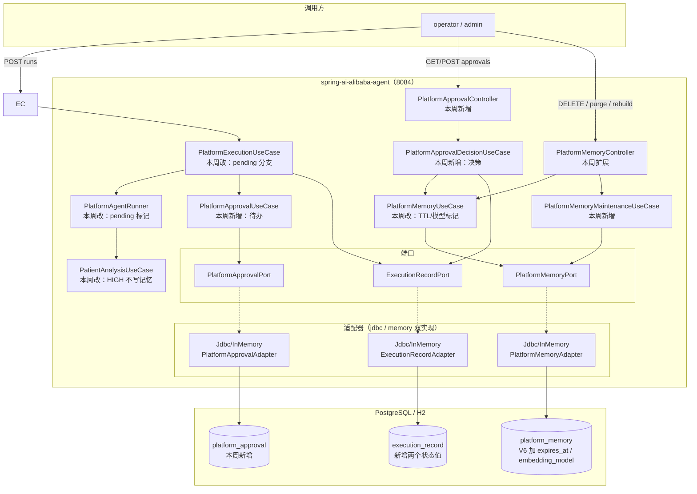
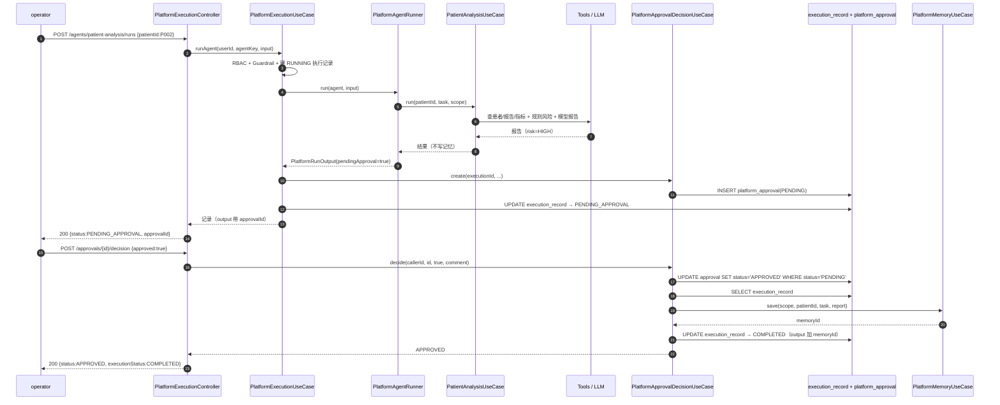
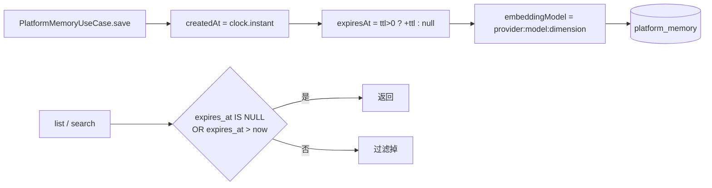
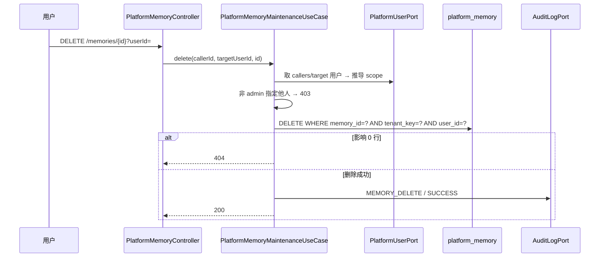
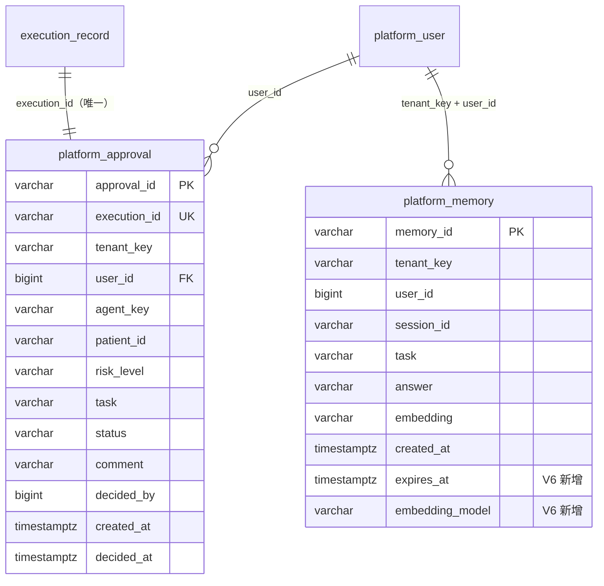
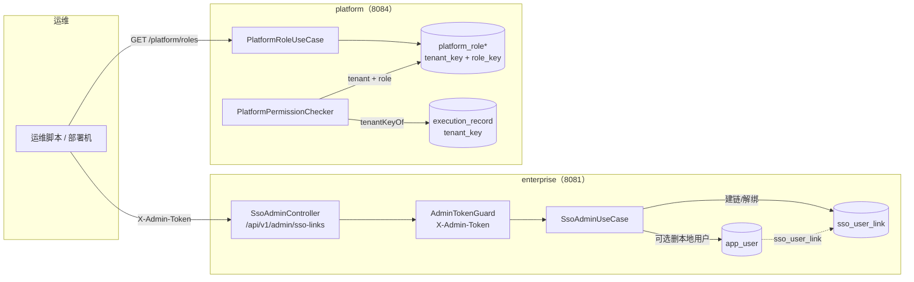

# Week 23 架构 — 患者分析 HITL + 长期记忆生命周期

> 范围：批次 1（本周编码）。批次 2（SSO 解绑 / 租户级角色）只在第 9 节给出边界与决策点，
> 产品语义确认后再画细图，避免把猜测写成架构。

## 1. 本周在系统中的位置

第 21 周把 Agent 1 做成平台一等 Agent 后，一次患者分析已经具备
「工具 → 规则风险 → 模型报告 → 长期记忆」的完整链路，但缺两个生产化能力：

- **高风险没有人工闸门**：报告生成后直接写记忆（等同直接进随访）；
- **记忆只能写不能管**：没有 TTL、不能删除、换 embedding 模型后旧向量无法识别与重建。

本周在**不改** Agent 内部链路、不改 Week 10 workflow HITL、不改响应信封的前提下，
在平台编排层补一个「人工审批」状态机，在记忆适配器层补生命周期字段。



## 2. HITL 时序（HIGH 风险）



### 2.1 为什么审批任务不塞进 execution_record

| 方案 | 问题 |
|------|------|
| 只靠 `execution_record.status=PENDING_APPROVAL` | 无法表达「谁审的、什么时候审的、审批意见」；待办列表要扫全表 |
| 新建 `platform_approval`（采用） | 待办有独立索引与状态；执行记录仍是运行日志；两者用 `execution_id` 唯一关联 |
| 引入 Flowable / Quartz | 单级审批、单实例，引入调度表/锁/版本升级，收益为负 |

### 2.2 决策的原子性

`markDecided` 只有一条 SQL：

```sql
UPDATE platform_approval
SET status = ?, decided_by = ?, comment = ?, decided_at = ?
WHERE approval_id = ? AND status = 'PENDING'
```

影响 0 行 → 409 `PLATFORM_CONFLICT`。这样即使两个审核人同时点「批准」，
也只有一个能进入「写记忆 + 改执行状态」，不会写出两条随访记忆。

### 2.3 失败与降级矩阵

| 场景 | 行为 |
|------|------|
| 模型不可用 | 沿用第 21 周：规则模板报告 + `degraded=true`；HIGH 仍进待审 |
| 工具失败 | 执行 `FAILED`，不产生审批任务 |
| 写审批任务失败 | 执行 `FAILED`（状态落库失败时整体失败，不能假装待审） |
| 写记忆失败（批准时） | 审批仍 `APPROVED`、执行仍 `COMPLETED`，`memoryId=null` + WARN（记忆不是主链路单点） |
| 审批后进程崩溃 | 状态已落库；重启后可查询/继续，不需要内存 checkpoint |
| 审批人不是本人/admin | 403；不泄露审批内容 |
| 审批不存在 | 404 |
| 重复决策 | 409；不重复写记忆 |

## 3. 记忆生命周期

### 3.1 保存与读取



- `expires_at` 由服务端算，客户端不能传；
- 读取过滤放在 SQL 里（JDBC 适配器）与内存适配器同一语义，避免「列表能看到、检索看不到」的分叉；
- 过期记录仍占表空间，由每日清理或 admin 手工 purge 删除。

### 3.2 删除



### 3.3 向量重建

```mermaid
flowchart LR
    A[admin POST rebuild] --> B[取 currentModel = provider:model:dim]
    B --> C[SELECT ... WHERE embedding_model IS NULL<br/>OR embedding_model <> current<br/>LIMIT n]
    C --> D{逐条 embed(task)}
    D -->|成功| E[UPDATE embedding + embedding_model]
    D -->|失败| F[failed++ / WARN]
    E --> G[返回 scanned/rebuilt/failed]
    F --> G
    G --> H[审计 MEMORY_REBUILD]
```

- 重建是**显式运维动作**，不在启动时自动跑：换模型后 embedding 配额与耗时不可控，
  自动重建会把一次发布变成一次全量 API 调用；
- 单条失败不中断，返回计数让运维判断是否重试；
- 维度写进 `embedding_model`，维度变化同样会被识别为「需要重建」。

## 4. 数据模型（V6）



## 5. 依赖与分层

| 规则 | 本周执行 |
|------|----------|
| Controller 不碰 Port/SQL | 审批/记忆控制器只调用 UseCase |
| UseCase 不写 SQL | 全部经 `PlatformApprovalPort` / `PlatformMemoryPort` |
| 隔离在 SQL 谓词 | 删除/列表/检索都带 `tenant_key + user_id`；重建是唯一例外（admin 运维，显式命名） |
| 领域不依赖 Web | `PlatformApproval` / `ApprovalStatus` 是纯 record/enum |
| 双适配器同契约 | `platform.persistence.mode=jdbc/memory` 切换，单测覆盖两套 |
| 时间可注入 | TTL 与审批时间用 `Clock`，单测不 sleep |

## 6. 观测与审计

| 事件 | 落点 |
|------|------|
| 高风险进入待审 | 执行记录 `PENDING_APPROVAL`；指标 `agent.run.count{execution.status=PENDING_APPROVAL}`；审计 `APPROVAL_SUBMIT` |
| 人工批准/拒绝 | 审计 `APPROVAL_DECIDE`（SUCCESS / DENIED）；日志带 approvalId/executionId |
| 删除记忆 | 审计 `MEMORY_DELETE`（SUCCESS / DENIED） |
| 清理过期 | 审计 `MEMORY_PURGE`（仅手工触发；定时任务只记日志，避免每天刷审计） |
| 重建向量 | 审计 `MEMORY_REBUILD`（SUCCESS / FAILURE，detail 只带计数） |

traceId 复用第 16 周 MDC / `X-Trace-Id`；审批决策作为独立 HTTP 请求产生自己的 trace，
与原始 Agent 执行的 trace 通过 `executionId` 关联（不伪造父子 span）。

## 7. 与第 10 周 HITL 的关系

| 维度 | Week 10 `patient-risk` | Week 23 `patient-analysis` |
|------|------------------------|----------------------------|
| 实现 | Spring AI Alibaba Graph `interruptBefore` + `MemorySaver` | 平台状态机 + `platform_approval` |
| 生命周期 | 进程内 checkpoint，重启丢 | 落库，重启/隔天可继续 |
| 暂停点 | `human_review` 节点前 | 报告生成后、写记忆前 |
| 恢复 | `CompiledGraph.resume(HumanFeedback)` | `POST /approvals/{id}/decision` |
| 适用 | 单次 Graph 运行 | 平台任意 Agent 的待办（当前仅 Agent 1） |

两者**并存**，不互相替换：Week 10 是「工作流内暂停」，Week 23 是「平台级人审任务」。
后续若把 Agent 1 改成 Graph，可把审批节点换成 `interruptBefore`，但审批表仍可复用作待办索引。

## 8. 为什么不上更复杂的方案（YAGNI）

- 不上消息队列：待办就是一张带索引的表，轮询/查询即可；没有异步消费者需求；
- 不上多级审批：当前只有「本人/admin 单级」，多级会引入审批链与或签/会签语义；
- 不上审批超时自动决策：自动拒绝高风险随访是**医疗语义上的危险默认值**，宁可让待办堆积并告警；
- 不上 Redis 缓存记忆：单用户几十到几百条，SQL 直查足够；缓存会引入失效与隔离漏洞。

## 9. 批次 2 的架构（A1 运维令牌 + B2 按租户复制角色）

用户已确认 A1/B2；以下是实际实现的增量，不改批次 1 的审批/记忆链路：



关键取舍：

| 决策 | 选择 | 影响 |
|------|------|------|
| 管理员身份 | A1 运维令牌（`ENTERPRISE_ADMIN_TOKEN`） | 不新增本地管理员登录面；未配令牌时端点 403（fail closed） |
| 解绑语义 | 只解绑 / 解绑并删本地用户（显式 `deleteLocalUser`） | 避免「解绑后同名用户仍在 → 再登录 409」死结 |
| 角色隔离 | B2：角色四表加 `tenant_key`，主键 `(tenant_key, role_key[, value])` | 租户角色互不影响；不开放租户自建角色（B3） |
| 执行记录 | V7 加 `tenant_key`，按 `user_id` 回填 | 可按租户统计/过滤；权限仍按用户校验 |
| 平台删用户级联 | 暂缓 | 平台当前无删用户 API；强行删会撞执行/审批外键，先走 enterprise 运维解绑 |

**不做**：租户管理员登录面、租户自建角色、平台用户删除/停用的完整生命周期（属产品语义，后续再定）。
