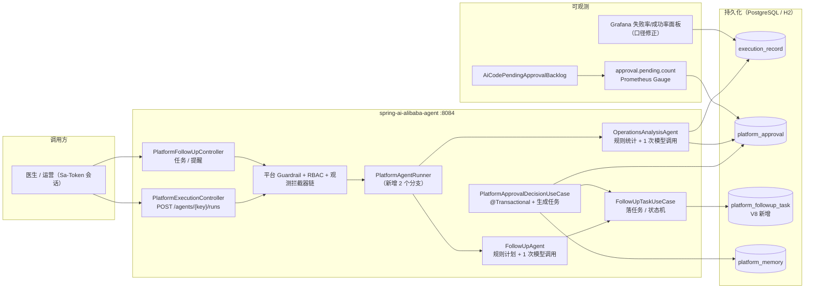
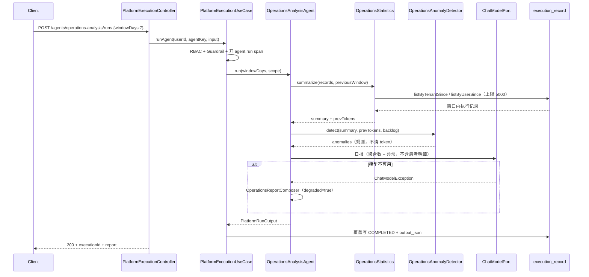
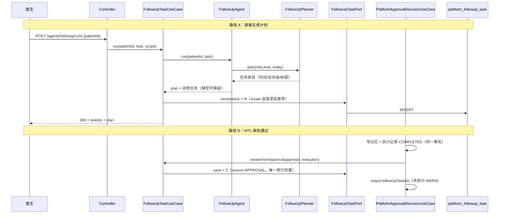
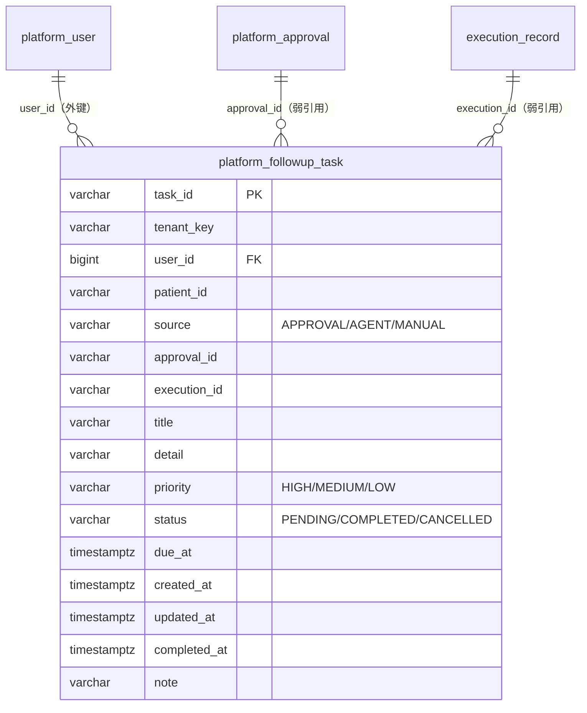

# 架构：Week 24 — Agent 2 运营分析 + Agent 4 随访 + 观测/一致性收口

> 本文只描述**本周新增或改动**的节点；第 1–23 周的结构见 `docs/architecture/week-23-architecture.md`。
> 代码分层仍按规范 3.3：`controller → application → domain ← infrastructure`。

## 1. 运行时拓扑（增量）



## 2. Agent 2：运营分析时序



**关键点**

- 统计在**应用层单点**（`OperationsStatistics`）完成，两个适配器只提供「时间窗列表」，
  H2/内存/真库口径天然一致；
- `failureRate` 分母 = `COMPLETED + FAILED`，与 TD-01 的 Grafana 口径同一常量来源
  （`OperationsSummary.denominator()`），避免「面板一套、日报另一套」；
- 模型只吃聚合数与异常，**发不出患者明细**（输入里就没有 patientId）。

## 3. Agent 4：随访任务时序（Agent 运行 + 审批联动）



**关键点**

- **计划条目由规则决定，模型只写说明**：临床时间点不能被幻觉改写；
- 任务写入在**用例层**而不是 Agent 里：Agent 是纯领域编排，拿不到租户（与 Week 21 记忆写入同一理由）；
- 审批联动失败**不回滚审批**：任务可重跑，高风险报告不能被随访任务卡住；
- `approval_id + title` 唯一索引让「重复生成」在数据库层也只留一条。

## 4. 数据模型（V8）



- 外键只到 `platform_user`（与 `platform_approval` 一致）：审批/执行记录被清理时不应阻断任务查询；
- `tenant_key` 冗余在任务行上：列表/提醒的隔离谓词写死在 SQL，不靠 join 推导；
- 唯一索引 `(approval_id, title)`：同一审批的同一计划条目只生成一次；
  注意 PostgreSQL 下 `NULL` 不参与唯一约束，所以 `source=AGENT`（`approval_id` 为 NULL）不受影响。

## 5. 一致性设计（TD-02）

```
┌───────────────────────── @Transactional（JDBC 模式） ─────────────────────────┐
│ 1. markDecided(WHERE status='PENDING')  ← 原子抢决策权（抢输 409）             │
│ 2. 写长期记忆（异常被 catch，不触发回滚）                                       │
│ 3. 生成随访任务（异常被 catch，不触发回滚）                                     │
│ 4. 执行记录覆盖写 COMPLETED/REJECTED + output_json                            │
└───────────────────────────────────────────────────────────────────────────────┘
                              │ 第 4 步抛异常
                              ▼
                    事务回滚 → 审批仍 PENDING（可重试）
                              │ 历史脏数据（升级前产生）
                              ▼
              ApprovalReconciliationScheduler（每 10 分钟）
              扫 APPROVED/REJECTED 且执行仍 PENDING_APPROVAL → 补写终态
```

- 为什么 `markDecided` 放第一步：并发下只能有一个赢家，避免两次写记忆/两套任务；
- 为什么对账是「按审批终态补执行状态」而不是「重新决策」：审批已经被人做过决定，
  对账只补执行记录的终态字段，不重复写记忆/任务。

## 6. 观测设计（TD-01 / TD-03）

| 项 | 变化 |
|----|------|
| `agent_run_count_total{execution_status}` | 不变（PENDING_APPROVAL / REJECTED 已是独立标签） |
| 失败率面板 | 分子 `execution_status="FAILED"`，分母 `execution_status=~"COMPLETED|FAILED"` |
| 成功率面板 | 新增：`COMPLETED / (COMPLETED + FAILED)` |
| 待办积压 | 新增 Gauge `approval.pending.count` → `approval_pending_count`；每 60s 采样 |
| 告警 | `AiCodePendingApprovalBacklog`：`approval_pending_count > 20` 持续 30m |

指标名仍由 `MonitoringMetricsContractTest` 用真实 Prometheus 注册表锁死；
新增 Gauge 走 `AgentObservabilityPort.recordGauge`，领域层不出现 Micrometer 类型。

## 7. 新增类型清单

| 层 | 类型 | 职责 |
|----|------|------|
| domain/model | `OperationsDailyReport` | 日报聚合根（窗口 + 汇总 + 异常 + 报告） |
| domain/model | `OperationsSummary` | 计数字段 + `successRate/failureRate/costConfigured/truncated` |
| domain/model | `OperationsAnomaly` / `OperationsAnomalyCode` / `OperationsAnomalyLevel` | 异常条目与规则码 |
| domain/model | `AgentRunSummary` | 按 Agent 分组的执行数/失败数/token |
| domain/model | `FollowUpTask` / `FollowUpStatus` / `FollowUpPriority` / `FollowUpSource` | 随访任务与枚举 |
| domain/model | `FollowUpPlan` / `FollowUpPlanItem` | 规则计划（未落库） |
| domain/service | `OperationsStatistics` | 窗口聚合（唯一口径来源） |
| domain/service | `OperationsAnomalyDetector` | 6 条规则 |
| domain/service | `OperationsReportComposer` | 降级模板 |
| domain/service | `FollowUpPlanner` | 风险 → 任务条目 |
| domain/port | `FollowUpTaskPort` | 任务持久化与原子状态迁移 |
| domain/port | `ExecutionRecordPort`（改） | 增加按租户/用户 + 时间窗查询 |
| domain/port | `PlatformApprovalPort`（改） | 增加 `countByStatus` |
| application | `OperationsAnalysisUseCase` | 统计 → 异常 → 日报 |
| application | `FollowUpTaskUseCase` | 计划落任务 / 查询 / 完成 / 取消 / 提醒 |
| application | `ApprovalReconciliationUseCase` | 审批-执行一致性对账 |
| infrastructure | `OperationsAnalysisAgent` / `FollowUpAgent` | Agent 运行时（规则 + 模型 + 降级） |
| infrastructure | `JdbcFollowUpTaskAdapter` / `InMemoryFollowUpTaskAdapter` | 任务持久化 |
| infrastructure | `PendingApprovalGaugeScheduler` / `ApprovalReconciliationScheduler` | 定时采样 / 对账 |
| infrastructure | `V8__platform_followup_task.sql` | 随访任务表 |
| controller | `PlatformFollowUpController` | 任务与提醒 API |
| dto | `FollowUpTaskResponse` / `FollowUpTaskListResponse` / `FollowUpReminderResponse` / `FollowUpTaskActionRequest` | 协议 |

## 8. YAGNI 陈述

- 不上 MQ：提醒是查询视图，没有推送渠道，消息队列只会多一套运维面；
- 不上 Quartz：两个 `@Scheduled`（采样 60s、对账 10min）足够，单实例；
- 不上 SQL 聚合 / 物化视图：演示库量级用应用层聚合即可，规则改动只改一处；
- 不做前端：本周只交付可被 Postman/网关直接调用的后端能力。
