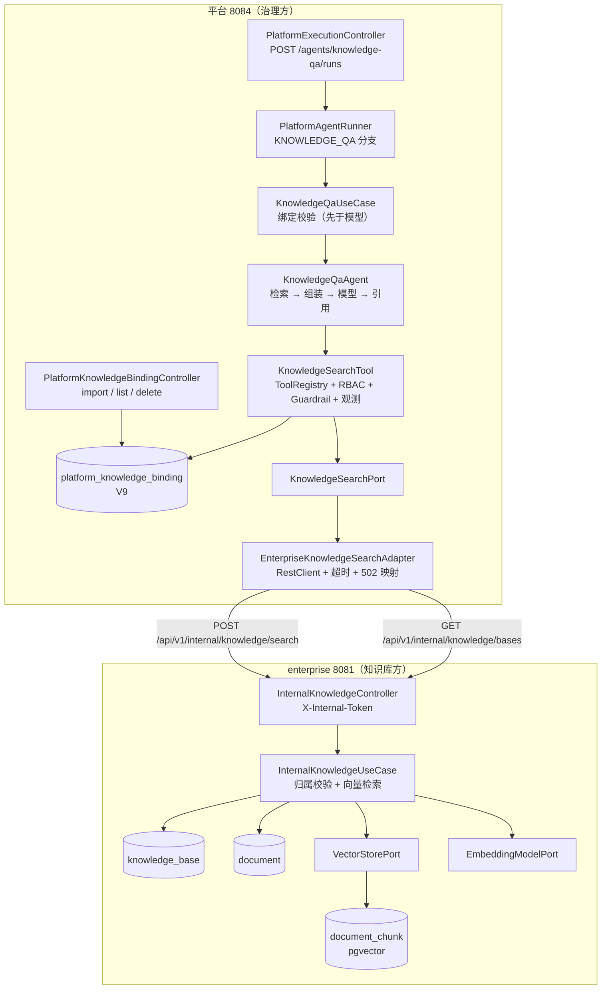
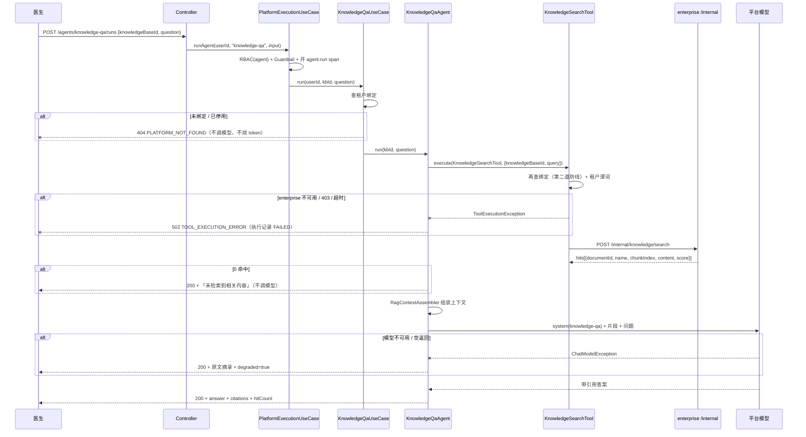
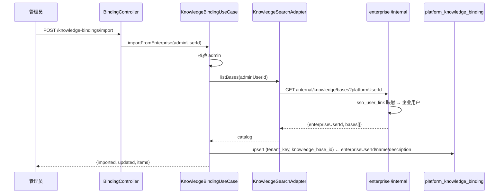

# 架构：Week 25 — 知识库 Agent 3 薄接入（平台包装 enterprise RAG）

> 只画本周新增/改动的节点。第 1–24 周结构见 `docs/architecture/week-24-architecture.md`。

## 1. 组件与调用关系

## 2. 问答时序（含三条失败路径）

## 3. 绑定导入时序

- 导入幂等：`(tenant_key, knowledge_base_id)` 唯一索引 + 先查后写；
- 企业侧重命名只更新快照，不改变绑定身份；
- 一个租户可以绑定多个知识库；同一企业知识库不能绑到两个租户（`tenant_key` 在唯一键里，理论上可以，
  但**导入人必须是该租户管理员**，且检索按租户隔离，不会串数据）。

## 4. 失败语义（为什么这么设计）

| 情况 | 返回 | 理由 |
|------|------|------|
| 知识库未绑定到租户 | 404 `PLATFORM_NOT_FOUND` | 调用方拿不到该资源；在模型之前失败，不烧 token |
| enterprise 未配置内部令牌 | 403（企业侧）→ 平台 502 | fail closed，不提供无鉴权检索 |
| enterprise 不可用/超时 | 502 `TOOL_EXECUTION_ERROR` | 「检索坏了」不能伪装成「没搜到」 |
| enterprise 返回 404（归属不符） | 502（平台视角是上游拒绝） | 平台绑定可能过期；日志带 kbId 便于对账 |
| 检索 0 命中 | 200 + 明确文案 | 有依据地告诉用户「没有」 |
| 模型失败 | 200 + 摘录 + `degraded=true` | 至少给原文与出处，不编造 |

## 5. 数据流与合规

- **平台不落知识库正文**：绑定表只有租户/ID/名称；切片正文只出现在本次执行的 `output_json`（已过 Guardrail 输出脱敏）；
- **企业侧只读**：内部端点不写会话/Token/模型调用，避免两个服务各记一套账；
- **引用可追溯**：`citations[].documentId + chunkIndex + documentName` 足以回到企业原文；
- **租户隔离双重**：平台绑定谓词 + 工具内二次校验；企业侧再校验知识库归属。

## 6. YAGNI 陈述

- 不引入消息队列/缓存：知识库问答是同步请求，缓存答案反而带来「过期答案」合规风险；
- 不做流式：当前前端未接入，SSE 会扩大改造面；
- 不做权限表：租户内全可见已满足当前演示与单院场景，科室级授权等有真实需求再加；
- 不做自动同步：企业侧改名是低频操作，重新导入即可。
