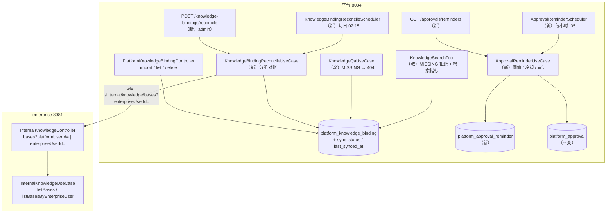
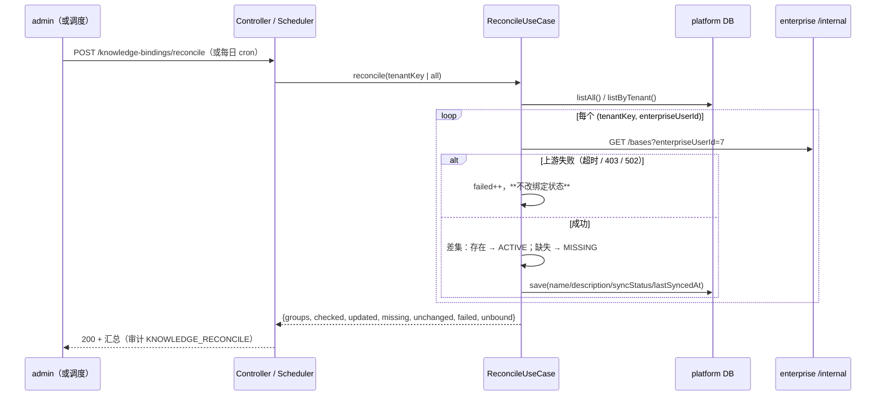
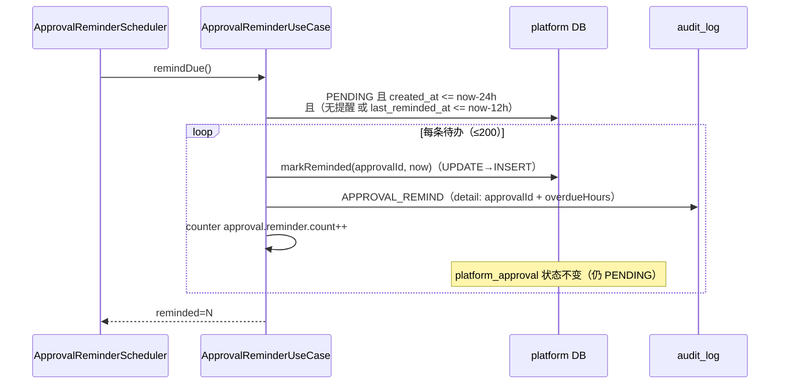
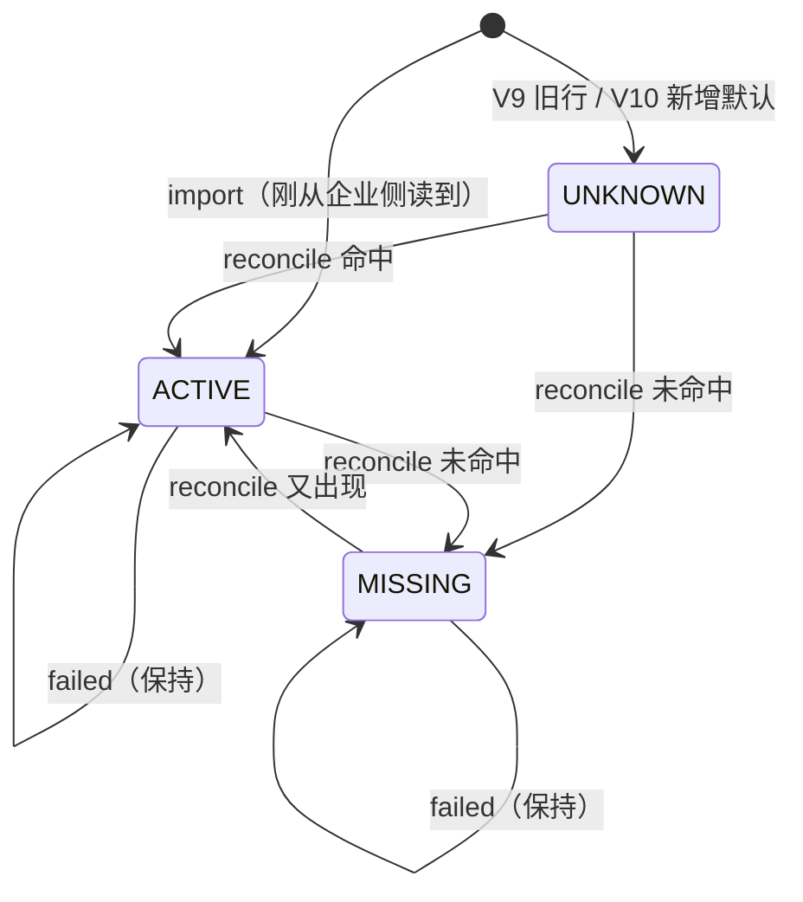

# 架构：Week 27 — 知识库运营化（对账 + 阈值提醒）

> 只画本周新增/改动的节点；第 1–26 周结构见 `docs/architecture/week-25-architecture.md`
> 与 `week-24-architecture.md`（第 26 周为运维收口周，没有增量架构文件）。

## 1. 组件与调用关系

新增/改动文件（生产代码）：

| 层 | 文件 |
|----|------|
| domain | `KnowledgeBindingSyncStatus`（新枚举）、`KnowledgeBinding`（加两字段 + `synced/markMissing`）、`KnowledgeBindingPort`（加 `updateSyncState/listAll/countBySyncStatus`）、`PlatformApprovalPort`（加 4 个提醒方法）、`AuditAction`（加 `KNOWLEDGE_RECONCILE` / `APPROVAL_REMIND`） |
| application | `KnowledgeBindingReconcileUseCase`（新）、`KnowledgeReconcileResult`（新）、`ApprovalReminderUseCase`（新）、`ApprovalReminderView`（新）；`KnowledgeBindingUseCase`（导入写 ACTIVE）、`KnowledgeQaUseCase`（MISSING → 404） |
| infrastructure | V10 迁移、`JdbcKnowledgeBindingAdapter` / `InMemoryKnowledgeBindingAdapter`（同步列）、`JdbcPlatformApprovalAdapter` / `InMemoryPlatformApprovalAdapter`（提醒记账）、两个 Scheduler（新）、`PlatformKnowledgeProperties` / `PlatformApprovalProperties`（配置） |
| controller/dto | 对账端点、提醒端点、绑定响应加 `syncStatus/lastSyncedAt`、`KnowledgeReconcileResponse`、`ApprovalReminderResponse` |
| enterprise | `InternalKnowledgeController`（互斥参数）、`InternalKnowledgeUseCase.listBasesByEnterpriseUser` |

## 2. 对账时序

**为什么按分组调用**：N 条绑定通常只属于 1–2 个企业用户，逐条调用会把 enterprise 打 N 次；
分组后调用次数 = 企业归属人数，且失败只影响该组。

## 3. 审批提醒时序

站内视图与调度解耦：`GET /approvals/reminders` 直接查「PENDING 且超过阈值」，
不依赖 reminder 表是否已记账——运营人员随时能看到积压，调度只负责「记账 + 指标 + 审计」。

## 4. 状态机（绑定）

`enabled` 是独立维度（是否允许检索），与 `sync_status`（企业侧是否存在）正交：
`enabled=false + ACTIVE` 表示「库还在，但本租户主动停用」。

## 5. 失败语义

| 场景 | 行为 | 为什么 |
|------|------|--------|
| enterprise 超时 / 令牌未配 / 5xx | 对账 `failed++`，绑定状态不变 | 一次抖动不能把全部知识库判死 |
| `enterpriseUserId` 在企业侧不存在 | 该组 `failed++`，不标 MISSING | 用户被删 ≠ 知识库被删，需人工核对 |
| 绑定 `MISSING` 被问答 | 404 `PLATFORM_NOT_FOUND`，不调模型/不调上游 | 明确告知「库已删除」，不伪装成「没检索到」 |
| 提醒调度异常 | 只记 WARN，不影响应用 | 与既有对账/采样同口径：运维任务不是单点 |
| 提醒重复（多实例） | 冷却窗口 + `UPDATE ... WHERE` 记账 | 重复提醒可接受，丢提醒不可接受 |
| 提醒后审批被决策 | 正常 409/批准路径，reminder 行保留 | 提醒不参与状态机 |

## 6. 指标与告警建议

| 指标 | 用途 | 建议告警 |
|------|------|----------|
| `knowledge_search_duration_seconds` | 检索 P95 / 上游慢 | P95 > 2s 持续 10m |
| `knowledge_hit_count_total` | 命中总量，配合 search count 算命中率 | 命中率为 0 持续 1h（需同时有请求） |
| `knowledge_binding_missing_count` | 企业侧删库/改名后的残留 | > 0 持续 1h（提示运营处理） |
| `knowledge_reconcile_count_total{result="failed"}` | 对账链路健康 | 连续 2 次 failed > 0 |
| `approval_reminder_count_total` | 提醒下发量 | 突增（提醒风暴） |

> 本次**不改** `deploy/monitoring/` 的告警与仪表盘：指标先落库/暴露，告警规则在下一周
> 按真实噪声调整（避免上线即误报）。

## 7. YAGNI 陈述

- 不做「对账自动新增/删除绑定」：绑定是租户可见性决策，自动扩散比漏同步更危险。
- 不做「审批自动拒绝/升级」：HIGH 风险患者分析宁可积压，也不能被系统静默终止。
- 不做「提醒站内信/WebSocket」：现有站内提醒是**查询视图**（随访同构），前端到位后再推。
- 不做「按科室授权」：需要 `platform_role_knowledge` 与真实组织架构，本周不引入半成品权限模型。
- 不做「多实例分布式锁」：当前单实例部署；调度幂等 + 冷却已足够，多实例时再加。
