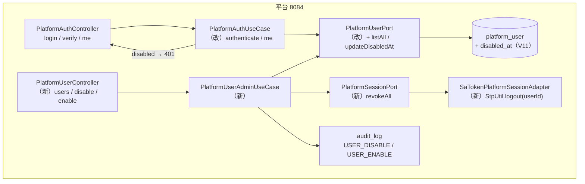
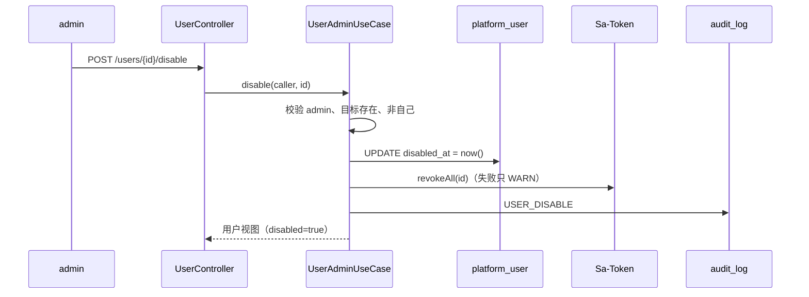
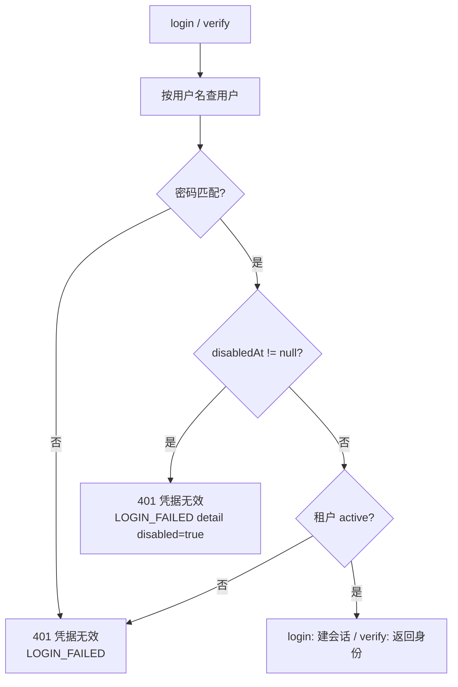
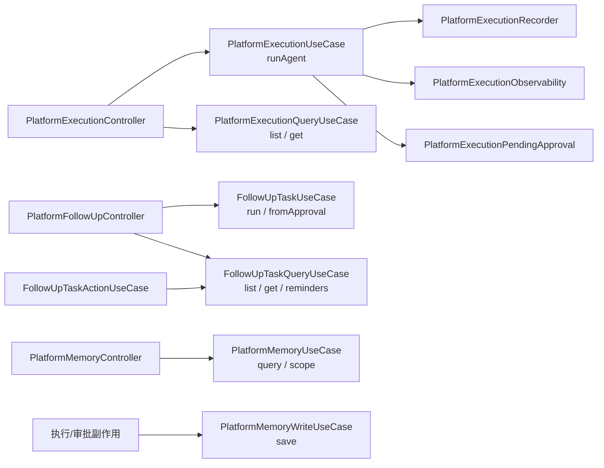

# 架构：Week 28 — 用户生命周期与结构收口

> 只画本周新增/改动的节点；前 27 周结构见 `docs/architecture/week-27-architecture.md`。

## 1. 组件与调用关系

新增/改动文件：

| 层 | 文件 |
|----|------|
| domain | `PlatformUser`（加 `disabledAt`，保留 4/5 参构造器）、`PlatformUserPort`（`listAll` / `updateDisabledAt`）、`PlatformSessionPort`（新）、`AuditAction`（`USER_DISABLE` / `USER_ENABLE`） |
| application | `PlatformUserAdminUseCase`（新）、`PlatformUserView`（新）；`PlatformAuthUseCase`（停用校验 + `me` 防御） |
| infrastructure | `V11__platform_user_disable.sql`、`JdbcPlatformUserAdapter` / `InMemoryPlatformUserAdapter`（列与合并语义）、`SaTokenPlatformSessionAdapter`（新） |
| controller/dto | `PlatformUserController`、`PlatformUserListResponse` / `PlatformUserResponse` |

## 2. 停用时序

## 3. 登录 / SSO 校验（停用分支）

对外文案完全一致，只有审计 detail 能区分停用/租户停用/密码错——避免账号状态探测。

## 4. 拆分后的依赖

拆分原则：只搬代码；Controller 改为按职责注入；public 行为、错误码、审计、指标口径不变。
目标：5 个执行类、3 个随访类、2 个记忆类全部 `< 200` 行。

## 5. 失败语义

| 场景 | 行为 | 原因 |
|------|------|------|
| 停用已停用用户 | 200 幂等，不重复审计 | 重复点击/重试不应该产生噪声 |
| 停用自己 | 400 | 避免唯一 admin 自锁 |
| 会话踢出失败 | 停用成功 + WARN | 状态已落库；`/auth/me` 的 disabled 检查兜底 |
| 停用用户 `/auth/me` | 401 | 即使 token 未被踢掉也不放行 |
| 历史数据读取 | 正常（admin/本人） | 停用不等于删除；审计与随访仍要可追溯 |
| seed 重跑 | 保留 `disabled_at` | 启动不能把停用用户复活 |

## 6. 边界

- gateway / enterprise 会话各有 TTL，停用不跨进程踢出；平台侧立即失效，其它入口等 TTL。
- 不做硬删与 `sso_user_link` 级联；恢复后 SSO 映射仍有效。
- 多实例时 Sa-Token 共享存储可让 `revokeAll` 生效；单实例是当前部署形态。
