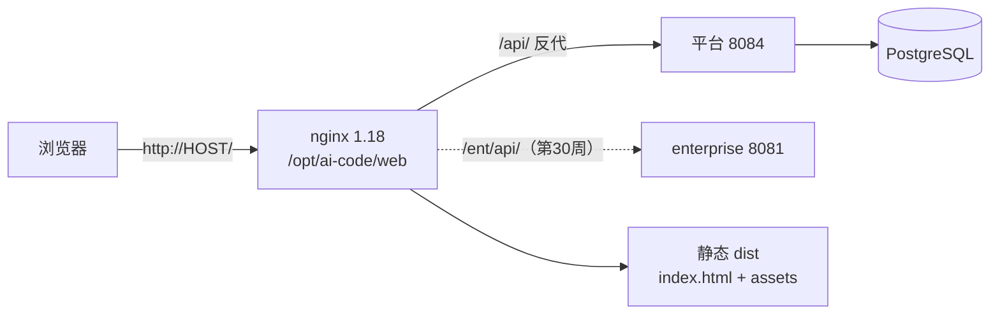
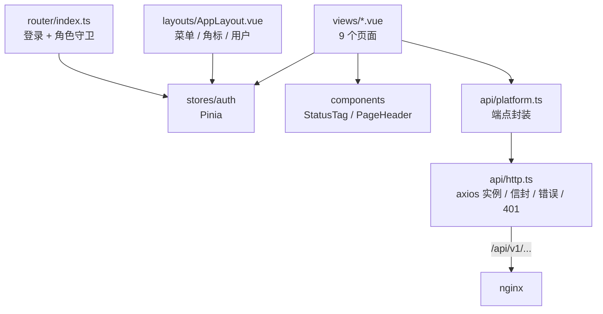
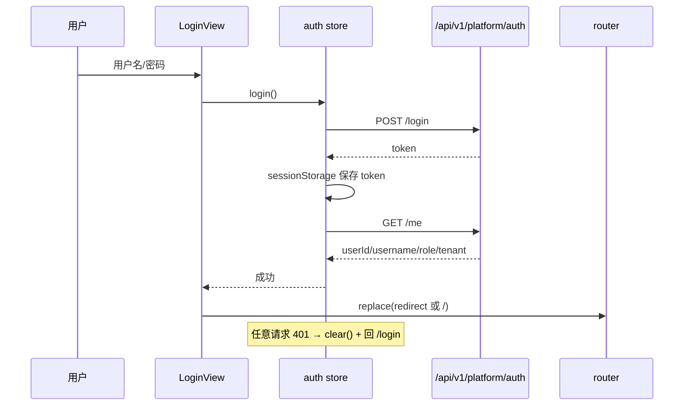

# 架构：Week 29 — 最小可用前端（apps/web）

> 只画本周新增的前端与部署节点；后端结构见 `week-28-architecture.md`。

## 1. 运行拓扑

- 同域：浏览器只访问 nginx；`/api` 保留前缀转发到平台，不放开 CORS。
- `trust-forwarded-for=true`：限流按 `X-Forwarded-For` 的真实客户端 IP，而不是 127.0.0.1。
- `/ent` 已预留但第 29 周不使用（第 30 周企业知识库页）。

## 2. 前端分层

职责：

| 层 | 职责 |
|----|------|
| `views` | 页面状态与交互；不直接拼 URL |
| `api/platform.ts` | 端点常量与类型化函数 |
| `api/http.ts` | 统一信封拆包、`ApiError`、401 清会话、180s 超时 |
| `stores/auth` | token（sessionStorage）/ me / 角色/登录退出 |
| `router` | 公开页、登录守卫、admin 路由守卫 |
| `utils` | 时间/JSON 安全解析、角色菜单 |

## 3. 登录与 401

- 刷新页面：守卫发现 token 但无 user → 调 `/auth/me` 恢复；失败清会话。
- 退出：先调 `/auth/logout`，无论成功失败都清本地会话。

## 4. 角色与菜单

| 角色 | 菜单 | Agent 运行 |
|------|------|------------|
| admin | 全部（含用户管理） | 允许 |
| operator | 去除用户管理 | 允许 |
| viewer | 去除用户管理 | 禁止（按钮禁用 + 后端 403） |

前端守卫只是体验优化；权限最终由后端 `403` 决定。

## 5. 错误与展示

- 信封 `code !== SUCCESS` → `ApiError(message, code, traceId)`；
- HTTP 状态兜底：400/401/403/404/409/429/502 有中文提示；
- 409（审批重复决策/随访重复完成）→ 提示后刷新当前列表；
- 模型输出只按文本/Markdown 安全渲染，不原样 `v-html`；
- 时间从 UTC 转本地（dayjs）。

## 6. 部署单元

| 单元 | 内容 |
|------|------|
| 静态站点 | `apps/web/dist` → `/opt/ai-code/web`，上一版保留 `/opt/ai-code/web.prev` |
| nginx | `deploy/app/nginx/aicode.conf`（80、`/api`、`/ent`、SPA fallback、assets 缓存） |
| 部署脚本 | `deploy/app/cloud-week29-web.sh`（备份 → 解压 → reload → trust-forwarded-for → 健康检查） |
| 回滚 | `web.prev` 整目录切回；`.env` 从 `/opt/ai-code/backup/week29-*` 恢复 |

## 7. 测试

| 层 | 方式 |
|----|------|
| 类型 | `vue-tsc --noEmit` |
| 纯函数/契约 | Vitest 11 例（信封、错误映射、权限菜单、JSON） |
| 端到端冒烟 | Playwright-core + 本机 Edge（登录、Agent、审批、知识库、用户、viewer 拦截） |
| 部署验收 | 隧道访问云端 nginx，同一套冒烟 7/7；公网 `http://HOST/` 200 |

## 8. 边界

- 只支持 HTTP，TLS 未上（上域名/证书时再加）；
- 无 SSE：Agent 同步 200，长任务 loading + 180s 超时；
- 无企业知识库页（第 30 周）；无前端 CI（手工 build + scp）；
- token 存 sessionStorage（XSS 风险已在文档登记，生产可换 HttpOnly Cookie + CSRF）。
