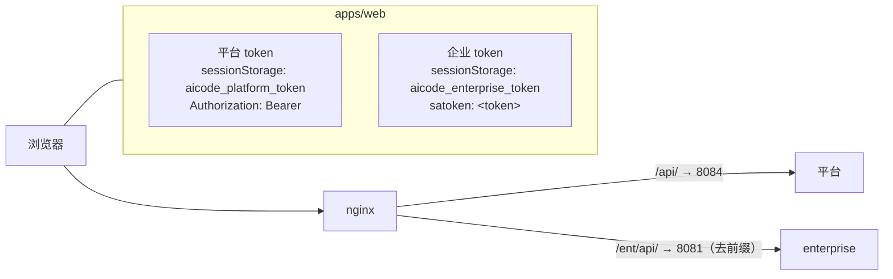
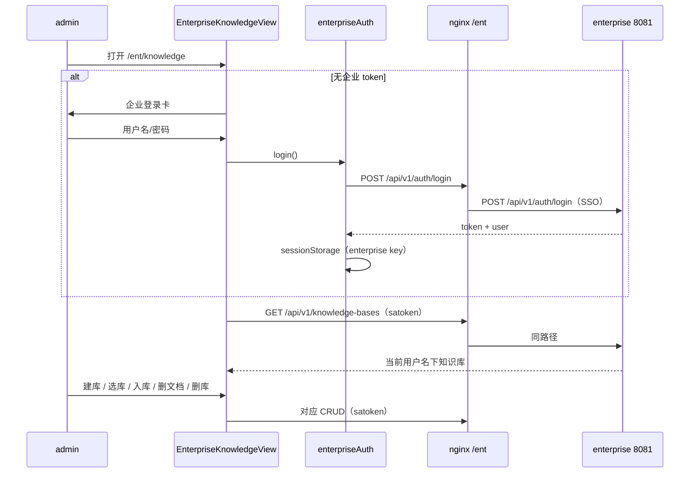
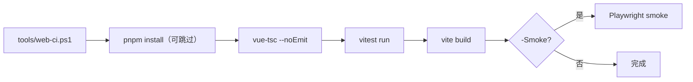

# 架构：Week 30 — 企业知识库页 + 前端 CI

> 前端继续在 `apps/web`；后端无改动。拓扑见 `week-29-architecture.md`，本文只画新增部分。

## 1. 双会话拓扑



- 两套 token **互不覆盖**：平台 401 只影响平台；企业 401 只回企业登录卡。
- 企业端 `sa-token.token-name=satoken`，因此不能复用平台的 `Authorization: Bearer` 客户端。

## 2. 企业页流程



## 3. 页面结构

```text
EnterpriseKnowledgeView
├── 未登录：EnterpriseLoginCard（username/password，错误提示）
└── 已登录：
    ├── 顶部：企业用户名 + 退出企业登录
    ├── 知识库表（id/name/description/createdAt）+ 新建/删除
    └── 选中库：
        ├── 文档表（documentId/name/chunkCount/createdAt）+ 删除
        └── 入库弹窗（name + content，≤100000）
```

## 4. 前端 CI



- 任一步非 0 立即退出，CI 与本地用同一脚本；
- 冒烟需要可达的 `WEB_BASE`，默认不跑，避免无后端环境误失败。

## 5. 失败语义

| 场景 | 行为 |
|------|------|
| 企业登录 401/503 | 企业登录卡显示后端 message；不影响平台 |
| 企业 token 过期 | 企业 API 401 → 清企业 token → 登录卡 |
| 删库有文档/被引用 | 后端 409/500 → 前端提示，不静默 |
| 入库超长/空白 | 后端 400 → 前端显示 message；提交按钮 loading |
| 冒烟失败 | `finally` 删除临时库，避免残留 |

## 6. 边界

- 企业页只做文本入库；PDF/OCR 不在本周；
- 仅 admin 可见/可访问（企业 SSO 映射通常只给管理员）；
- SSE 未做：`ChatModelPort` 同步，见 Week 30 Spec ADR；
- 无 TLS；CI 为本地脚本，不接 SaaS。
