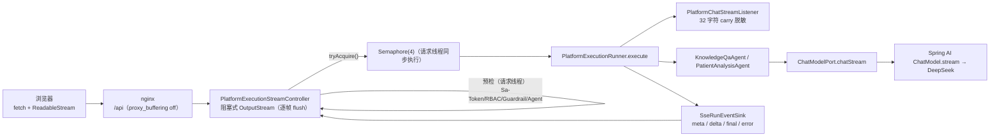
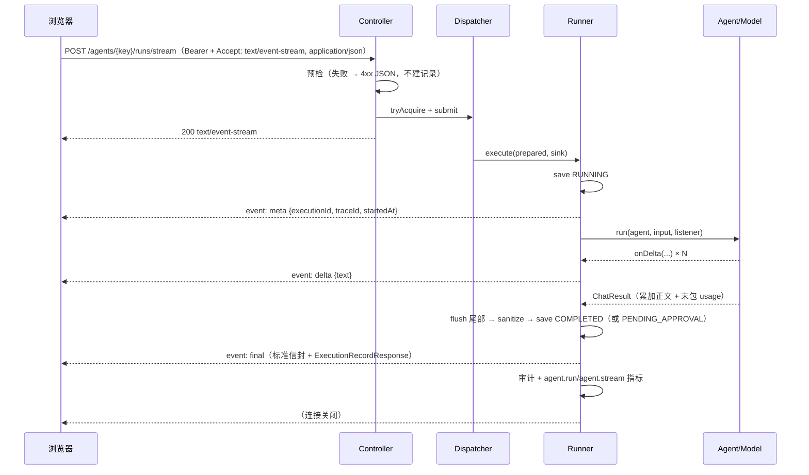

# 架构：Week 31 — 真 SSE 流式

> 拓扑沿用 Week 29（nginx 同域）：浏览器 → nginx `/api` → 平台 8084。
> 本文只画新增的流式链路；执行记录/审批/记忆仍是 Week 23–28 的同一套状态机。

## 1. 组件与线程模型



- **两套限流**：信号量在"落 RUNNING 记录之前"决定接不接（满了 429，不留僵尸）；
  线程池大小等于信号量，队列只吸收提交抖动。
- **心跳**：单线程调度器每 15s 写一行 SSE 注释 `: ping`，防止空闲连接被中间层掐断；
  写失败即视为客户端断开 → 取消。
- **MDC/traceId**：请求线程抓 `MDC` 上下文，请求线程内恢复、finally 清理；
  OTel 父上下文由 `TraceIds` 派生，保证日志与链路同源。

## 2. 事件序列



失败路径：执行期异常 → save FAILED → `event: error`；断连/超时 → save CANCELLED，不写 final。

## 3. 状态机

```text
preflight ──失败──> 4xx JSON（不建记录）
   │通过
   ▼
RUNNING ──正常──────> COMPLETED ──(final)
   ├──异常──────────> FAILED ──(error)
   ├──HIGH 风险─────> PENDING_APPROVAL ──(final，outputJson 含 approvalId)
   └──停止/断连/超时─> CANCELLED（无 final：客户端已经走了）
```

- 终态只落一次：`SseRunEventSink` 用 `AtomicBoolean terminal` 兜底；
- 已 COMPLETED 后客户端才断开，记录保持 COMPLETED，仅日志标注 final 未送达；
- `CANCELLED` 不计失败率，但计入 `totalRuns` 与 `agent.run.count{status=CANCELLED}`。

## 4. 脱敏（carry buffer）

```text
delta1 "…电话1381234"   → pending 长度 < 32 → 不发
delta2 "5678，请回电"   → 取安全前缀脱敏后发；尾部 32 字符继续留
finish()                → 尾部脱敏后发（此时 138****5678 已完整）
```

- carry 32 > 身份证 18 位，跨块号码不会被切开漏掩；
- final 的 `outputJson` 仍整体脱敏（权威值），与预览一致；
- 残留风险：超长邮箱 local part 跨块（见接口文档）。

## 5. 记录 / 审计 / 指标映射

| 关注点 | 同步端点 | 流式端点（Week 31） |
|---|---|---|
| 执行记录 | RUNNING → COMPLETED/FAILED/PENDING_APPROVAL | 同一 `PlatformExecutionRunner.execute`，新增 CANCELLED |
| 审计 | `AGENT_RUN` SUCCESS/FAILURE | 同上；取消记 FAILURE + `error=cancelled by client` |
| span | `agent.run` | 同上（请求线程内创建，traceId 与请求一致） |
| token | `agent.run` span 属性 + 指标 | 同上（流式末包 usage） |
| 首字 | 无 | `agent.stream.first.delta` Timer（毫秒 → 秒导出） |
| 流终态 | 无 | `agent.stream.count{stream.result=completed\|failed\|cancelled}` |
| Langfuse | trace 维度同一套 | 同一套（`beginTrace` 在 请求线程内） |

## 6. 配置

| 键 | 默认 | 说明 |
|---|---|---|
| `platform.execution.stream.enabled` | true | 关闭 → 503，前端回退同步 |
| `platform.execution.stream.max-concurrent` | 4 | 信号量 + 线程池 |
| `platform.execution.stream.queue-capacity` | 16 | 提交抖动缓冲 |
| `platform.execution.stream.timeout-seconds` | 300 | SSE 输出流 超时 → 取消 |
| `platform.execution.stream.heartbeat-seconds` | 15 | SSE 注释心跳 |
| `spring.ai.openai.chat.options.stream-usage` | true | 流式末包带 usage |

## 7. nginx

`location ~ ^/api/v1/platform/agents/[^/]+/runs/stream$`：`proxy_buffering off`、
`proxy_cache off`、`proxy_read_timeout 300s`、`proxy_http_version 1.1`、`Connection ""`。
不关缓冲的话，令牌会被 nginx 攒到结束才下发，**首字延迟等于总耗时**。
