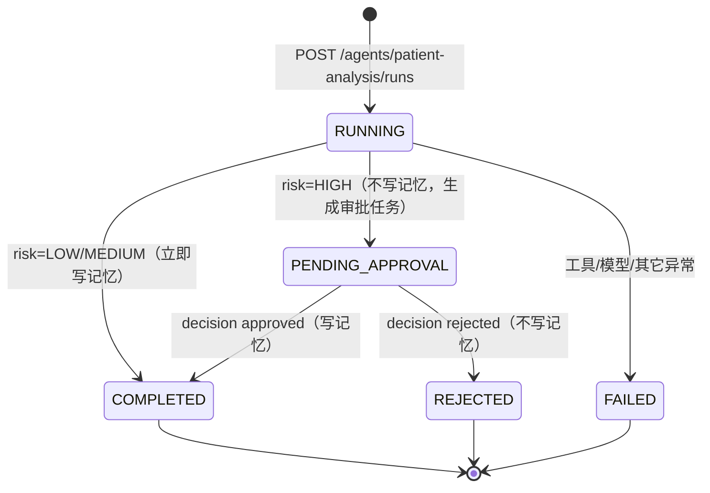
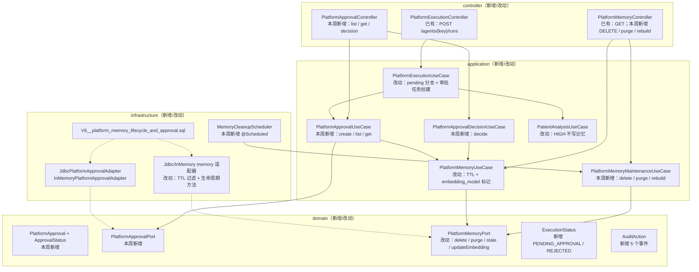

# Spec: Week 23 — 患者分析 HITL + 长期记忆生命周期（批次 1）/ SSO 解绑与租户级角色（批次 2）

> 本 Spec 承接 `docs/specs/week-22.md` 的「未实现项与目标阶段」表：
> #1 患者分析 HITL、#2 记忆生命周期 → **批次 1**；
> #3 SSO 解绑、#4 租户级角色 / 执行记录租户维度、#11 SSO 409/503 真机 → **批次 2**。
>
> 阅读提纲：`notes/week-23-hitl-memory-lifecycle.md` ｜ 迁移/回滚手册：`docs/deploy/week-23-migration.md`
>
> 批次 1 是本周的编码交付；批次 2 依赖两个**产品语义决策**（见第十节），
> 决策确认前不写生产代码，避免把「管理员身份从哪来」「租户能否自定义角色」猜错后返工。

## Objective

让第 21 周交付的 Agent 1（`patient-analysis`）具备**可跨进程、可重启**的人工审核：
HIGH 风险的分析报告不再直接落长期记忆（随访），而是生成一条审批任务并停在
`PENDING_APPROVAL`；人工批准后才写记忆并转 `COMPLETED`，拒绝则转 `REJECTED` 且不写记忆。

同时把第 21 周留下的「记忆只能写、不能管」补齐：**TTL 到期不可见并可清理、按范围删除、
换 embedding 模型后可批量重建向量**，并用 V6 迁移把生命周期字段与审批表落库。

## Tech Stack

| 项 | 说明 |
|----|------|
| Spring Boot 3.4.5 / JDK 17 / Sa-Token / Flyway / H2(MODE=PostgreSQL) | 复用，不新增框架 |
| `JdbcTemplate` + `PlatformJdbcSupport` | 复用第 16 周落库模式（`platform.persistence.mode=jdbc/memory`） |
| Spring `@Scheduled`（内置） | 每日清理过期记忆；`cleanup-enabled=false` 可关 |
| `Clock`（Week 22 已有 Bean，UTC） | TTL / 审批时间可注入固定时钟单测 |
| 无新依赖 | 不引入 Quartz、Redis、消息队列、工作流引擎 |

## Commands

- 不改 `JAVA_HOME`。JDK17：`-Djdk.17.home=E:\Program Files\Eclipse Adoptium\jdk-17.0.20.8-hotspot`
- 根聚合测试：`powershell -NoProfile -ExecutionPolicy Bypass -File .\run-maven-jdk17.ps1 test`
- 单模块测试：`.\run-maven-jdk17.ps1 -pl apps/spring-ai-alibaba-agent -am test`
- 单类测试：`.\run-maven-jdk17.ps1 -pl apps/spring-ai-alibaba-agent -am test "-Dtest=PlatformApprovalUseCaseTest" "-Dsurefire.failIfNoSpecifiedTests=false"`
- 启动：`apps/spring-ai-alibaba-agent` 下 `.\run-maven-jdk17.ps1 spring-boot:run`（默认 `jdbc` profile）
- 构建：`.\run-maven-jdk17.ps1 -q -DskipTests package`

## 一、为什么 HITL 放在「报告之后、记忆之前」

需求原文是「HIGH 风险报告人工确认后才进随访」。三个可选暂停点：

| 方案 | 问题 |
|------|------|
| 模型调用前暂停 | 审核人看不到报告，只能盲批；批准后还要再等一次模型耗时 |
| 工具调用前暂停 | 审核人拿不到指标/报告依据，无法判断风险 |
| **报告生成后、写长期记忆前（采用）** | 审核人看到完整报告与规则依据；批准即「进随访」，拒绝则不留随访记录 |

「进随访」在第 23 周的具体落点是**写长期记忆**（`platform_memory`）。真正的随访任务、
消息提醒属于 Agent 4（README 第 6 阶段），本周不提前实现；接口与状态机为它留好位置。

## 二、状态机（写死并单测）



| 事件 | execution_record.status | platform_approval.status | 写记忆 |
|------|--------------------------|---------------------------|--------|
| 中/低风险执行完成 | `COMPLETED` | 无 | 是（原有行为） |
| 高风险执行完成 | `PENDING_APPROVAL` | `PENDING` | **否** |
| 批准 | `COMPLETED` | `APPROVED` | 是 |
| 拒绝 | `REJECTED` | `REJECTED` | 否 |
| 重复决策 | 不变 | 不变 | 否（409） |

关键约束：

- **只有 HIGH 触发**：中/低风险与第 21 周行为逐字段一致（记忆、`COMPLETED`、输出字段）；
- **暂停不占线程**：状态落 `execution_record` + `platform_approval`，进程重启、审核隔天到达都能继续；
  这一点优于第 10 周 `MemorySaver`（进程内 checkpoint，重启丢）；
- **决策不调用模型**：审核只搬运已生成报告与写记忆，不重新烧 token；
- 审批归属：只有任务发起人（`user_id`）或 admin 可决策；其他人 403；不存在 404；
- 幂等：`markDecided` 以 `WHERE status='PENDING'` 原子更新，抢输的一方得到 409
  （`PLATFORM_CONFLICT`），不会重复写记忆。

### 2.1 输出契约增量（`PlatformRunOutput.output`）

| 字段 | 出现时机 | 说明 |
|------|----------|------|
| `approvalId` | `PENDING_APPROVAL` | 审批任务 ID |
| `approvalStatus` | 有审批时 | `PENDING` / `APPROVED` / `REJECTED` |
| `memoryId` | 批准后 / 中低风险 | 写入的长期记忆 ID；待审时为 null |
| `task` | 始终 | 归一化后的任务原文（审批通过后写记忆要用同一份） |

## 三、审批数据模型（V6）

```sql
CREATE TABLE IF NOT EXISTS platform_approval (
    approval_id  VARCHAR(64) PRIMARY KEY,
    execution_id VARCHAR(64) NOT NULL,
    tenant_key   VARCHAR(64) NOT NULL,
    user_id      BIGINT      NOT NULL,
    agent_key    VARCHAR(64) NOT NULL,
    patient_id   VARCHAR(64) NOT NULL,
    risk_level   VARCHAR(16) NOT NULL,
    task         VARCHAR     NOT NULL,
    status       VARCHAR(16) NOT NULL,          -- PENDING / APPROVED / REJECTED
    comment      VARCHAR(1024) NOT NULL DEFAULT '',
    decided_by   BIGINT,
    created_at   TIMESTAMP WITH TIME ZONE NOT NULL,
    decided_at   TIMESTAMP WITH TIME ZONE,
    CONSTRAINT fk_platform_approval_user FOREIGN KEY (user_id) REFERENCES platform_user(id)
);
CREATE UNIQUE INDEX IF NOT EXISTS uk_platform_approval_execution ON platform_approval(execution_id);
CREATE INDEX IF NOT EXISTS idx_platform_approval_owner ON platform_approval(user_id, status, created_at);
CREATE INDEX IF NOT EXISTS idx_platform_approval_tenant ON platform_approval(tenant_key, status, created_at);
```

- `execution_id` 唯一：一次执行最多一条审批任务，重试/并发不会造出两条；
- 不存报告正文：报告在 `execution_record.output_json` 里（已过 Guardrail 脱敏），审批详情按需查执行记录，
  避免同一份患者报告存两处后不一致；
- `tenant_key` 本周先落库（值从用户记录推导），**批次 2** 的「执行记录 tenant 维度」会与它对齐；
- `decided_by` 允许为 admin，不加外键（admin 用户被删时不应阻断历史审批查询）。

## 四、记忆生命周期

### 4.1 TTL

| 项 | 语义 |
|----|------|
| 保存 | `expires_at = created_at + ttl-days`；`ttl-days<=0` 表示永不过期（`expires_at=null`） |
| 读取 | 所有列表/检索都带 `(expires_at IS NULL OR expires_at > CURRENT_TIMESTAMP)`，过期即不可见 |
| 清理 | 每日 `cleanup-cron`（默认 03:30）删除 `expires_at <= now` 的记录；`cleanup-enabled=false` 关闭 |
| 手工清理 | `POST /memories/purge-expired`（仅 admin），返回删除条数，便于真机验收与运维 |

默认 `ttl-days=90`。理由：慢病随访记忆一年内仍可能有用，但「永久保留」会让演示库无限膨胀；
90 天足以覆盖一个随访周期，且可通过环境变量按机构调整。

### 4.2 删除

- `DELETE /api/v1/platform/memories/{memoryId}`：默认删自己的；admin 可带 `userId` 删他人；
- 删除谓词同时带 `memory_id + tenant_key + user_id`，**不是**「先查后删」；
- 删不到 → 404（不区分「不存在」与「是别人的」，不泄露存在性）；
- 审计 `MEMORY_DELETE`（SUCCESS/DENIED），失败不阻断删除结果。

### 4.3 向量重建

问题：第 21 周真机留下过 2 条空向量；换 embedding 模型后旧向量与新向量**不可比**，
但旧代码没有任何字段能判断「哪条向量是旧模型算的」。

| 项 | 语义 |
|----|------|
| 标记 | 保存时写 `embedding_model = <provider>:<model|default>:<dimension>` |
| 候选 | `embedding_model` 为空或与当前值不同 → 需要重建 |
| 触发 | `POST /memories/rebuild-embeddings`（仅 admin），`limit` 默认 100、上限 500 |
| 行为 | 重新 embedding `task`，更新 `embedding` + `embedding_model`；单条失败只计数不中断 |
| 返回 | `{scanned, rebuilt, failed, currentModel}` |
| 审计 | `MEMORY_REBUILD`（SUCCESS/FAILURE），detail 只带计数，不带记忆正文 |

**边界说明**：重建只处理「向量模型变了」，不处理「向量维度变了且旧向量被当成新维度」的情况——
维度不同会让余弦直接抛错或得到无意义分数，因此 `embedding_model` 里包含维度，维度变化同样命中候选。

## 五、V6 迁移（平台库）

```sql
ALTER TABLE platform_memory ADD COLUMN IF NOT EXISTS expires_at TIMESTAMP WITH TIME ZONE;
ALTER TABLE platform_memory ADD COLUMN IF NOT EXISTS embedding_model VARCHAR(128);
CREATE INDEX IF NOT EXISTS idx_platform_memory_expires ON platform_memory(expires_at);
-- 另含第三节 platform_approval 与索引
```

- 既有行 `expires_at` 为 NULL（视为永不过期，不误删历史数据）；
- 既有行 `embedding_model` 为 NULL（视为待重建，正好覆盖第 21 周的两条空向量）；
- 脚本同时可跑 PostgreSQL 与 H2(MODE=PostgreSQL)，不使用方言专有语法；
- 真库验收按规范 3.7.4：首次启动 `Successfully applied 1 migration ... now at version v6`、
  重启只校验、历史表无跳过版本、未污染同库其它应用。

## 六、API 摘要

| Method | Path | 权限 | 说明 |
|--------|------|------|------|
| POST | `/api/v1/platform/agents/patient-analysis/runs` | operator/admin | HIGH → 200 + `status=PENDING_APPROVAL` + `approvalId` |
| GET | `/api/v1/platform/approvals?status=PENDING&limit=20` | 登录 | 自己待办；admin 看全部；非法 status 400 |
| GET | `/api/v1/platform/approvals/{approvalId}` | 本人/admin | 审批详情（不含报告正文，报告查执行记录） |
| POST | `/api/v1/platform/approvals/{approvalId}/decision` | 本人/admin | `{approved, comment}`；重复决策 409 |
| DELETE | `/api/v1/platform/memories/{memoryId}?userId=` | 本人/admin | 按范围删除，删不到 404 |
| POST | `/api/v1/platform/memories/purge-expired?limit=100` | admin | 清理过期记忆 |
| POST | `/api/v1/platform/memories/rebuild-embeddings?limit=100` | admin | 重建过期/缺失向量 |

详见 `docs/api/week-23-api.md` 与 `docs/postman/week-23.postman_collection.json`。

## 七、配置

```yaml
platform:
  memory:
    lifecycle:
      ttl-days: ${PLATFORM_MEMORY_TTL_DAYS:90}
      cleanup-enabled: ${PLATFORM_MEMORY_CLEANUP_ENABLED:true}
      cleanup-cron: ${PLATFORM_MEMORY_CLEANUP_CRON:0 30 3 * * *}
      rebuild-batch-limit: ${PLATFORM_MEMORY_REBUILD_BATCH_LIMIT:100}
```

`.env.example` 同步列出这 4 个可选键与默认值；**不出现任何真实密钥/地址**。

## 八、增量架构



新增类型清单：

| 层 | 类型 | 名称 |
|----|------|------|
| domain | 模型/枚举 | `PlatformApproval`、`ApprovalStatus` |
| domain | Port | `PlatformApprovalPort` |
| application | UseCase | `PlatformApprovalUseCase`（待办）、`PlatformApprovalDecisionUseCase`（决策）、`PlatformMemoryMaintenanceUseCase` |
| application | 组件 | `PlatformExecutionRecordWriter`、`PlatformRunOutputJson` |
| infrastructure | Adapter | `JdbcPlatformApprovalAdapter`、`InMemoryPlatformApprovalAdapter` |
| infrastructure | 调度 | `MemoryCleanupScheduler` |
| infrastructure | 配置 | `PlatformMemoryLifecycleProperties` |
| controller | API | `PlatformApprovalController` + 3 个记忆生命周期端点 |
| dto | 协议 | `ApprovalDecisionRequest`、`PlatformApprovalResponse`、`PlatformApprovalListResponse`、3 个记忆操作响应 |

### 为什么不上工作流引擎 / 消息队列（YAGNI）

审批只需「一条待办 + 一次原子状态迁移」，落两张表 + 索引即可；引入 Flowable/Quartz 会带来
调度表、锁、版本升级与运维成本，而当前是单实例、低并发。等出现「多级审批 / 超时自动升级 /
审批人组」时再换引擎，状态机与 Port 已把替换面收敛。

## 九、Success Criteria（批次 1）

- [x] **HITL 用例**：HIGH → `PENDING_APPROVAL` + `approvalId` + 不写记忆；
      批准 → `COMPLETED` + 写记忆 + `memoryId`；拒绝 → `REJECTED` + 不写记忆
      （`PlatformApprovalUseCaseTest` / `PatientAnalysisUseCaseTest` / `PlatformAgentRunnerPatientAnalysisTest`）
- [x] **HITL 权限/幂等**：他人审批 403、不存在 404、重复决策 409、非 PENDING 不可决策；
      中/低风险完全不产生审批任务（`PlatformApprovalUseCaseTest` / `PlatformExecutionHitlTest`）
- [x] **HITL HTTP**：运行 HIGH 返回 200 且 `data.status=PENDING_APPROVAL`；
      待办列表/详情/decision 走完整拦截器链（`PlatformApprovalHttpTest`，6 例）
- [x] **HITL 观测**：待审终态记 `agent.run.count{execution.status=PENDING_APPROVAL}`；
      决策写 `APPROVAL_DECIDE` 审计（`PlatformExecutionObservabilityTest` 增补 1 例）
- [x] **TTL**：保存写 `expires_at`；过期记录列表/检索均不可见；`ttl-days=0` 永不过期；
      清理只删过期项（`PlatformMemoryLifecycleTest` / `JdbcPlatformMemoryLifecycleTest`）
- [x] **删除**：本人可删、他人删不到（404）、admin 可删指定用户、谓词带 scope；
      删除写 `MEMORY_DELETE` 审计（`PlatformMemoryLifecycleTest` / `PlatformMemoryMaintenanceHttpTest`）
- [x] **重建**：空/异模型记录被选中，重建后 `embedding_model` 更新、可被语义检索命中；
      单条失败不中断；非 admin 403（`PlatformMemoryLifecycleTest` / `JdbcPlatformMemoryLifecycleTest`）
- [x] **迁移**：V6 在 H2(MODE=PostgreSQL) 首次启动
      `Successfully applied 6 migrations ... now at version v6`、后续上下文只校验；
      **真实 PostgreSQL 2026-10-25 已执行**：`Successfully applied 1 migration ... now at version v6`，
      重启只校验、旧行 5 条不变（`expires_at` 全 NULL），详见 `docs/deploy/week-23-migration.md` 第 9 节
- [x] **契约零回退**：响应信封 / traceId / 错误码 / 第 4–22 周用例零回退；
      批次 1 根聚合 **777**（ai-core 90 / enterprise 37 / patient 21 / platform 529 / gateway 100）；
      批次 2 后 **798**（enterprise 55 / platform 532），Failures/Errors 均为 0
      （Week 22 基线 726 → 777 → 798，批次 1 +51、批次 2 +21）
- [x] **文档**：Spec / 架构 / API / Postman / 部署手册 / 实现日志 / README + 规范 7.3 索引同步

### 9.1 交付结果（2026-10-25）

| 门禁 | 结果 |
|------|------|
| 模块测试 | 批次 1：platform **529**（478 + 51）；批次 2：platform **532**、enterprise **55**（37 + 18），全绿 |
| 根聚合测试 | 批次 1 **777**；批次 2 后 **798**（90 + 55 + 21 + 532 + 100），`BUILD SUCCESS` |
| V6（H2） | 首次启动 `Migrating ... version "6"` → `Successfully applied 6 migrations ... now at version v6`；后续上下文 `Successfully validated 6 migrations` + `Schema "public" is up to date` |
| V6（PostgreSQL） | **已执行**（2026-10-25 02:51）：`Successfully applied 1 migration ... now at version v6`；重启 `Schema "public" is up to date`；5 条旧记忆未丢（`expires_at` 全 NULL），备份 `/opt/ai-code/backup/week23-20261025-024942` |
| 云端 HITL 验收 | **PASS=21 FAIL=0**（`cloud-accept-week23.sh`）：P002 HIGH 1731 tokens → 待审 → 批准写记忆 → 重复决策 409 → 删除 → 重建 5 条旧向量为 `openai:qwen3.7-text-embedding-flash:1024`；V7 后复跑 **PASS=21**（1439 tokens，重建 scanned=0） |
| V7（H2） | 首次启动 `Migrating ... version "7"` → `Successfully applied 7 migrations ... now at version v7` |
| V7（PostgreSQL） | **已执行**（2026-10-25 06:30）：`Successfully applied 1 migration ... now at version v7`；default/hospital-b 各 3 角色；执行记录 13 条 tenant 与 user 不一致数 = 0；备份 `/opt/ai-code/backup/week23-b2-20261025-062917` |
| 批次 2 云端验收 | **PASS=19 FAIL=0**：令牌 403/200、角色租户、执行 tenant、建链/解绑删本地用户、**409**、**503**、恢复后 200 |
| 密钥 | 仓库未新增密钥/真实地址；云端生成 64 位 `ENTERPRISE_ADMIN_TOKEN` 仅写入服务器 `.env`，日志/文档不打印 |
| 分层 | Controller 只调 UseCase；审批/记忆 SQL 只在适配器；领域层无 Web 类型 |
| 已知边界 | 审批决策后的「写记忆 + 改执行状态」不是单事务（memory 失败只 WARN；执行状态写失败会留下 APPROVED + PENDING 组合），见第十三节 |

### 9.2 批次 1 测试清单（新增 51）

| 测试类 | 例数 | 覆盖 |
|--------|------|------|
| `PlatformApprovalUseCaseTest` | 11 | 创建待办、批准写记忆、拒绝不写、权限、幂等、审计、记忆失败降级 |
| `PlatformExecutionHitlTest` | 5 | 执行用例 pending 分支、批准/拒绝终态、非 pending 不建任务、缺装配显式失败 |
| `PlatformApprovalHttpTest` | 6 | 完整拦截器链：待审/列表/详情/批准/拒绝/409/403/400 |
| `JdbcPlatformApprovalAdapterTest` | 4 | 落库往返、原子决策、按用户/状态过滤 |
| `PlatformMemoryLifecycleTest` | 13 | TTL、过期不可见、清理、删除范围、重建、批量上限 |
| `JdbcPlatformMemoryLifecycleTest` | 5 | V6 列往返、过期过滤、清理、scope 删除、向量标记/更新 |
| `PlatformMemoryMaintenanceHttpTest` | 4 | 删除/清理/重建 HTTP 权限与响应 |
| `PatientAnalysisUseCaseTest`（增补） | +1 | HIGH 不写记忆 |
| `PlatformAgentRunnerPatientAnalysisTest`（增补） | +1 | HIGH + scope → pendingApproval |
| `PlatformExecutionObservabilityTest`（增补） | +1 | 待审 span/metric 标签 |

## 十、批次 2：已确认 A1 + B2 并实现

> 2026-10-25 用户确认：**A1 运维令牌** + **B2 按租户复制角色**。
> 本节为实现口径；2026-10-25 06:29–06:35 已完成云端 V7 迁移与 enterprise 发布，验收 PASS=19。

### 10.1 决策 A（已选 A1）：enterprise 运维令牌

| 项 | 实现 |
|----|------|
| 令牌 | `ENTERPRISE_ADMIN_TOKEN` 环境变量 → `enterprise.admin.token`；未配置时端点一律 403（fail closed） |
| 比较 | `MessageDigest.isEqual`，日志不打印令牌 |
| 端点 | `GET /api/v1/admin/sso-links`、`POST /api/v1/admin/sso-links`、`DELETE /api/v1/admin/sso-links/{platformUserId}` |
| 鉴权位置 | 不走 Sa-Token（`/api/v1/admin/**` 在 `SaTokenConfig` 排除），由 `X-Admin-Token` 守卫 |
| 解绑语义 | `deleteLocalUser=false` → 只解绑（本地同名用户仍在，下次登录 409 属预期，文档写清）；`true` → 解绑并删本地用户，下次登录可重新开户 |
| 重建语义 | `POST` 幂等；平台用户换绑到新本地用户；本地用户已被别的平台用户占用 → 409，不静默抢占 |
| 删本地用户约束 | 若仍被文档/会话引用，返回 409，提示“只解绑”，不做级联删业务数据 |

### 10.2 决策 B（已选 B2）：角色按租户复制

| 项 | 实现 |
|----|------|
| 表 | V7 重建 `platform_role` / `platform_role_agent` / `platform_role_tool` / `platform_role_patient`，主键含 `tenant_key` |
| 迁移 | 旧全局角色复制给 `platform_tenant` 中每个租户；租户表为空时至少 default；旧授权一并复制 |
| 查询 | `PlatformRolePort.findByKey(tenantKey, roleKey)`；兼容入口 `findByKey(roleKey)` 只读 default |
| 权限判定 | `PlatformPermissionChecker` 按用户 `tenant_key + role_key` 取角色，旧库缺失时回退 default |
| seed | 逐 `(tenant, role)` 判空补缺（default + hospital-b），不覆盖已存在角色/授权 |
| 执行记录 | `execution_record.tenant_key`（V7 加列 + 按 user 回填）；`ExecutionRecord` / 响应体带 `tenantKey` |
| 不做的 | 租户自建角色（B3）、租户级角色管理 UI；角色仍是平台预置模板的副本 |

### 10.3 批次 2 交付清单

- [x] SSO 解绑/重建接口（只解绑 / 解绑并删本地用户两种语义）
- [ ] 平台删用户时的 `sso_user_link` 级联：**暂缓**——平台当前没有“删除用户”API，
      强行删会撞 `execution_record` / `platform_approval` 外键；先由 enterprise 运维端点解绑，
      待平台用户生命周期（停用/删除）产品语义确定后再做（见 Open Questions）
- [x] `platform_role` 租户维度 + `execution_record.tenant_key` + V7 迁移（H2 + 云端均已执行）
- [x] SSO 409（同名未建链）/ 503（平台不可达）**真机**：批次 2 验收 PASS=19，含 409/503
- [x] 单测 / MVC 契约 / 适配器测试 / 文档增量（Postman/部署手册见交付物）

### 10.4 批次 2 测试

| 测试类 | 例数 | 覆盖 |
|--------|------|------|
| `SsoAdminUseCaseTest` | 10 | 建链、幂等、重建、冲突、删本地用户、只解绑、列表 limit |
| `SsoAdminControllerTest` | 4 | 令牌 403、建链/解绑/列表响应（standalone MockMvc） |
| `JdbcSsoUserLinkAdapterTest`（增补） | +2 | 双向查询、listAll/unlink |
| `SsoLoginUseCaseTest`（增补） | +1 | 解绑+删本地用户后可重新开户 |
| `JdbcPlatformRoleAdapterTest`（增补） | +2 | 租户隔离、排序 |
| `JdbcExecutionRecordAdapterTest`（增补） | +1 | tenant_key 往返 |
| `PlatformExecutionUseCaseTest`（增补） | +1 | 执行记录落调用方租户 |
| `PlatformSeedIdempotencyTest`（增补断言） | 0 | hospital-b 角色副本与授权 |

## 十一、Open Questions

- 审批是否允许「转交他人」或「多级审批」→ 当前单级、仅本人/admin，出现真实科室主任场景再加；
- 审批超时是否自动拒绝 → 当前不自动决策（自动拒绝会让高风险患者静默失去随访），只做待办提醒；
- 记忆 TTL 是否按租户配置 → 当前全局 `ttl-days`，多机构不同合规要求时再按租户覆盖；
- 向量重建是否要保留旧向量 → 当前直接覆盖；若需回滚旧模型检索，需双列存储（YAGNI）；
- `execution_record` 的 `PENDING_APPROVAL` 是否计入成功率指标 → 当前单独标签，Grafana 成功率分母
  需排除待审（面板口径在批次 2 统一改）。

## 十二、ADR

| 决策 | 选项 | 选择 | 理由 |
|------|------|------|------|
| HITL 暂停点 | 模型前 / 工具前 / 报告后 | 报告后、写记忆前 | 审核人看得到报告；「进随访」就是写记忆 |
| 暂停实现 | Graph interrupt / 平台状态机 | 平台状态机（两张表） | 跨进程、可重启；Week 10 的 MemorySaver 重启即丢 |
| 审批存储 | 只存 execution / 独立审批表 | 独立 `platform_approval` | 待办列表要有索引与状态机；执行记录是运行日志不是任务队列 |
| 报告存放 | 审批表冗余 / 执行记录单份 | 执行记录单份 | 避免两份报告不一致；审批详情按 executionId 取 |
| 决策并发 | 先查后改 / 原子 markDecided | 原子 `WHERE status='PENDING'` | 抢输方 409，杜绝重复写记忆 |
| TTL 形态 | 定时物理删 / 到期不可见 + 定期清理 | 两者结合 | 读取立即生效；清理控制表膨胀 |
| 向量版本 | 不记录 / 记录模型标识 | `embedding_model` 列 | 没有标记就无法判断哪些向量需要重建（第 21 周已留空向量） |
| 重建入口 | 自动后台 / 管理端点 | 管理端点（默认 100 条/批） | 换模型是低频运维动作，自动重建会打爆 embedding 配额 |

## 十三、已知边界与补偿

| # | 边界 | 影响 | 当前处理 / 何时补 |
|---|------|------|-------------------|
| 1 | 审批「markDecided → 写记忆 → 改执行状态」不是单事务 | 极端情况下审批已 APPROVED 但执行仍 `PENDING_APPROVAL`（或记忆缺失） | 记忆失败只 WARN（与第 21 周口径一致）；执行状态写失败会抛 500，需人工查 `executionId` 修正。多实例/强一致需求出现时引入 `@Transactional` 或补偿任务 |
| 2 | 审批详情不含报告正文 | 审核人需再调 `GET /executions/{id}` | 有意为之（报告单份存执行记录）；Postman/前端按两步取 |
| 3 | 审批无自动超时 | 待办可能长期堆积 | 不自动拒绝（医疗语义危险）；用 `GET /approvals?status=PENDING` 做运维巡检，后续接告警 |
| 4 | 定时清理单实例 | 多实例会重复执行 | 清理是幂等删除，重复执行无害；多实例前换分布式锁 |
| 5 | 向量重建同步执行 | 大批量会占用请求线程 | 默认 100 条/批、上限 500；运维分多次调用，后续可改异步任务 |
| 6 | TTL 全局 | 不同租户不同合规要求无法差异化 | 全局 `ttl-days` 先够用；按租户覆盖需 `tenant_memory_policy` 表 |
| 7 | 审批列表 admin 看全部租户 | 平台管理员跨租户可见 | admin 本就是平台级角色；批次 2 的角色租户化会重新定义可见范围 |
