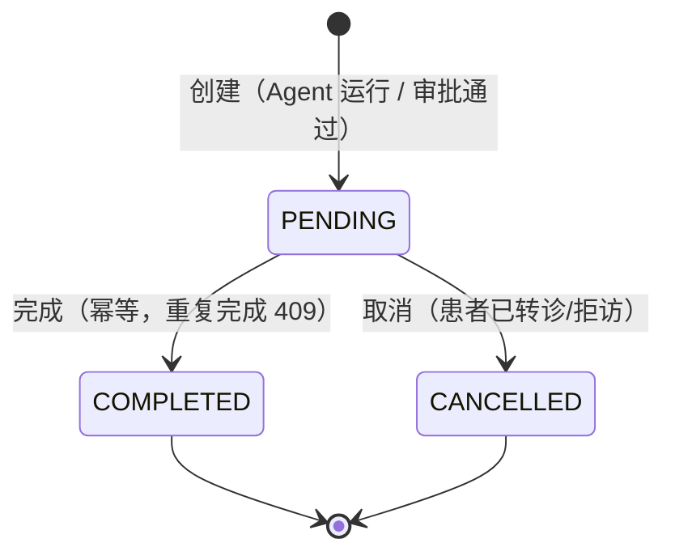

# Spec: Week 24 — Agent 2 运营分析 + Agent 4 随访 + 观测/一致性收口

> 承接 `docs/specs/week-24-candidates.md` 第 5 节「建议的第 24 周范围（现实版）」：
> **P0 = Agent 2 运营分析 + Agent 4 随访 + 技术债最小集（TD-01/02/03）+ 验收/文档/回归**。
>
> 本 Spec 只承诺 P0；Agent 3（知识库）、TD-04 回滚演练、TD-05/06/07 在第九节与
> 第十二节明确「本周是否做」，不写半套代码。

## Objective

让医疗 SaaS 平台补齐 README 第 6 阶段的 **Agent 2（运营分析）** 与 **Agent 4（随访）**，
并把第 23 周 HITL 上线后暴露的三笔 P0 技术债收口：**Grafana 失败率口径**、
**审批决策的跨表一致性**、**待办积压的可观测与告警**。

一句话：从「能做一次患者分析」升级为「**能看运营、能落随访、出了问题说得清**」。

## Tech Stack

| 项 | 说明 |
|----|------|
| Spring Boot 3.4.5 / JDK 17 / Flyway / H2(MODE=PostgreSQL) | 复用，不新增框架 |
| `JdbcTemplate` + `PlatformJdbcSupport` | 复用第 16 周落库模式（`platform.persistence.mode=jdbc/memory`） |
| 既有 `ChatModelPort` / `PromptTemplatePort` / `ToolPort` | Agent 2/4 复用；不新增模型厂商 |
| 既有 `AgentObservabilityPort` + Micrometer | TD-03 新增 **Gauge** 能力（端口加一个方法） |
| Spring `@Scheduled`（已有 `@EnableScheduling`） | 待办积压采样、审批对账 |
| `Clock`（Week 22 Bean，UTC） | 窗口边界、到期时间、对账时间可注入固定时钟 |
| 无新依赖 | 不引入 Quartz、MQ、短信/邮件网关、前端 |

## Commands

- 不改 `JAVA_HOME`。JDK17：`-Djdk.17.home=E:\Program Files\Eclipse Adoptium\jdk-17.0.20.8-hotspot`
- 根聚合测试：`powershell -NoProfile -ExecutionPolicy Bypass -File .\run-maven-jdk17.ps1 test`
- 单模块：`.\run-maven-jdk17.ps1 -pl apps/spring-ai-alibaba-agent -am test`
- 单类：`.\run-maven-jdk17.ps1 -pl apps/spring-ai-alibaba-agent -am test "-Dtest=OperationsAnalysisUseCaseTest" "-Dsurefire.failIfNoSpecifiedTests=false"`
- 启动：`apps/spring-ai-alibaba-agent` 下 `.\run-maven-jdk17.ps1 spring-boot:run`（默认 `jdbc` profile）
- 打包：`.\run-maven-jdk17.ps1 -q -DskipTests package`

## Boundaries

- **Always**：Agent 2 日报 + 异常发现；Agent 4 随访任务 + 站内提醒 + 审批通过后自动生成任务；
  TD-01 面板口径、TD-02 审批决策一致性、TD-03 待办积压指标与告警；V8 迁移在 H2 与真实
  PostgreSQL 两处可执行；新增代码有单测；文档/日志/索引同步。
- **Ask first**：把 Agent 4 的通知接到短信/邮件/企业微信（需要外部网关与密钥）；
  把 `platform_user` 改成硬删（会撞执行记录/审批外键）；引入 MQ 或工作流引擎。
- **Never**：本周实现 Agent 3 知识库（避免与 enterprise 现有 RAG 重复建设）；
  云端 pgvector 迁移；HIS/LIS 真实数据接入；租户自建角色（B3）；多级审批；
  前端页面；Kubernetes。

## 一、为什么是这三个 P0（范围取舍）

| 候选 | 本周 | 理由 |
|------|------|------|
| Agent 2 运营分析 | **做完整版** | 数据源（`execution_record` / `platform_approval` / token）已全在平台库里；无外部依赖；能把第 17–20 周的指标与业务动作对上 |
| Agent 4 随访 | **做完整版（站内）** | 第 23 周 HITL 批准后「写记忆」是随访的占位；本周把它落成可查询/完成/取消的任务；提醒只做站内，外部通道没有供应商 |
| TD-01 Grafana 口径 | **做** | 待审执行被算进失败率分母，是**上线即在误导**的观测口径 |
| TD-02 审批一致性 | **做** | 已有 `APPROVED + PENDING_APPROVAL` 的理论窗口；Agent 4 上线后会产生真实随访任务，必须堵住 |
| TD-03 待办积压告警 | **做** | 审批无超时（有意不自动拒绝），只能靠积压指标暴露 |
| Agent 3 知识库 | **不做** | enterprise 已有 RAG；平台再建一套会出现两套知识库/两套权限。等产品确认「平台原生 vs 包装」再做（见 Open Questions） |
| TD-04 回滚演练 | **只出脚本与手册** | 需要云端维护窗口；不在开发主路径上，演练记录在运维手册补 |

## 二、Agent 2：运营分析（`operations-analysis`）

### 2.1 数据口径（写死并单测）

| 指标 | 口径 | 数据来源 |
|------|------|----------|
| `totalRuns` | 窗口内全部执行记录数 | `execution_record.started_at ∈ [from, to)` |
| `completed` / `failed` / `pendingApproval` / `rejected` / `running` | 按 `status` 计数 | 同上 |
| `successRate` / `failureRate` | **分母只取 `COMPLETED + FAILED`**；`PENDING_APPROVAL` / `REJECTED` / `RUNNING` 不进分母 | 同上（与 TD-01 同一口径） |
| `totalTokens` | `prompt + completion` 之和；`usage` 未知（0）的记录不计入 | `prompt_tokens` / `completion_tokens` |
| `totalCostUsd` | 按 `ModelPriceCatalog` 的单价逐条累加；**价目表未配置该模型时该条成本为 0 并置 `costConfigured=false`** | 执行记录的 `model` + token |
| `agents[]` | 按 `agentKey` 分组：`runs` / `failures` / `tokens` | 同上 |

- **窗口**：`windowDays` 默认 7、范围 1–30；`windowEnd` 默认「当前整点」，`windowStart = windowEnd - windowDays`。
  端点不接受客户端传任意 `Instant`（避免查全表/跨租户猜时间）。
- **租户**：`tenantKey` 只能由登录用户记录推导。**admin 统计整租户；非 admin 只统计自己的执行记录**
  （与审批列表「admin 全租户、普通用户只看自己」保持同一套语义，见 ADR-3）。
- **上限**：单次统计最多读取 5000 条（`operations.max-records`），超出截断并在输出里置 `truncated=true`；
  这是「单实例演示库」的 YAGNI 取舍，数据量上来后再换 SQL 聚合或物化视图。

### 2.2 异常发现（规则，可解释）

| code | 级别 | 触发 | 阈值配置 |
|------|------|------|----------|
| `FAILURE_RATE_HIGH` | HIGH | `failureRate >= 0.3` 且分母 ≥ 5 | `failure-rate-high` |
| `FAILURE_RATE_ELEVATED` | MEDIUM | `failureRate >= 0.2` 且分母 ≥ 5 | `failure-rate-medium` |
| `APPROVAL_BACKLOG` | HIGH | 当前租户待审任务 > 20 | `approval-backlog` |
| `TOKEN_SPIKE` | MEDIUM | 本窗口 token > 上一等长窗口 × 2，且上一窗口 > 0 | `token-spike-ratio` |
| `AGENT_FAILURE_CONCENTRATION` | MEDIUM | 单个 Agent 失败 ≥ 3 且占该 Agent 执行数 ≥ 50% | `agent-failure-min` |
| `NO_TRAFFIC` | INFO | 窗口内 `totalRuns == 0` | — |

- 异常**不影响执行成功**：它是报告的一部分，不是抛异常的条件；
- 排序：HIGH → MEDIUM → INFO，同级按 code 字典序，最多返回 20 条；
- 上一等长窗口只用于 `TOKEN_SPIKE`，不额外暴露全部指标（避免输出膨胀）。

### 2.3 日报生成与降级

- Prompt：`operations-daily-report`（新增 `prompts/operations-daily-report-v1.txt`），结构固定：
  `运营概览 / 异常与风险 / 建议动作`，中文，≤400 字，**禁止编造输入里没有的数字**。
- 模型不可用（`ChatModelException`）或返回空 → **降级为规则模板** `OperationsReportComposer`，
  `degraded=true`，报告明确标注「规则模板生成」；
- 模型调用只发聚合结果与异常列表，**不发患者明细**（执行记录里可能有 patientId，输出到报告时只保留数量）。

### 2.4 输出契约（`PlatformRunOutput.output`）

| 字段 | 说明 |
|------|------|
| `reportType` | 固定 `DAILY` |
| `windowStart` / `windowEnd` / `windowDays` | 窗口（ISO-8601） |
| `summary` | 2.1 的计数字段 + `successRate` / `failureRate` / `costConfigured` / `truncated` |
| `agents` | `[{agentKey, runs, failures, tokens}]`，按 `runs` 倒序 |
| `anomalies` | `[{code, level, message, value, threshold}]` |
| `report` | Markdown 日报正文 |
| `degraded` / `model` | 是否降级、模型名 |
| `task` | 归一化任务原文 |

## 三、Agent 4：随访（`followup`）

### 3.1 任务模型（V8）

```sql
CREATE TABLE IF NOT EXISTS platform_followup_task (
    task_id     VARCHAR(64) PRIMARY KEY,
    tenant_key  VARCHAR(64) NOT NULL,
    user_id     BIGINT      NOT NULL,
    patient_id  VARCHAR(64) NOT NULL,
    source      VARCHAR(16) NOT NULL,            -- APPROVAL / AGENT / MANUAL
    approval_id VARCHAR(64),                     -- 来源审批（可空）
    execution_id VARCHAR(64),                    -- 来源执行（可空）
    title       VARCHAR(200) NOT NULL,
    detail      VARCHAR(1024) NOT NULL DEFAULT '',
    priority    VARCHAR(16) NOT NULL,            -- HIGH / MEDIUM / LOW
    status      VARCHAR(16) NOT NULL,            -- PENDING / COMPLETED / CANCELLED
    due_at      TIMESTAMP WITH TIME ZONE NOT NULL,
    created_at  TIMESTAMP WITH TIME ZONE NOT NULL,
    updated_at  TIMESTAMP WITH TIME ZONE NOT NULL,
    completed_at TIMESTAMP WITH TIME ZONE,
    note        VARCHAR(512) NOT NULL DEFAULT '',
    CONSTRAINT fk_platform_followup_task_user FOREIGN KEY (user_id) REFERENCES platform_user(id)
);
CREATE INDEX IF NOT EXISTS idx_platform_followup_task_owner
    ON platform_followup_task(tenant_key, user_id, status, due_at);
CREATE INDEX IF NOT EXISTS idx_platform_followup_task_patient
    ON platform_followup_task(tenant_key, patient_id, status, due_at);
CREATE UNIQUE INDEX IF NOT EXISTS uk_platform_followup_task_source
    ON platform_followup_task(approval_id, title);
```

- **`uk_platform_followup_task_source` 防重**：同一条审批重复触发「生成随访任务」只会留下一条；
  删除审批不级联删任务（随访任务有独立业务价值）；
- 不存患者姓名/诊断：任务只带 `patientId` 与计划标题，患者信息按需查；
- `due_at` 用 UTC `Instant`，展示层按机构时区换算（本周不做时区配置）。

### 3.2 计划规则（`FollowUpPlanner`，可解释、不烧 token）

| 风险 | 任务（相对执行当天） | 优先级 |
|------|----------------------|--------|
| HIGH | +3 天「复测血压与症状」、+14 天「复查 HbA1c/空腹血糖」、+30 天「门诊复诊」 | HIGH |
| MEDIUM | +7 天「复测血压」、+30 天「门诊复诊」 | MEDIUM |
| LOW | +30 天「常规复查」 | LOW |

- 预警/复诊间隔是**演示规则**，不是临床指南；替换点收敛在 `FollowUpPlanner`，接真实指南时只改这一处；
- 模型只负责把计划写成给患者/医生看的**说明文本**（`follow-up-plan` Prompt），
  **任务条目、时间、优先级一律由规则决定**（模型不得增删任务，避免幻觉造出「不存在的复诊」）；
- 模型不可用 → 模板文本 + `degraded=true`。

### 3.3 状态机



- 完成/取消都走 `UPDATE ... WHERE status='PENDING'` 原子迁移；抢输方 409（`PLATFORM_CONFLICT`）；
- 完成后不可再取消；`completed_at` 只对 `COMPLETED` 写值；
- 审计：`FOLLOWUP_TASK_CREATE` / `FOLLOWUP_TASK_COMPLETE` / `FOLLOWUP_TASK_CANCEL`，
  detail 只带 taskId/patientId/executionId，不带患者隐私正文。

### 3.4 与审批的联动（关键）

```
审批 approved
  ├─ 写长期记忆（第 23 周行为，不变）
  ├─ 生成随访任务（本周新增；查询 3 条 HIGH 计划任务，source=APPROVAL）
  └─ 执行记录 output 追加 followUpTaskIds（失败只 WARN，不影响审批结果）
审批 rejected
  └─ 不生成任务、不写记忆（不变）
```

- 任务生成**失败不回滚审批**：审批已经生效，任务可由 `POST /agents/followup/runs` 重跑补齐；
  但会写 `FOLLOWUP_TASK_CREATE/FAILURE` 审计，便于对账；
- 幂等：`approval_id + title` 唯一索引；重复决策在 `markDecided` 处已被挡住，索引是第二道防线。

### 3.5 站内提醒

`GET /api/v1/platform/followup-tasks/reminders?days=7`：

| 分组 | 语义 |
|------|------|
| `overdue` | `due_at < now` 且 `status=PENDING` |
| `dueSoon` | `now <= due_at <= now + days` 且 `status=PENDING` |

- `days` 默认 7、上限 30；只返回 `PENDING`；按 `dueAt` 升序；
- 提醒是**查询视图**，不写「已读」状态（没有通知渠道，先不做状态机，YAGNI）；
- 不接短信/邮件/企业微信（见 Boundaries）。

## 四、技术债收口

### 4.1 TD-01：Grafana 失败率口径

- `aicode-platform-overview.json` 的失败率查询改为 `execution_status=~"COMPLETED|FAILED"` 作分母；
- 新增「成功率」面板与「待审/拒绝」单独曲线（`sum by (execution_status)` 已有，保留）；
- 契约：现有 COMPLETED/FAILED 曲线数值不变；`PENDING_APPROVAL` 不再拉高失败率。

### 4.2 TD-02：审批决策一致性

现状：`markDecided → 写记忆 → 改执行状态` 三步无事务，极端情况留 `APPROVED + PENDING_APPROVAL`。

| 措施 | 说明 |
|------|------|
| 单事务 | `PlatformApprovalDecisionUseCase.decide` 加 `@Transactional`（JDBC 模式由 Boot 的 `DataSourceTransactionManager` 提供）；三步在同一事务内，执行状态写失败会让审批回滚到 `PENDING`，可重试 |
| 记忆失败仍容忍 | 写记忆异常被 catch（与第 21 周口径一致），**不触发回滚**；`memoryId=null` |
| 对账任务 | `ApprovalReconciliationScheduler`（默认每 10 分钟，可关）：扫 `APPROVED/REJECTED` 但执行仍 `PENDING_APPROVAL` 的审批，按审批终态补写执行状态；幂等、只记 WARN/audit |
| 已知边界 | 事务生效依赖 JDBC 模式；`memory` 模式（单测/演示）没有事务管理器，行为退化为「尽力而为」，文档写清 |

- 验收：模拟执行状态写入失败 → 不出现 `APPROVED + PENDING_APPROVAL`；对账任务能把历史脏数据修回 `COMPLETED`。

### 4.3 TD-03：待办积压指标与告警

- `AgentObservabilityPort` 新增 `recordGauge(name, value, tags...)`；Micrometer 用 `Gauge.builder`
  绑定到「已登记的最新值」（用 `AtomicReference` 持有，避免 Gauge 强引用业务对象）；
- 新指标 `approval.pending.count` → Prometheus `approval_pending_count`，标签 `tenant.key`
  **不进标签**（租户数会增长，改为全局聚合；分租户用审批列表接口）；
- `PendingApprovalGaugeScheduler` 每 60s 采样一次 `PENDING` 计数（默认开启，`pending-gauge.enabled=false` 可关）；
- 告警：`AiCodePendingApprovalBacklog`（`approval_pending_count > 20` 持续 30m，warning）；
- 契约测试：新增指标出现在 `/actuator/prometheus` 文本里（名字/类型锁死）。

## 五、API 摘要

| Method | Path | 权限 | 说明 |
|--------|------|------|------|
| POST | `/api/v1/platform/agents/operations-analysis/runs` | admin | 生成日报（窗口 1–30 天） |
| POST | `/api/v1/platform/agents/followup/runs` | operator/admin | 生成随访计划并落任务 |
| GET | `/api/v1/platform/followup-tasks?status=PENDING&patientId=&limit=20` | 登录 | 自己（admin 可 `userId`）的任务 |
| GET | `/api/v1/platform/followup-tasks/{taskId}` | 本人/admin | 任务详情 |
| POST | `/api/v1/platform/followup-tasks/{taskId}/complete` | 本人/admin | `{note}`；重复完成 409 |
| POST | `/api/v1/platform/followup-tasks/{taskId}/cancel` | 本人/admin | `{reason}`；已终态 409 |
| GET | `/api/v1/platform/followup-tasks/reminders?days=7` | 登录 | 站内提醒（overdue + dueSoon） |

- 全部沿用扁平信封 + `traceId`；错误码复用 `PLATFORM_*` 系列；
- 详见 `docs/api/week-24-api.md` 与 `docs/postman/week-24.postman_collection.json`。

## 六、配置

```yaml
platform:
  operations:
    max-records: ${PLATFORM_OPERATIONS_MAX_RECORDS:5000}
    failure-rate-high: 0.30
    failure-rate-medium: 0.20
    approval-backlog: 20
    token-spike-ratio: 2.0
    agent-failure-min: 3
  followup:
    default-reminder-days: ${PLATFORM_FOLLOWUP_REMINDER_DAYS:7}
    max-reminder-days: 30
  approval:
    pending-gauge:
      enabled: ${PLATFORM_APPROVAL_PENDING_GAUGE_ENABLED:true}
      interval-ms: 60000
    reconciliation:
      enabled: ${PLATFORM_APPROVAL_RECONCILIATION_ENABLED:true}
      cron: "${PLATFORM_APPROVAL_RECONCILIATION_CRON:0 */10 * * * *}"
      limit: 200
```

`.env.example` 同步列出可选键与默认值；不出现真实密钥/地址。

## 七、增量架构

```mermaid
flowchart TB
    subgraph API["controller（新增/改动）"]
        EC["PlatformExecutionController<br/>已有：POST /agents/{key}/runs"]
        FC["PlatformFollowUpController<br/>本周新增：list/get/complete/cancel/reminders"]
        AC["PlatformApprovalController<br/>不变"]
    end

    subgraph APP["application（新增/改动）"]
        EU["PlatformExecutionUseCase<br/>不变"]
        OA["OperationsAnalysisUseCase<br/>本周新增：窗口统计 + 异常 + 日报"]
        FU["FollowUpTaskUseCase<br/>本周新增：计划落任务 / 查询 / 完成 / 取消 / 提醒"]
        AD["PlatformApprovalDecisionUseCase<br/>改动：@Transactional + 生成随访任务"]
        AU["PlatformApprovalUseCase<br/>改动：countPending（TD-03）"]
        REC["ApprovalReconciliationUseCase<br/>本周新增：脏数据对账"]
    end

    subgraph DOMAIN["domain（新增/改动）"]
        OPS["OperationsStatistics / OperationsDailyReport / OperationsAnomaly<br/>本周新增"]
        FT["FollowUpTask + FollowUpStatus + FollowUpPriority + FollowUpPlan<br/>本周新增"]
        FP["FollowUpPlanner / OperationsReportComposer<br/>本周新增（纯规则）"]
        PORT1["ExecutionRecordPort<br/>改动：按租户/用户 + 时间窗查询"]
        PORT2["FollowUpTaskPort / PlatformApprovalPort.countByStatus<br/>本周新增/改动"]
        ENUM["AgentType + OPERATIONS_ANALYSIS / FOLLOW_UP<br/>AuditAction + 3 个事件"]
    end

    subgraph INFRA["infrastructure（新增/改动）"]
        JD1["JdbcFollowUpTaskAdapter / InMemoryFollowUpTaskAdapter"]
        JD2["Jdbc/InMemory ExecutionRecordAdapter<br/>改动：时间窗查询"]
        SCH1["PendingApprovalGaugeScheduler<br/>本周新增"]
        SCH2["ApprovalReconciliationScheduler<br/>本周新增"]
        V8["V8__platform_followup_task.sql"]
        GA["Micrometer/Noop/SkyWalking Observability<br/>改动：recordGauge"]
    end

    EC --> EU --> OA
    EC --> EU --> FU
    FC --> FU
    AC --> AD
    AD --> FU
    REC --> PORT2
    SCH1 --> PORT2
    SCH1 --> GA
    PORT2 -.-> JD1
    PORT1 -.-> JD2
    V8 -.-> JD1
```



新增类型清单：

| 层 | 类型 | 名称 |
|----|------|------|
| domain | 模型/枚举 | `OperationsDailyReport`、`OperationsSummary`、`OperationsAnomaly`、`OperationsAnomalyCode`、`AgentRunSummary`、`FollowUpTask`、`FollowUpStatus`、`FollowUpPriority`、`FollowUpSource`、`FollowUpPlan`、`FollowUpPlanItem` |
| domain | 领域服务 | `OperationsStatistics`、`OperationsAnomalyDetector`、`OperationsReportComposer`、`FollowUpPlanner` |
| domain | Port | `FollowUpTaskPort`、`OperationsReportPort`（可选，模型文本生成）、`ExecutionRecordPort` 扩方法 |
| application | UseCase | `OperationsAnalysisUseCase`、`FollowUpTaskUseCase`、`ApprovalReconciliationUseCase` |
| infrastructure | Adapter | `JdbcFollowUpTaskAdapter`、`InMemoryFollowUpTaskAdapter`、`FollowUpAgent`（agent 运行时）、`OperationsAnalysisAgent` |
| infrastructure | 调度 | `PendingApprovalGaugeScheduler`、`ApprovalReconciliationScheduler` |
| infrastructure | 配置 | `PlatformOperationsProperties`、`PlatformFollowUpProperties`、`PlatformApprovalProperties` |
| controller | API | `PlatformFollowUpController` |
| dto | 协议 | `FollowUpTaskResponse`、`FollowUpTaskListResponse`、`FollowUpReminderResponse`、`FollowUpTaskActionRequest` |

### 为什么不上 MQ / 工作流引擎（YAGNI）

随访任务就是「一张表 + 一个状态机 + 一次到期查询」；提醒是查询视图，没有推送渠道。
引入 MQ/Quartz 会带来调度表、重试、死信与运维成本，而当前单实例、低并发。
等出现「必须准时推送」「多实例抢任务」时再换，端口与状态机已把替换面收敛。

## 八、Success Criteria

- [x] **Agent 2 统计口径**：给定窗口与租户，`totalRuns/completed/failed/pendingApproval/tokens/cost`
      与 `execution_record` 逐条累加一致；`failureRate` 分母只含 `COMPLETED+FAILED`；
      admin 看整租户、operator 只看自己（`OperationsAnalysisUseCaseTest`）
- [x] **Agent 2 异常**：6 条规则各自命中与不误报；异常不影响执行成功
      （`OperationsAnomalyDetectorTest`）
- [x] **Agent 2 降级**：模型抛异常/空返回 → `degraded=true` + 规则模板报告
      （`OperationsAnalysisAgentTest`）
- [x] **Agent 2 HTTP**：`POST /agents/operations-analysis/runs` 走完整拦截器链；operator 403；
      `windowDays=0/31` 400（`PlatformOperationsHttpTest`）
- [x] **Agent 4 计划规则**：HIGH/MEDIUM/LOW 三档任务条数、间隔、优先级正确；模型不增删任务
      （`FollowUpPlannerTest` / `FollowUpAgentTest`）
- [x] **Agent 4 任务状态机**：完成/取消原子迁移、重复操作 409、他人 403、不存在 404、
      完成后再取消 409（`FollowUpTaskUseCaseTest` / `FollowUpTaskActionUseCaseTest`）
- [x] **Agent 4 审批联动**：批准 → 3 条任务 + `followUpTaskIds`；拒绝 → 0 条；
      重复批准只留一套任务；任务写失败不影响审批结果（`PlatformApprovalFollowUpTest`）
- [x] **站内提醒**：overdue 与 dueSoon 分组正确、只含 PENDING、按到期升序、
      `days` 上限 30（`FollowUpTaskUseCaseTest` / `PlatformFollowUpHttpTest`）
- [x] **V8 迁移**：H2 首次启动 `Successfully applied 8 migrations ... now at version v8`，后续只校验；
      **真实 PostgreSQL 尚未执行**（云端发布待维护窗口，手册见 `docs/deploy/week-24-ops.md`）
- [x] **TD-01**：Grafana 失败率分母排除 `PENDING_APPROVAL`；成功率曲线与积压面板可加载
      （面板 JSON 可解析 + 18 个面板不重叠）
- [x] **TD-02**：执行状态写失败时整个决策回滚（`PlatformApprovalTransactionTest` 用 H2 + 真实事务管理器
      验证「审批仍 PENDING、任务不残留」）；对账任务能修复历史脏数据（`ApprovalReconciliationUseCaseTest` 6 例）
- [x] **TD-03**：`approval.pending.count` 出现在 `/actuator/prometheus`；
      告警规则 `AiCodePendingApprovalBacklog` 已添加（`MonitoringMetricsContractTest` 增补）
- [x] **零回退**：响应信封 / traceId / 错误码 / 第 1–23 周用例全绿；根聚合 798 → **885**

### 8.1 交付结果（2026-10-25）

| 门禁 | 结果 |
|------|------|
| 模块测试 | platform **619**（Week 23 为 532，本周 +87）；enterprise 55 / ai-core 90 / patient 21 / gateway 100 不变 |
| 根聚合测试 | **885**，Failures 0 / Errors 0，`BUILD SUCCESS` |
| V8（H2） | 首次 `Successfully applied 8 migrations ... now at version v8`；后续上下文 `Successfully validated 8 migrations` |
| V8（PostgreSQL） | **未执行**（待云端维护窗口；手册第 2–3 节含检查 SQL 与回滚条件） |
| 面板/告警 | 仪表盘 JSON 18 面板可解析；失败率/成功率同口径；新增 `AiCodePendingApprovalBacklog` |
| 密钥 | 未新增密钥/真实地址；`.env.example` 只列可选键与默认值 |
| 分层 | Controller 只调 UseCase；统计/计划规则在 domain；SQL 只在适配器 |
| 已知边界 | 运营统计上限 5000 条、随访计划为演示规则、`@Transactional` 仅 JDBC 模式、TD-04/05 待执行 |

## 九、产品决策默认值（本次采用，可改）

| # | 问题 | 本次默认 | 依据 |
|---|------|----------|------|
| 1 | Agent 3 形态 | **不做**（下一批） | 避免与 enterprise RAG 重复建设；先把 Agent 2/4 端到端做实 |
| 2 | Agent 4 提醒渠道 | **只做站内查询** | 无短信/邮件供应商与密钥；不把外部依赖塞进本周 |
| 3 | 平台用户生命周期 | **不做硬删**；TD-06 停用留 P1 | 硬删会撞 `execution_record` / `platform_approval` 外键 |
| 4 | admin 跨租户语义 | **admin 天然跨租户**（审批/执行/运营统计），普通用户只看本租户+本人 | 与第 23 周既有实现一致；TD-07 只需把语义写进 Spec 与测试，不改行为 |
| 5 | pgvector / HIS-LIS | **延后** | 没有扩展与真实数据，明确不占本周排期 |
| 6 | Agent 2 日报口径 | 按 **租户 + 天**、面向前两类角色（admin/operator）；默认 7 天窗口 | 运营看的是趋势与异常，不是单次执行 |

## 十、Open Questions

- Agent 3 定「平台原生知识库」还是「包装 enterprise RAG」？→ 建议后者（平台只做权限/租户校验 + 答案透传）；
- 随访任务是否需要「指派给其他医生」？→ 当前任务归属发起人；多级/转派随 Agent 4 二期；
- 随访完成是否必须填「复测结果」？→ 当前 `note` 可选；结构化结果需要新表，等真实随访流程；
- Agent 2 是否需要「按 Agent/按天」的细分 CSV 导出？→ 当前只返回 JSON + Markdown，导出等 BI 需求；
- 待办积压告警阈值（20 条）是否按租户？→ 当前全局；多租户运营量差异大时改分租户（需低基数标签方案）。

## 十一、ADR

| 决策 | 选项 | 选择 | 理由 |
|------|------|------|------|
| Agent 2 统计实现 | SQL 聚合 / 拉窗口内记录在应用层算 | 应用层算（上限 5000 条） | 双适配器（H2/内存）只需一份规则；单实例演示库量级够；规则可单测 |
| 失败率分母 | 全部状态 / 只 COMPLETED+FAILED | 只 COMPLETED+FAILED | 待审不是失败；否则 TD-01 修完面板还是错的 |
| Agent 2 权限 | 所有人看全租户 / admin 全租户+普通用户只看自己 | 后者 | 与审批列表、执行记录列表同一套可见性语义 |
| 随访任务生成者 | 模型生成任务 / 规则生成任务+模型写说明 | 后者 | 临床时间点不能被模型幻觉改写；规则可解释、可测试 |
| 随访任务存储 | 复用 `platform_memory` / 新表 | 新表 `platform_followup_task` | 记忆是「文本+向量」，任务是「状态机+到期时间」，语义不同 |
| 审批联动失败处理 | 回滚审批 / 只 WARN + 审计 | 只 WARN + 审计 + 可重跑 | 审批已生效；任务可补，不能因为任务失败让高风险报告卡住 |
| 审批一致性 | 分布式事务 / 本地事务 + 对账 | 本地事务 + 对账任务 | 单库单实例；@Transactional 覆盖主路径，对账兜底历史脏数据 |
| 待办指标标签 | 按租户 / 全局 | 全局 | 租户数增长会让时间序列爆炸；分租户用审批列表查 |
| 提醒已读状态 | 建通知表 / 查询视图 | 查询视图 | 没有通知渠道，已读状态是空转的状态机（YAGNI） |

## 十二、已知边界与后续

| # | 边界 | 影响 | 何时补 |
|---|------|------|--------|
| 1 | Agent 2 统计在应用层聚合、上限 5000 条 | 大数据量窗口会被截断（`truncated=true`） | 记录数上万后改 SQL 聚合 / 物化视图 |
| 2 | 随访计划是演示规则 | 不是临床指南 | 接真实指南时只改 `FollowUpPlanner` |
| 3 | 站内提醒不是推送 | 不主动通知医生 | 接短信/邮件/企业微信时新增 `FollowUpNotifierPort` |
| 4 | `@Transactional` 只对 JDBC 模式生效 | 内存模式仍是尽力而为 | 内存模式只用于测试/演示，文档已标注 |
| 4.1 | 事务内含一次记忆 embedding 调用（外部 HTTP） | 审批决策的最长耗时会受 `embedding.timeout-seconds`（默认 30s）影响 | 决策本身低频；embedding 失败已捕获不阻塞。若成为瓶颈，把记忆写入移到事务外 + 对账补齐 |
| 5 | 对账任务单实例 | 多实例重复执行（幂等，无害） | 多实例前加分布式锁 |
| 6 | 未做 Agent 3 / pgvector / HIS-LIS / 用户停用 | 第 6 阶段目标未全绿 | 见第九节与 `week-24-candidates.md` |
| 7 | TD-04 回滚演练只出脚本 | 没有演练证据 | 运维窗口执行后补记录 |
