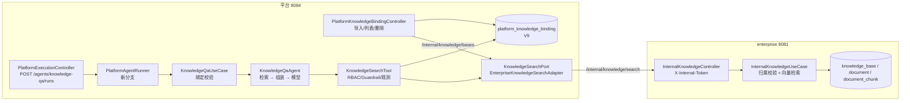

# Spec: Week 25 — 知识库 Agent 3 薄接入（平台包装 enterprise RAG）

> 承接第 24 周结论：Agent 3 **不做平台原生知识库**，先以「包装 enterprise RAG」落地；
> 两条路都绕不开 pgvector，因此本周把「检索」与「pgvector 前置」分开交付：
> **代码可跑、失败显式**，扩展安装属于运维窗口。

## Objective

让平台具备第 6 阶段的 **Agent 3（知识库 Agent）**：医生在平台内选择**本租户已绑定的**
企业知识库提问，平台调用 enterprise 的**只读检索**拿切片，再**用自己的模型生成带引用的答案**，
全程经过平台 RBAC、租户隔离、Guardrail、执行记录、审计与可观测。

一句话：**知识库在 enterprise，治理在平台**——不把两个服务的权限模型缝在一起，也不让问答绕过平台。

## 决策：为什么是「包装」而不是「平台原生」

| 维度 | 包装（本周采用） | 平台原生 |
|------|------------------|----------|
| 文档/OCR/切片/向量 | 复用 enterprise 已有管线（`document` / `document_chunk` / PaddleOCR） | 要重建整套文档生命周期 |
| 租户与权限 | 平台新增「租户 → 知识库」绑定，检索前校验 | 知识库表直接带 `tenant_key` |
| 身份 | 绑定记录 `enterpriseUserId`，不需要每个平台用户都有企业账号 | 只用 `platform_user` |
| 建设成本 | 本周完成（内部端点 + 绑定 + Agent + 工具） | 至少再一周，且仍要 pgvector |
| 风险 | 依赖 enterprise 可用性与 pgvector | 与 enterprise 出现两套知识库/两套权限 |

**关键取舍**：包装**不代理 enterprise 的问答接口**（`POST /knowledge-bases/{id}/chats`），
只代理**检索**。因为问答接口会自己调模型、写自己的会话与 Token 记录——平台会失去审计、
Guardrail 与执行记录，等于在治理上开一个后门。答案必须由平台生成。

## 三个前置与本周处理

| 前置 | 问题 | 本周处理 |
|------|------|----------|
| **pgvector** | 云端 enterprise 库在 Week 22 跳过了 V6，`document_chunk` 不存在；`rag.vector-store=pgvector` 的检索会直接 SQL 失败 | 代码**显式失败**（502 `TOOL_EXECUTION_ERROR`），不降级成「没有相关内容」；运维步骤见 `docs/deploy/week-25-knowledge.md`：装扩展 → 补 V6 → 重新入库；本地/单测用 `RAG_VECTOR_STORE=memory` |
| **跨进程身份** | enterprise `/api/v1/**` 全部要 Sa-Token 登录态 | 新增 `X-Internal-Token` 守卫的**只读**端点（`/api/v1/internal/knowledge/**`），未配置令牌一律 403（fail closed）；不做用户会话代持 |
| **租户语义** | enterprise 只有 `knowledge_base.user_id`，没有租户 | 平台 V9 `platform_knowledge_binding`：`tenant_key + knowledge_base_id + enterprise_user_id`；检索按绑定的企业用户执行，企业侧仍校验归属 |

## 一、职责边界（写死并单测）

| 职责 | enterprise（8081） | 平台（8084） |
|------|--------------------|--------------|
| 文档上传/解析/切片/向量 | ✅ | ❌ |
| 知识库归属 | ✅ 按 `app_user.id` | ❌ |
| 租户 / 角色 / 数据域 | ❌ | ✅ |
| 检索（只读） | ✅ 内部端点 | 调用方 |
| 答案生成 / 引用 | ❌ | ✅ 平台模型 + Prompt |
| 审计 / 执行记录 / 观测 | ❌ | ✅ |

## 二、enterprise 内部端点（新增）

| Method | Path | 鉴权 | 说明 |
|--------|------|------|------|
| GET | `/api/v1/internal/knowledge/bases?platformUserId=` | `X-Internal-Token` | 平台用户 → 企业用户映射，列出其知识库（导入用） |
| POST | `/api/v1/internal/knowledge/search` | `X-Internal-Token` | 按 `enterpriseUserId + knowledgeBaseId` 检索切片（不生成答案） |

- 不走 Sa-Token（`/api/v1/internal/**` 在拦截器白名单），由 `InternalTokenGuard` 守卫；
- **未配置令牌 → 403**（不提供「无鉴权可用」的退路）；比较用 `MessageDigest.isEqual`；
- 只读：不建会话、不写 Token 记录、不调用模型；
- 归属校验：`knowledge_base.user_id == enterpriseUserId`，否则 404（不泄露存在性）；
- `topK` 夹到 1–50；`query` 空白 400。

## 三、平台数据模型（V9）

```sql
CREATE TABLE IF NOT EXISTS platform_knowledge_binding (
    binding_id          VARCHAR(64) PRIMARY KEY,
    tenant_key          VARCHAR(64) NOT NULL,
    enterprise_user_id  BIGINT NOT NULL,
    knowledge_base_id   BIGINT NOT NULL,
    name                VARCHAR(255) NOT NULL,
    description         VARCHAR(1000) NOT NULL DEFAULT '',
    enabled             BOOLEAN NOT NULL,
    created_by          BIGINT NOT NULL,
    created_at          TIMESTAMP WITH TIME ZONE NOT NULL,
    updated_at          TIMESTAMP WITH TIME ZONE NOT NULL,
    CONSTRAINT fk_platform_knowledge_binding_user FOREIGN KEY (created_by) REFERENCES platform_user(id)
);
CREATE UNIQUE INDEX ... ON platform_knowledge_binding(tenant_key, knowledge_base_id);
CREATE INDEX ... ON platform_knowledge_binding(tenant_key, enabled);
```

- 绑定是**租户资源**：同一租户内所有用户共享；`enabled=false` 立即不可检索；
- `enterprise_user_id` 是「知识库归属人」的快照：导入时来自管理员自己的 SSO 映射，
  检索时直接用它，不要求每个平台用户都有企业账号；
- 名称/描述是导入时快照：企业侧改名后需重新导入（本周不做自动同步）。

## 四、平台侧链路

```
POST /api/v1/platform/agents/knowledge-qa/runs {knowledgeBaseId, question}
  → RBAC（agent: knowledge-qa）
  → KnowledgeQaUseCase：查租户绑定（未绑定 404，不进模型）
  → KnowledgeQaAgent：
       KnowledgeSearchTool（RBAC tool + Guardrail 参数白名单 + tool.call 观测）
         → 查绑定（第二道防线）→ KnowledgeSearchPort → enterprise /internal/knowledge/search
       → 命中为 0：直接返回「未检索到」，不调模型
       → 命中 >0：RagContextAssembler 组装上下文 → 平台模型 → 带引用答案
       → 模型不可用：降级为原文摘录（degraded=true），不编造
  → 执行记录 output_json（answer / citations / hitCount / degraded / steps）
```

## 五、权限矩阵

| 操作 | viewer | operator | admin |
|------|--------|----------|-------|
| 运行 `knowledge-qa` Agent | ❌ 403 | ✅（需 `knowledge-qa` + `KnowledgeSearchTool` 授权） | ✅ |
| 查看本租户知识库绑定 | ✅ | ✅ | ✅ |
| 导入知识库绑定 | ❌ 403 | ❌ 403 | ✅ |
| 删除知识库绑定 | ❌ 403 | ❌ 403 | ✅ |

- 跨租户不可见：绑定查询/删除都带 `tenant_key`；
- 租户隔离的第二道防线在工具内（按 Platform Run 的租户查绑定），即使有人绕过用例也拿不到别的租户知识库。

## 六、配置

```yaml
# enterprise
enterprise:
  internal:
    token: ${ENTERPRISE_INTERNAL_TOKEN:}

# platform
platform:
  knowledge:
    enabled: ${PLATFORM_KNOWLEDGE_ENABLED:true}
    base-url: ${PLATFORM_KNOWLEDGE_BASE_URL:http://127.0.0.1:8081}
    internal-token: ${PLATFORM_KNOWLEDGE_INTERNAL_TOKEN:}
    timeout-ms: ${PLATFORM_KNOWLEDGE_TIMEOUT_MS:5000}
    default-top-k: ${PLATFORM_KNOWLEDGE_DEFAULT_TOP_K:4}
    max-top-k: ${PLATFORM_KNOWLEDGE_MAX_TOP_K:10}
    max-question-chars: ${PLATFORM_KNOWLEDGE_MAX_QUESTION_CHARS:4000}
```

两侧 `internal-token` 必须一致；`.env.example` 只给占位符。

## 七、增量架构



新增类型清单：

| 层 | 类型 | 名称 |
|----|------|------|
| domain | 模型 | `KnowledgeBinding`、`KnowledgeSearchQuery/Hit`、`KnowledgeBaseCatalog(+Entry)`、`KnowledgeAnswer`、`KnowledgeCitation`、`KnowledgeStep` |
| domain | Port | `KnowledgeBindingPort`、`KnowledgeSearchPort` |
| domain | 服务 | `KnowledgeQaAgent`（平台生成答案 + 降级） |
| application | UseCase | `KnowledgeBindingUseCase`（导入/列表/删除）、`KnowledgeQaUseCase` |
| infrastructure | Adapter | `Jdbc/InMemoryKnowledgeBindingAdapter`、`EnterpriseKnowledgeSearchAdapter` |
| infrastructure | Tool | `KnowledgeSearchTool`（自动进 ToolRegistry 与装饰器链） |
| controller/dto | API | `PlatformKnowledgeBindingController` + 4 个 DTO |
| 迁移 | V9 | `platform_knowledge_binding` |
| Prompt | `knowledge-qa-v1.txt` | 只依据片段、必须带引用、不编造 |
| enterprise | 内部 | `InternalKnowledgeController`、`InternalKnowledgeUseCase`、`InternalTokenGuard`、`InternalProperties` |

## 八、Success Criteria

- [x] **enterprise 内部端点**：无令牌/错令牌 403；未映射平台用户 404；他人知识库 404；
      `topK` 夹取；返回文档名与相似度（`InternalKnowledgeUseCaseTest` 6 / `InternalKnowledgeControllerTest` 4）
- [x] **平台绑定**：导入幂等（第二次 `imported=0/updated=N`）、租户隔离、admin-only、
      删除带租户谓词（`KnowledgeBindingUseCaseTest` 6）
- [x] **检索工具**：未绑定/停用/无 Platform Run 一律拒绝；`topK` 夹取；
      JSON 形状与 Agent 解析一致（`KnowledgeSearchToolTest` 6）
- [x] **Agent**：有命中生成带引用答案；0 命中**不调模型**；模型不可用降级为摘录；
      工具失败向上抛（`KnowledgeQaAgentTest` 5）
- [x] **用例**：未绑定在模型调用前 404；问题/ID 校验；无平台范围拒绝（`KnowledgeQaUseCaseTest` 6）
- [x] **HTTP**：admin 导入 → operator 列表/问答 200 → 未绑定 404 → viewer 403 →
      operator 删除 403 → admin 删除 200 → 未登录 401（`PlatformKnowledgeHttpTest` 6）
- [x] **V9（H2）**：首次启动 `Successfully applied 9 migrations ... now at version v9`；后续只校验
- [ ] **V9（真实 PostgreSQL）**：**未执行**——与 pgvector/V6 一起安排运维窗口（见 `docs/deploy/week-25-knowledge.md`）
- [x] **零回退**：第 1–24 周用例全绿；根聚合 885 → **924**
- [x] **文档**：Spec/架构/API/Postman/运维手册/实现日志/README/索引同步

### 8.1 交付结果（2026-10-25）

| 门禁 | 结果 |
|------|------|
| 企业模块测试 | **65**（Week 24 为 55，本周 +10） |
| 平台模块测试 | **648**（Week 24 为 619，本周 +29） |
| 根聚合测试 | **924**，Failures 0 / Errors 0，`BUILD SUCCESS` |
| V9（H2） | `Successfully applied 9 migrations ... now at version v9` |
| V9（PostgreSQL） | **未执行**（待运维窗口；pgvector 安装步骤与回滚见部署手册） |
| 密钥 | 未新增真实令牌；`.env.example` 只给占位符；两侧令牌必须一致 |
| 分层 | enterprise 内部端点只读、不调模型；平台领域无 HTTP 类型；SQL 只在适配器 |
| 已知边界 | 依赖 enterprise 在线、绑定是快照、租户内全可见、云端 pgvector 未装 |

> **未执行项已排期**：pgvector/V6、第 24/25 周发布、V8/V9 真库、TD-04/TD-05 统一收敛到
> [`week-26-candidates.md`](week-26-candidates.md)（第 26 周 = 上线收口周）。

## 九、Open Questions

- 知识库**自动同步**（企业侧改名/删除）→ 当前按导入快照；后续加定时对账或 webhook；
- **按角色/用户**细粒度知识库授权（目前租户内全可见）→ 需要 `platform_role_knowledge` 表；
- 是否允许 operator **导入**自己的企业知识库（目前仅 admin）→ 取决于是否有「科室自建库」需求；
- **重排/混合检索**（BM25 + 向量）→ enterprise 侧能力，平台只消费结果；
- 知识库问答是否写**长期记忆**（便于随访引用）→ 涉及隐私与纠错，先不做。

## 十、ADR

| 决策 | 选项 | 选择 | 理由 |
|------|------|------|------|
| 包装范围 | 代理问答 / 只代理检索 | **只代理检索** | 平台生成答案才能进 Guardrail/审计/执行记录/观测 |
| 身份传递 | 用户会话透传 / 内部服务令牌 + 绑定快照 | **后者** | 不要求每个平台用户有企业账号；令牌可轮换、fail closed |
| 租户语义 | 给 enterprise 加 tenant / 平台绑定表 | **平台绑定表** | 不动企业库结构；企业侧仍按本地用户归属校验 |
| 检索失败 | 返回空结果 / 显式 502 | **显式 502** | 「没检索到」与「检索坏了」必须区分，医疗场景不能糊过去 |
| 0 命中 | 仍调模型 / 不调模型 | **不调模型** | 无依据作答等于编造；直接返回「未检索到」 |
| 模型失败 | 报错 / 降级摘录 | **降级摘录 + degraded** | 用户至少拿到原文与出处，且明确未归纳 |
| 绑定归属人 | 每用户映射 / 导入时快照 enterpriseUserId | **快照** | 一次导入、全租户可用；避免逐用户 SSO 依赖 |

## 十一、已知边界

| # | 边界 | 影响 | 何时补 |
|---|------|------|--------|
| 1 | 依赖 enterprise 在线 | 企业服务不可用时问答 502 | 需要时加熔断/缓存（缓存答案有合规风险，先不做） |
| 2 | pgvector 未装时检索必失败 | 云端需运维窗口 | `docs/deploy/week-25-knowledge.md` 安装与回滚步骤 |
| 3 | 绑定是快照 | 企业侧改名/删除不会同步 | 需要时加对账任务 |
| 4 | 租户内全可见 | 无法按科室隔离知识库 | 有需求时加 `platform_role_knowledge` |
| 5 | 引用只回传切片正文 | 平台输出可能含文档原文 | 输出经 Guardrail 脱敏；截断长度由 `max-content` 控制 |
| 6 | 未做流式输出 | 长答案等待时间较长 | 前端/SSE 需求出现时再做 |
