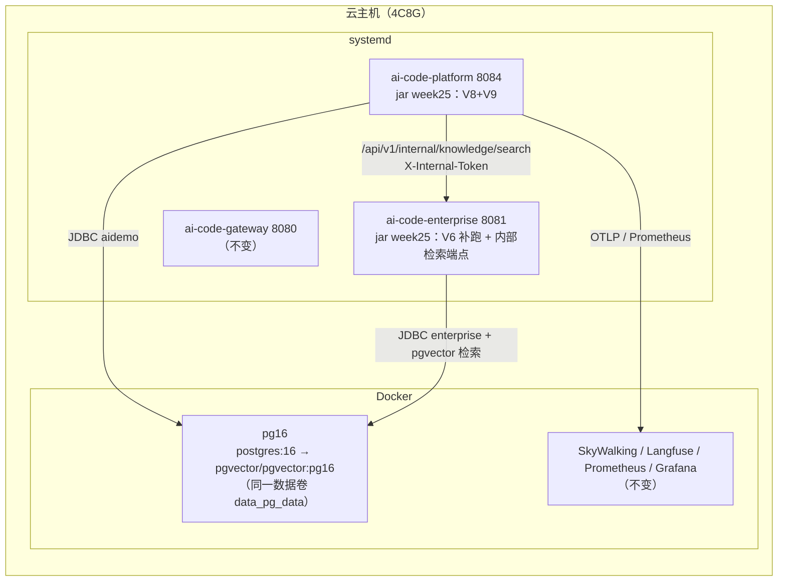

# Spec: Week 26 — 上线收口周（pgvector/V6、V8/V9 真库、发布验收、TD-04/05）

> 来源：`docs/specs/week-26-candidates.md`（候选计划）收敛成的执行版。
> 原则：**本周不写新业务功能**。目标是把第 24/25 周「代码与脚本已就绪、但未在真实环境执行」的事项
> 在云端跑完，并留下可复核的证据（迁移日志、验收输出、演练记录）。
>
> 本周唯一一处生产代码改动是 enterprise 的 Flyway `out-of-order` 配置占位符
> （第 4.1 节）：云端 V7 先于 V6 应用，补跑 V6 必须允许乱序，且 `.env` 的 properties 源不做 relaxed binding，
> 只能用占位符暴露——这是真机暴露的配置缺陷，不是新功能。

## Objective

让四件「代码已就绪」的事在云端真正成立：**pgvector 可检索**、**V6/V8/V9 已落库**、
**两套验收脚本 FAIL=0**、**回滚演练与 TTL 回填有记录**。

## Tech Stack

- 复用既有：PostgreSQL 16（Docker）、pgvector 0.8.7、Flyway 10.20.1、Spring Boot 3.4.5、systemd、SkyWalking/Prometheus。
- 本周不新增依赖、不新增表、不新增 Agent/Tool。

## Commands

- 不改 `JAVA_HOME`；本地构建用 `-Djdk.17.home=E:\Program Files\Eclipse Adoptium\jdk-17.0.20.8-hotspot`
- Maven：`-s D:\soft\maven-3.9.4\conf\settings-ailocal.xml`（仓库 `E:\workRepositoryAi`）
- 测试：`powershell -NoProfile -ExecutionPolicy Bypass -File .\run-maven-jdk17.ps1 test`
- 打包：`.\run-maven-jdk17.ps1 -pl apps/enterprise-knowledge-agent,apps/spring-ai-alibaba-agent -am -DskipTests package`
- 部署：`.\tools\deploy-app.ps1 -Target enterprise -SkipTests` / `-Target platform -SkipTests`
- 云端巡检/验收：`powershell -File .\remote.ps1 -Script .\logs\...\*.sh`、
  `bash /opt/ai-code/app/cloud-accept-week24.sh|cloud-accept-week25.sh`

## Boundaries

- **Always**：变更前备份（库 + jar + .env）；每一步都有「改前/改后」证据；验收脚本 FAIL=0；演练只碰 `*_drill`。
- **Ask first**：要改业务语义、要给 enterprise 加 actuator、要动 Langfuse/SkyWalking 数据。
- **Never**：新功能、新表、新依赖；改已应用迁移脚本；把真实令牌/密码写进仓库或日志。

## 一、范围（P0 六项）

| # | 事项 | 本周动作 | 验收 |
|---|------|----------|------|
| 1 | enterprise 装 pgvector + 补跑 V6 | 把 pg16 容器切到 `pgvector/pgvector:pg16`（保留数据卷）；`CREATE EXTENSION vector`；`SPRING_FLYWAY_LOCATIONS` 恢复两目录；临时 `out-of-order=true` 补 V6 | `vector 0.8.7`；`document_chunk` + hnsw 索引；history 含 `6`；重启只校验 |
| 2 | 第 24 周 V8 云端发布与验收 | 发布平台 week-25 jar（含 V8+V9），跑 `cloud-accept-week24.sh` | V8 表/索引存在；脚本 FAIL=0 |
| 3 | 第 25 周发布（enterprise → 平台） | 两侧内部令牌对齐；先 enterprise 后平台；导入绑定并问答 | `cloud-accept-week25.sh` FAIL=0；答案带 citations |
| 4 | V9 真库校验 + 三 Agent 回归 | 历史表含 v9；patient-analysis / followup / knowledge-qa 各跑一次 | 三个 Agent 均 COMPLETED；HITL 409、未绑定 404 仍生效 |
| 5 | TD-04 回滚演练 | 用本周备份恢复到 `*_drill` 临时库 | 行数校验通过；生产库不受影响；RTO 记录 |
| 6 | TD-05 旧记忆 TTL 回填 | 备份后执行 `ttl-backfill-week24.sql` | `expires_at IS NULL` 归零；列表/检索正常 |

顺序：1 → 2 → 3 → 4 → 5 → 6（1 不做，3 的知识库问答必然 502，这是刻意的显式失败）。

## 二、环境事实（变更前巡检）

| 项 | 变更前 |
|----|--------|
| 平台 | 8084，jar 06:30（Week 23 代码），Flyway `v1–v7` |
| enterprise | 8081，jar 06:32（Week 23 代码），Flyway `1,2,3,4,5,7`（**跳过 6**），`RAG_VECTOR_STORE=memory` |
| PostgreSQL | 容器 `pg16`，镜像 `postgres:16`，数据卷 `data_pg_data`，库 `aidemo/enterprise/skywalking` |
| pgvector | **未安装**（容器内无 `vector` 扩展文件） |
| 业务数据 | `platform_memory=5`（`expires_at` 全 NULL）、`platform_approval=3`、`enterprise app_user=1`、`knowledge_base=0` |
| 令牌 | 两侧 `*_INTERNAL_TOKEN` **均未配置** |

## 三、增量架构（只画本周改动的运行形态）



无新增 Port / Adapter / UseCase；唯一代码改动见 4.1。

## 四、本周改动

### 4.1 enterprise Flyway 乱序开关（代码）

```yaml
# apps/enterprise-knowledge-agent/src/main/resources/application.yml
spring:
  flyway:
    out-of-order: ${SPRING_FLYWAY_OUT_OF_ORDER:false}
```

为什么必须这样写：

1. 云端历史为 `1,2,3,4,5,7`，补 V6 属于乱序；默认 `outOfOrder=false` → 启动直接
   `Validate failed: Detected resolved migration not applied to database: 6`；
2. `.env` 由 `config.import: optional:file:.env[.properties]` 作为 **properties 源**加载，
   不是真实环境变量，**不做 relaxed binding**：写 `SPRING_FLYWAY_OUT_OF_ORDER=true` 不会被绑定到
   `spring.flyway.out-of-order`（真机第一次发布就是这样失败并自动回滚的）；
3. 用占位符 `${SPRING_FLYWAY_OUT_OF_ORDER:false}` 才能读到 `.env` 里的键，且默认关闭、行为不变。

### 4.2 pgvector 容器切换（运维）

`postgres:16` 镜像不含 `vector`，容器内也没有编译工具链；直接换官方
`pgvector/pgvector:pg16`（同 PG16 主版本、同一数据卷），容器名/网络/端口/重启策略/env 全部保持，
旧镜像保留可回滚。脚本：`deploy/app/cloud-week26-pgvector.sh`。

副作用与修复：旧镜像基于 Debian 13（glibc 2.41），pgvector 镜像基于 Debian 12（glibc 2.36），
数据库记录的 `datcollversion=2.41` 与运行库不一致 → 每次连接告警。按官方 HINT
`ALTER DATABASE ... REFRESH COLLATION VERSION` + `REINDEX DATABASE` 修复（`aidemo/enterprise/skywalking/postgres`）。

## 五、Success Criteria

- [x] **pgvector**：`pg_available_extensions` 有 `vector`；`enterprise` 库 `vector 0.8.7`；
      `document_chunk` 存在且含 `idx_document_chunk_embedding`（hnsw）
- [x] **V6**：启动日志 `Migrating ... to version "6 - document chunk pgvector" [out of order]` →
      `Successfully applied 1 migration ... now at version v6`；重启只 `Successfully validated 7 migrations`
- [x] **V8/V9**：平台启动 `Successfully applied 2 migrations ... now at version v9`；
      `platform_followup_task` / `platform_knowledge_binding` 与唯一索引存在
- [x] **令牌**：两侧 `ENTERPRISE_INTERNAL_TOKEN` / `PLATFORM_KNOWLEDGE_INTERNAL_TOKEN` 一致（只记录 sha256 前 12 位）
- [x] **验收 week24**：`cloud-accept-week24.sh` FAIL=0（含 HITL 3 条随访任务、重复决策 409、Gauge）
- [x] **验收 week25**：`cloud-accept-week25.sh` FAIL=0（导入 → 问答 200 带 citations → 未绑定 404 → viewer 403）
- [x] **三 Agent 回归**：patient-analysis / followup / knowledge-qa 各一次成功；限流 429、重复决策 409、未绑定 404 仍生效
- [x] **TD-04**：`rollback-drill.sh` 在 `*_drill` 库恢复成功，生产库行数不变，RTO 记录
- [x] **TD-05**：`platform_memory.expires_at IS NULL` 归零，列表/检索正常
- [x] **零回退**：本地根聚合 924 用例全绿（Week 25 基线）
- [x] **文档**：Spec/部署手册/实现日志/README/索引同步

### 5.1 交付结果（2026-10-25）

| 门禁 | 结果 |
|------|------|
| 本地根聚合 | **924** 用例全绿（ai-core 90 / enterprise 65 / patient 21 / platform 648 / gateway 100） |
| pgvector | `0.8.7`，容器镜像 `pgvector/pgvector:pg16`，数据卷不变 |
| 排序规则 | `datcollversion` 由 `2.41` 刷新为 `2.36`，四个库 `REINDEX` 通过 |
| V6（真库） | 乱序应用成功，`now at version v6`；重启 `validated 7 migrations` |
| V8/V9（真库） | `applied 2 migrations`，`now at version v9` |
| week24 验收 | **PASS=23 FAIL=0**（修掉 2 个脚本缺陷，见实现日志 10.2） |
| week25 验收 | **PASS=13 FAIL=0**（含带引用的真实问答：hitCount=2、citations=2，见实现日志 9.4） |
| TD-04 演练 | 平台/企业两库恢复成功，RTO 见 `docs/deploy/week-26-closeout.md` 第 7 节 |
| TD-05 回填 | `expires_at IS NULL` → 0，5 条旧记忆 TTL 90 天 |

> 真实数字与命令输出见 `notes/impl-logs/week-26.md`；运维步骤见 `docs/deploy/week-26-closeout.md`。

## 六、风险与回滚

| 风险 | 缓解 | 已验证 |
|------|------|--------|
| 换 PG 容器导致库不可用 | 只换镜像不换卷；旧镜像保留；脚本失败自动回滚到 `postgres:16` | 是（60s 内就绪，数据行数不变） |
| glibc 差异导致排序/索引不一致 | `REFRESH COLLATION VERSION` + `REINDEX DATABASE` | 是 |
| V6 乱序被 Flyway 拒绝 | 占位符 `out-of-order` + `.env` 开关；失败即回滚 | 是（第一次失败已回滚过一次） |
| 令牌不一致导致全量 502 | 先 enterprise 后平台；只写 `.env`、不打印；对齐后校验 sha256 | 是 |
| 验收脚本误判 | 脚本自身缺陷当周修（pipefail + `grep -q` 的 SIGPIPE、double-parse） | 是 |
| 演练误连生产库 | `rollback-drill.sh` 只接受 `*_drill` 库名 | 是 |

平台/enterprise 回滚：`.\tools\deploy-app.ps1 -Target platform -Rollback`；`-Target enterprise -Rollback`。
数据库回滚：本周备份 `/opt/ai-code/backup/week26-20261025-125829/`（两库 dump + jar + .env + 状态快照）。

## 七、Open Questions

- 知识库绑定仍是「导入快照」，企业侧改名/删库不会自动同步 → 第 27 周候选（对账任务）。
- 租户内知识库全可见，无科室级授权 → 有需求时加 `platform_role_knowledge`。
- 旧记忆 TTL 回填后，历史医疗记忆会在 90 天后过期 → 需产品/合规确认保留策略。
- PG 容器基座（Debian 12）与旧环境（Debian 13）不同，后续升级需保持「同一主版本 + 刷新 collation」的流程。

## 八、ADR

| 决策 | 选项 | 选择 | 理由 |
|------|------|------|------|
| pgvector 安装方式 | 宿主机 apt / 容器内编译 / 换官方 pgvector 镜像 | **换镜像** | 容器内无工具链；apt 装到宿主机对容器无效；官方镜像同主版本、卷兼容 |
| 排序规则不一致 | 忽略告警 / 重建镜像 / REFRESH+REINDEX | **REFRESH+REINDEX** | 官方 HINT 路径，小库秒级完成，索引与排序一致 |
| V6 补跑 | 手工执行 SQL + 插历史行 / 允许乱序 | **允许乱序** | 走 Flyway 正常路径，checksum/历史可信；开关默认关闭 |
| 乱序开关暴露方式 | 环境变量 / yml 占位符 | **yml 占位符** | `.env` 是 properties 源，不做 relaxed binding；占位符才能读到 |
| 发布顺序 | 平台先 / enterprise 先 | **enterprise 先** | 平台的新工具依赖 enterprise 内部端点；令牌先企业后平台避免窗口期 |
| 验收脚本判定 | 保留原判据 / 修脚本 | **修脚本** | 原判据要求 enterprise 有 actuator、且 pipefail 下大响应必误判，属脚本缺陷 |

## 九、已知边界

| # | 边界 | 影响 | 何时补 |
|---|------|------|--------|
| 1 | 绑定是快照 | 企业侧改名/删除不同步 | 第 27 周对账 |
| 2 | 租户内全可见 | 无法按科室隔离 | 有需求时 |
| 3 | 知识库依赖 enterprise 在线 | 中断即 502（有意，不缓存医疗答案） | 需要熔断时 |
| 4 | 未做流式输出 | 长答案等待较久 | 前端到位 |
| 5 | 旧记忆 TTL 统一 90 天 | 历史医疗记忆到期 | 合规确认后按租户/类型区分 |
| 6 | 云端 PG 基座为 Debian 12 | 与本地/旧镜像 glibc 版本不同 | 升级时沿用本章流程 |
