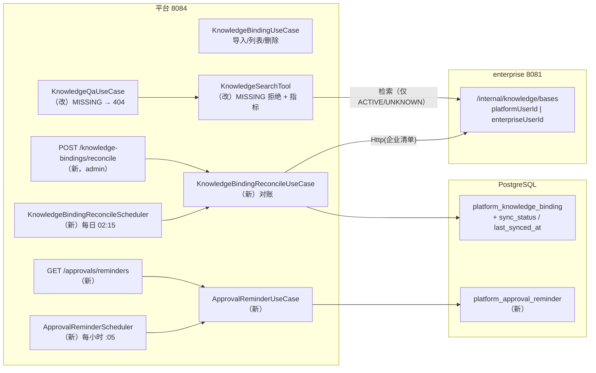

# Spec: Week 27 — 知识库运营化（绑定对账 + 审批超时提醒 + 检索指标）

> 来源：`docs/specs/week-26-candidates.md` 第 2 节 P1 #1 / #3 / #6，以及
> `docs/specs/week-26.md` 第九节「已知边界 #1：绑定是快照，企业侧改名/删除不同步」。
>
> 本周是第 26 周上线收口后的**第一个功能周**：不新增 Agent、不换框架，只把第 25 周
> 「导入即快照」和「审批只能靠人盯」这两个运营缺口补上，并给知识库检索补专项指标。

## Objective

让知识库绑定与审批待办从「一次性快照 / 被动积压」变成**可运营**：

1. **绑定对账**：定时（以及 admin 手动）把 `platform_knowledge_binding` 与企业侧知识库清单比对，
   企业侧改名 → 自动同步名称/描述；企业侧删除 → 标记 `MISSING` 并拒绝检索（不再 502 或空答案）；
   企业侧新增 → 只统计不自动绑定（绑定关系仍是管理动作）。
2. **审批超时提醒**：待审超过阈值（默认 24h）生成**站内提醒**（可查询 + 调度记账 + 审计 + 指标），
   冷却窗口内不重复提醒；**绝不自动拒绝**（高风险患者不能因为超时被系统静默放行/关闭）。
3. **检索指标**：`knowledge.search.duration` / `knowledge.hit.count`，让命中率与耗时可见；
   对账本身也产出 `knowledge.reconcile.count` / `knowledge.binding.missing.count`。

## Tech Stack

- 复用既有：Spring Boot 3.4.5、PostgreSQL 16 / pgvector、Flyway、Micrometer + Prometheus、
  Sa-Token、H2（`MODE=PostgreSQL`）单测。
- 本周**不新增依赖**；新增 1 个迁移 `V10`、1 张运维表 `platform_approval_reminder`、
  2 个调度任务、5 个指标。

## Commands

- 不改 `JAVA_HOME`；本地构建用 `-Djdk.17.home=E:\Program Files\Eclipse Adoptium\jdk-17.0.20.8-hotspot`
- Maven：`-s D:\soft\maven-3.9.4\conf\settings-ailocal.xml`（仓库 `E:\workRepositoryAi`）
- 测试：`powershell -NoProfile -ExecutionPolicy Bypass -File .\run-maven-jdk17.ps1 test`
- 单模块：`.\run-maven-jdk17.ps1 -pl apps/spring-ai-alibaba-agent -am test`
- 打包：`.\run-maven-jdk17.ps1 -pl apps/spring-ai-alibaba-agent,apps/enterprise-knowledge-agent -am -DskipTests package`

## Boundaries

- **Always**：先写失败用例（RED）再写实现；H2 与 PostgreSQL 同一套迁移；新增 public 类型写 JavaDoc；
  一个类不超过 200 行；失败路径有明确语义（不把上游故障伪装成「没有数据」）。
- **Ask first**：要改审批决策语义、要让对账删除绑定、要引入新的外部依赖。
- **Never**：自动批准/拒绝审批；自动新增租户绑定；把知识库正文写进平台库/日志；
  修改已应用的 V1–V9 迁移；把内部令牌写进仓库。

## 一、范围与不做的边界

### 1.1 本周交付（P1 #1 / #3 / #6）

| # | 事项 | 交付物 | 预估 |
|---|------|--------|------|
| 1 | **知识库绑定对账/自动同步** | V10 同步状态列；`KnowledgeBindingReconcileUseCase`；`KnowledgeBindingReconcileScheduler`；`POST /api/v1/platform/knowledge-bindings/reconcile`；enterprise `GET /internal/knowledge/bases?enterpriseUserId=` | 1d |
| 2 | **审批待办超时站内提醒** | V10 `platform_approval_reminder`；`ApprovalReminderUseCase`；`ApprovalReminderScheduler`；`GET /api/v1/platform/approvals/reminders`；审计 `APPROVAL_REMIND` | 0.5d |
| 3 | **知识库检索专用指标** | `knowledge.search.duration`（Timer）、`knowledge.hit.count`（Counter）、对账指标 2 个；契约测试与直方图配置 | 0.5d |

### 1.2 明确不做（沿用第 26 周候选的触发条件）

| 事项 | 原因 |
|------|------|
| 知识库按科室/角色授权（P1 #2） | 1–2d，需要「一租户内多科室」的真实需求；本周不做，避免权限模型半成品 |
| 平台用户停用 TD-06（P2 #1 相邻） | 第 28 周主题（用户生命周期） |
| 知识库 SSE 流式、日报导出、HIS/LIS 真实数据源 | 前端/外部接口未到位 |
| 审批自动拒绝 / 自动升级 | **产品红线**：HIGH 风险患者分析宁可积压也不能静默终止 |
| 对账自动新增绑定 | 绑定是「租户可见性」决策，必须 admin 显式导入 |
| 对账自动删除绑定 | 删绑定会改变可检索范围；只标记 `MISSING`，由 admin 决定是否删除 |

## 二、设计

### 2.1 绑定同步状态（V10）

`platform_knowledge_binding` 增加两列：

| 列 | 类型 | 语义 |
|----|------|------|
| `sync_status` | `VARCHAR(16) NOT NULL DEFAULT 'UNKNOWN'` | `UNKNOWN`（导入后尚未对账）/ `ACTIVE`（最近一次对账在企业侧存在）/ `MISSING`（最近一次对账企业侧已无此库） |
| `last_synced_at` | `TIMESTAMPTZ NULL` | 最近一次成功对账时间；失败不改写 |

状态机：

```text
import ──────────────────────────────► ACTIVE (lastSyncedAt=now)
UNKNOWN ──reconcile: 存在────────────► ACTIVE
UNKNOWN ──reconcile: 不存在──────────► MISSING
ACTIVE  ──reconcile: 不存在──────────► MISSING
MISSING ──reconcile: 又出现──────────► ACTIVE
任意    ──reconcile: 上游失败────────► 保持原状态（只计 failed）
```

**关键约束**：对账失败（enterprise 停机、令牌未配置、超时）**绝不允许**把绑定翻成 `MISSING`。
上游一次抖动若把所有知识库标记删除，会直接打断线上问答——这比「状态晚一天更新」危险得多。

检索语义变化：

| 绑定状态 | `POST /agents/knowledge-qa/runs` |
|----------|----------------------------------|
| 未绑定 / `enabled=false` | 404 `PLATFORM_NOT_FOUND`（既有） |
| `MISSING` | 404 `PLATFORM_NOT_FOUND`，消息明确「企业侧已删除」，**不调模型、不调 enterprise** |
| `UNKNOWN` / `ACTIVE` | 正常检索（`UNKNOWN` 只是「还没对账」，不能当成不存在） |

### 2.2 对账算法（按 租户 + 企业归属人 分组）

一次对账 = 对每个 `(tenantKey, enterpriseUserId)` 分组调用一次企业清单（不是每条绑定一次）：

```text
bindings = listAll()（手动触发时只取调用者租户）
for group in groupBy(tenantKey, enterpriseUserId):
    try:
        catalog = enterprise.listBasesByEnterpriseUser(enterpriseUserId)
    catch ToolExecutionException:
        failed++; continue                      # 不改任何绑定状态
    for binding in group:
        if catalog 中存在 knowledgeBaseId:
            ACTIVE；name/description 有变化则更新（updated++）否则 unchanged++
        else:
            MISSING（missing++）；不删除
    unbound = catalog 中未绑定到本租户的库数量     # 只统计，供运营发现“导入遗漏”
```

- **手动端点**：仅 admin；只对**调用者所在租户**的绑定对账（租户隔离不因运维接口放宽）。
- **调度**：默认每天 `02:15`（cron `0 15 2 * * *`），可用
  `PLATFORM_KNOWLEDGE_RECONCILE_ENABLED=false` 关闭；单实例假设（多实例重复执行幂等）。
- **审计**：手动对账写 `KNOWLEDGE_RECONCILE`（userId=调用者）；调度对账只写日志，
  避免每日一条系统审计噪声（系统故障由日志 + 指标暴露）。
- **指标**：`knowledge.reconcile.count{result=updated|missing|unchanged|failed}` 计数；
  `knowledge.binding.missing.count` Gauge = 当前 `MISSING` 绑定总数。

### 2.3 enterprise 侧按企业用户列库

第 25 周的 `/internal/knowledge/bases?platformUserId=` 需要实时 SSO 映射，适合「导入」；
对账时绑定里记录的是 `enterpriseUserId`，且导入人可能离职/解绑，因此新增同一端点的
`enterpriseUserId` 模式：

```text
GET /api/v1/internal/knowledge/bases?enterpriseUserId=7
```

- 两个参数**恰好一个**：都给或都不给 → 400 `VALIDATION_ERROR`；
- `enterpriseUserId` 对应的本地用户不存在 → 404（平台按 failed 处理，**不标记 MISSING**）；
- 仍由 `X-Internal-Token` 守卫，未配置即 403。

### 2.4 审批超时提醒（不自动拒绝）

新增表 `platform_approval_reminder`（**不修改** `platform_approval` 的领域模型）：

| 列 | 语义 |
|----|------|
| `approval_id` | PK + FK → `platform_approval` |
| `reminder_count` | 已提醒次数 |
| `last_reminded_at` | 最近提醒时间（冷却判断） |

调度算法：

```text
cutoff   = now - thresholdHours（默认 24h）
cooldown = now - cooldownHours（默认 12h）
candidates = PENDING 且 created_at <= cutoff 且（从未提醒 或 last_reminded_at <= cooldown）
for approval in candidates (limit 200):
    markReminded(approvalId, now)     # UPDATE 影响 0 行再 INSERT
    audit(APPROVAL_REMIND, approvalId, overdueHours)
    counter approval.reminder.count++
    # 状态不变：仍是 PENDING
```

- **站内视图**：`GET /api/v1/platform/approvals/reminders?limit=20`
  返回当前用户（admin 为全部）超过阈值的待审任务 + `overdueHours`；
  与随访站内提醒同构（查询视图，不依赖调度是否跑过）。
- **不自动拒绝**：提醒只写 reminder 表/审计/指标，**不改 `platform_approval.status`**，
  单测显式断言决策状态与 `decidedBy` 不变。
- **冷却**：默认 12h，避免每小时刷同一条待办；`limit` 默认 200，防止一次拉爆。
- **可关闭**：`PLATFORM_APPROVAL_REMINDER_ENABLED=false`。

### 2.5 指标

| Micrometer 名 | 类型 | 标签 | Prometheus 导出名 |
|---------------|------|------|-------------------|
| `knowledge.search.duration` | Timer | `knowledge.outcome=SUCCESS|FAILURE` | `knowledge_search_duration_seconds_*` |
| `knowledge.hit.count` | Counter（amount=命中数） | 无 | `knowledge_hit_count_total` |
| `knowledge.reconcile.count` | Counter | `knowledge.result=updated|missing|unchanged|failed` | `knowledge_reconcile_count_total` |
| `knowledge.binding.missing.count` | Gauge | 无 | `knowledge_binding_missing_count` |
| `approval.reminder.count` | Counter | 无 | `approval_reminder_count_total` |

- Timer 进 `percentiles-histogram` + `maximum-expected-value: 5s`（否则 P95 永远 NaN，Week 20 踩过）；
- 标签全部低基数：**不打租户 / knowledgeBaseId**（序列会随医院数增长）；
- 指标常量集中在 `MonitoringMetricNames`，契约测试用真实 Prometheus 注册表锁死导出名。

## 三、增量架构



## 四、Success Criteria

- [x] **V10**：H2 首次启动 `Successfully applied 10 migrations ... now at version v10`；重启只校验；
      `platform_knowledge_binding` 两列可空/默认正确，`platform_approval_reminder` 与索引存在。
- [x] **对账·改名**：企业侧改名后手动对账，绑定 `name` 更新、`syncStatus=ACTIVE`、`updated>=1`。
- [x] **对账·删库**：企业侧删除后对账，绑定 `syncStatus=MISSING` 且**行仍存在**；
      该库问答 404 且不调用模型。
- [x] **对账·失败不改状态**：enterprise 抛 `ToolExecutionException` 时返回 `failed>=1`，
      原 `ACTIVE` 绑定保持 `ACTIVE`、`lastSyncedAt` 不变。
- [x] **对账·权限/租户**：operator 403；admin 只对账本租户；`unbound` 只统计不建绑定。
- [x] **提醒·超时**：`createdAt` 早于 24h 的 PENDING 出现在 `GET /approvals/reminders`；
      调度后 `reminder_count=1`、审计有 `APPROVAL_REMIND`、指标 `approval.reminder.count` 有值。
- [x] **提醒·冷却**：同一审批在冷却窗口内第二次调度不再提醒（`reminder_count` 仍为 1）。
- [x] **提醒·不自动拒绝**：提醒前后 `status=PENDING`、`decidedBy=null`；批准/拒绝/409 语义不变。
- [x] **指标**：一次知识库问答后 `/actuator/prometheus` 出现
      `knowledge_search_duration_seconds_count` / `knowledge_hit_count_total`；对账后出现
      `knowledge_reconcile_count_total` 与 `knowledge_binding_missing_count`。
- [x] **零回退**：根聚合 **971** 用例全绿（Week 26 基线 924；platform 690 / enterprise 70 /
      ai-core 90 / patient 21 / gateway 100）。
- [x] **文档**：Spec / 架构 / 接口 / 实现日志 / README / 日志索引同步。

> 云端发布与真机验收**尚未执行**（无运维窗口）：发布平台 jar 后 Flyway 自动应用 V10，
> 再按第 2.2/2.4 节手动触发一次对账与一次超时提醒即可复核。

### 4.1 交付结果（2026-10-25）

| 门禁 | 结果 |
|------|------|
| 根聚合 | **971** 用例全绿（ai-core 90 / enterprise 70 / patient 21 / platform 690 / gateway 100） |
| platform 模块 | 648 → **690**（+42） |
| enterprise 模块 | 65 → **70**（+5） |
| V10（H2） | 首次 `applied 10 migrations ... now at version v10`；重启 `validated 10 migrations` |
| 对账语义 | 13 个用例：改名 / 删库不删行 / 失败不改状态 / 新库不绑定 / 租户隔离 / 审计 / 指标 |
| 提醒语义 | 9 个用例：阈值 / 冷却 / 不自动拒绝 / admin 全量 / 单条失败不中断 |
| 云端 V10 | **未执行**：发布平台 jar 后自动应用，按第 2 节验证列/表/端点 |

## 五、风险与回滚

| 风险 | 影响 | 缓解 |
|------|------|------|
| 对账把上游抖动当「已删除」 | 全部知识库问答 404 | 失败不改状态（单测锁定）；`MISSING` 需连续成功对账才写入 |
| 对账一次调用过多分组 | enterprise 压力、调度超时 | 按分组调用；`batch-limit` 默认 500 条绑定；单组失败不中断 |
| 提醒风暴 | 通知刷屏、审计膨胀 | 12h 冷却 + 单次 200 条上限 + `enabled` 开关 |
| 提醒改动审批状态 | 高风险任务被静默关闭 | 提醒只写 reminder 表；单测断言状态不变 |
| V10 加列在 H2 与 PG 行为不一致 | 真库迁移失败 | 只用 `ADD COLUMN IF NOT EXISTS` + 标准类型；H2/PG 同一脚本 |
| 指标标签高基数 | Prometheus 序列爆炸 | 只打 outcome/result 两个低基数标签 |

回滚：代码回滚到 Week 26 版本即可；V10 为**只增列/只增表**，不删不改既有列，
旧代码可继续运行（多出的列/表被忽略）。若必须回滚库：
`ALTER TABLE platform_knowledge_binding DROP COLUMN sync_status, DROP COLUMN last_synced_at;`
`DROP TABLE platform_approval_reminder;`（建议先备份，参照 `docs/deploy/week-26-closeout.md`）。

## 六、ADR

| 决策 | 选项 | 选择 | 理由 |
|------|------|------|------|
| 对账按平台用户还是企业用户 | 复用 `platformUserId` / 新增 `enterpriseUserId` | **企业用户** | 绑定里记录的就是企业归属人；导入人离职/解绑不应让对账失效 |
| 企业侧删库如何处理 | 自动删绑定 / 标记 MISSING / 忽略 | **标记 MISSING** | 保留历史与审计；检索显式 404，admin 决定删除 |
| 企业侧新增库是否自动绑定 | 自动导入 / 只统计 | **只统计 `unbound`** | 绑定决定租户可见性，属管理决策，不能因对账扩散 |
| 对账失败是否改状态 | 标记 UNKNOWN / 保持原状态 | **保持** | 上游抖动不能打断线上问答；失败有日志 + `failed` 指标 |
| 提醒状态放哪 | 扩展 `platform_approval` / 新表 | **新表** | 提醒是运维记账，不改审批聚合与既有构造器；冷却查询用 LEFT JOIN |
| 超时是否自动拒绝 | 自动拒绝 / 只提醒 | **只提醒** | HIGH 风险患者分析不能因超时被静默终止（产品红线） |
| 提醒去重 | 每次调度都发 / 冷却窗口 | **12h 冷却** | 兼顾「不遗漏」与「不刷屏」；视图始终可查 |
| 指标标签 | 租户/知识库 ID / 只 outcome | **只 outcome/result** | 避免时间序列随租户/知识库数线性膨胀 |

## 七、Open Questions

- 企业侧删库后，`MISSING` 绑定是否要提供「一键清理」批量删除端点？当前保留单条删除，等运营反馈。
- 提醒的接收人是否需要扩展到「科室审批人」？当前审批归属仍是发起人 + admin，科室角色（P1 #2）落地后再定。
- `unbound` 是否要在管理端做成「发现新知识库」列表并一键导入？当前只在响应里给计数。
- 对账频率（每日 02:15）是否够用？若企业侧改名频繁，可加 `PLATFORM_KNOWLEDGE_RECONCILE_CRON` 调整。
