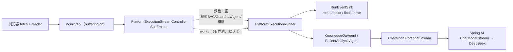

# Spec: Week 31 — 真 SSE 流式（知识库问答 + 患者分析）

> 来源：`docs/adr/0001-sse-deferred.md`（SSE 顺延第 31 周）+ `docs/specs/week-30.md` 边界。
> 基线：Week 30 收盘（2026-10-25）根聚合 **990** 用例、前端 Vitest **11**、云端 `http://HOST/` 可用。
>
> **状态：已执行（2026-11-01）。** 交付见 `docs/architecture/week-31-architecture.md`、
> `docs/api/week-31-api.md`、`notes/impl-logs/week-31.md`、`docs/adr/0002-sse-streaming.md`。

## Objective

1. **两个长正文 Agent 支持模型增量输出**：`knowledge-qa`、`patient-analysis` 首字可见，
   不再"转圈等 30–60s"；流式内容必须来自模型真实增量，**不做假流式**。
2. **新增 SSE 端点**：`POST /api/v1/platform/agents/{agentKey}/runs/stream`，
   鉴权 / RBAC / Guardrail / 执行记录 / 审计 / 指标 / 审批副作用与同步端点**语义一致、只执行一次**。
3. **取消与断连有终态**：新增 `CANCELLED`；页面可"停止生成"，客户端断连不留 `RUNNING` 僵尸记录，
   `CANCELLED` 不计入失败率。

## 1. 决策依据（为什么是这一周）

| 依据 | 说明 |
|------|------|
| ADR-0001 | 第 30 周已把 SSE 明确顺延第 31 周，并列出 6 步实施清单；本周按清单落地 |
| 触发条件已满足 | 患者分析真实耗时 20–60s（云端实测 32s），属于"P95 等待不可接受"的口径 |
| 技术前提已具备 | Spring AI 1.0.0 `ChatModel.stream(Prompt)` 可用（`spring-ai-model` 传递 `reactor-core 3.7.5`）；Servlet 栈用 `SseEmitter` 即可，**不引入 WebFlux** |
| 前端已就位 | `apps/web` 有 4 个 Agent 页、执行详情与 401/403/409 文案，只需替换提交链路与结果渲染 |

**关键判断**：只在前端加 `EventSource` 是假流式（ADR-0001 已否）。本周必须同时打通
**适配器增量 → 平台 SSE → 浏览器 reader**；任一段缺失则降级为同步 200，不交付"半套"。

## 2. 现状与缺口

| 层 | 现状 | 缺口 |
|----|------|------|
| `libs/ai-core` | `ChatModelPort.chat(...)` 同步；`SpringAiChatModelAdapter` 只调 `chatModel.call` | 无增量契约 |
| 平台 | `POST /platform/agents/{key}/runs` 同步 200；`PlatformExecutionRunner` 跑完落库 | 无流式端点、事件、取消 |
| Agent | `KnowledgeQaAgent`、`PatientAnalysisAgent` 各有**一次**模型调用产出正文 | delta 送不出去 |
| 前端 | axios 同步 180s + loading | 无 reader、无追加渲染、无停止 |
| nginx | `/api/` 反代 180s，未关 buffering | SSE 可能被缓冲到结束才下发（首字延迟=总耗时） |
| 状态机 | `RUNNING/COMPLETED/FAILED/PENDING_APPROVAL/REJECTED` | 无"用户中止"语义：客户端断开后任务仍跑完（白烧 token），进程崩溃会留 `RUNNING` |

## 3. 范围

### 3.1 P0（本周必须交付）

| # | 事项 | 交付 | 预估 |
|---|------|------|------|
| 1 | 流式契约 | `ChatStreamListener`（`onDelta`/`onComplete`/`isCancelled`）、`ChatModelPort.chatStream(...)` 默认实现（同步回退=单 chunk）、`StreamCancelledException` | 0.3d |
| 2 | Spring AI 增量适配 | `SpringAiChatModelAdapter.chatStream`：`chatModel.stream(prompt)` → 累加文本 + 末包 usage + 取消即 `takeWhile` 退订 | 0.5d |
| 3 | 平台 SSE 端点 | 预检**同步**（401/403/404/400/429/503 走 JSON 信封）→ `SseEmitter` + worker；心跳、超时、`X-Accel-Buffering: no` | 0.8d |
| 4 | 编排与记录一致性 | `PlatformExecutionRunner` 拆 `prepare`/`execute`；`RunEventSink`；COMPLETED/FAILED/PENDING_APPROVAL/CANCELLED **只落一次**；审计/指标/span 复用 | 0.5d |
| 5 | 两个 Agent 流式 | `KnowledgeQaAgent`、`PatientAnalysisAgent` 接受 listener；无命中/降级/审批语义不变 | 0.4d |
| 6 | 流式脱敏 | `StreamingTextSanitizer`（32 字符 carry，复用 `GuardrailPort.sanitizeTextOutput`）；final 仍整体脱敏 | 0.3d |
| 7 | 取消/断连 | `ExecutionStatus.CANCELLED`（无迁移，`VARCHAR(24)` 足够）+ 统计/指标/前端标签 | 0.4d |
| 8 | 前端 | `api/stream.ts`（fetch + ReadableStream SSE 解析）、Agent 页增量渲染、停止按钮、final 覆盖、无 meta 才回退同步 | 0.9d |
| 9 | 部署/验收 | nginx 流式 location（`proxy_buffering off` / 300s）、平台 jar + web 发布、`cloud-accept-week31.sh` | 0.4d |
| 10 | 文档 | Spec/架构/接口/ADR-0002/实现日志/README/logs-index/Postman | 0.4d |

合计 ≈ 4.9 人日。

### 3.2 P1（有余量再做，不进门禁）

- **OpenAI 兼容适配器**（`FRAMEWORK_MODEL_PROVIDER=openai-compatible`）的增量解析：
  本轮默认回退为 **单 chunk**（契约不变，首字收益为 0），生产默认 `spring-ai` 不受影响；
- Grafana 增加 `agent.stream.*` 面板；
- `GET`（`EventSource` 兼容）流式入口 —— 需要 token 走 query，**默认不做**（令牌进 URL 会进访问日志）。

### 3.3 不做

- WebFlux 重写 / 双栈；多实例广播（Redis/Kafka）；`Last-Event-ID` 断线续传；
- gateway `/gw/` 直连 Run 的流式（该入口未接 SSE，本周不动）；
- 运营日报 / 随访 / 多 Agent 的 token 级流式（先覆盖两个"长正文"Agent，其余走同步）；
- TLS/域名、PDF/OCR 页面、科室授权、Docker/K8s。

## 4. 目标架构

### 4.1 组件与线程



- **预检同步、执行异步**：预检失败仍是正确 HTTP 状态 + JSON 信封；只有预检通过才 `200 text/event-stream`。
  这样不会出现"HTTP 200 里塞一个 403"的假成功。
- worker 用**有界线程池 + 全局并发信号量**（默认 4）：拿不到槽位时在**建执行记录之前**返回 429，
  避免"有 RUNNING 记录但没线程执行"。
- 同步端点 `.../runs` 完全保留（前端回退、脚本、Postman、历史契约都用它）。

### 4.2 事件契约

`200 text/event-stream;charset=UTF-8`，响应头 `Cache-Control: no-cache`、`X-Accel-Buffering: no`，
15s 注释心跳 `: ping`。

| 事件 | data | 说明 |
|------|------|------|
| `meta` | `{executionId, agentKey, traceId, startedAt}` | 已落 `RUNNING` 记录；前端可跳详情 |
| `delta` | `{text}` | 模型增量（已按 32 字符 carry 脱敏）；同一连接内顺序保证 |
| `final` | 标准信封 + `ExecutionRecordResponse` | **权威结果**（与同步端点同结构，含 citations/riskLevel/degraded/approvalId） |
| `error` | `{code, message, traceId, executionId?}` | 执行期错误；记录已落 `FAILED` |

> `final` 必带完整 `outputJson`，前端收到后**覆盖**预览文本。预览只负责"早看到字"，
> 不承担正确性；这样降级（模型中途失败 → 原文摘录）也不会让页面留下半截错误答案。

### 4.3 取消与断连状态机

```text
preflight ──失败──> 4xx JSON（不建记录）
   │通过
   ▼
RUNNING ──正常──────> COMPLETED ──(send final)
   ├──异常──────────> FAILED ──(send error)
   ├──HIGH 风险─────> PENDING_APPROVAL ──(send final)
   └──停止/断连/超时─> CANCELLED（无 final：客户端已经走了）
```

- 断连检测：`SseEmitter.send` 抛 `IOException` 或 `onTimeout` → `RunEventSink.cancel()`；
- 取消不"硬杀线程"：`isCancelled()` 为 true 时由 `takeWhile` 让 Reactor **退订上游**，
  最多多等一个 chunk；
- 终态只落一次：sink 记录 `terminalSaved`；已 COMPLETED 之后不再写 CANCELLED
  （用户断连但任务已完成，记录保持 COMPLETED，仅日志标注 final 未送达）。

### 4.4 安全与一致性

- **脱敏**：delta 走 `sanitizeTextOutput`，用 32 字符 carry 防手机号/身份证跨 chunk 漏掩；
  final 仍整体脱敏并作为权威值。残留风险：>29 字符的邮箱 local part 跨块可能漏掩前 2 字符
  （已在接口文档登记，可把 carry 调大）。
- **traceId 跨线程**：预检线程抓 `MDC` 上下文 + `TraceIds.current()`，worker 内恢复、finally 清理；
  验收要求同一 traceId 贯穿 started/completed 日志与 Langfuse trace。
- **副作用一次**：审批 / 记忆写入仍只在 `PatientAnalysisUseCase` / 审批用例内执行一次；
  流式只旁路"文本增量"，不新增第二条写库链路。
- **令牌**：`Authorization: Bearer` 头（不用 query）；SSE 用 `fetch` 而非 `EventSource`。
- **内容协商**：前端发 `Accept: text/event-stream, application/json` —— 预检失败要能回 JSON 信封
  （只发 `text/event-stream` 时 4xx 会变成 406）。

## 5. 接口契约

`POST /api/v1/platform/agents/{agentKey}/runs/stream`

| 项 | 值 |
|----|----|
| 鉴权 | `Authorization: Bearer <token>`（Sa-Token，与同步端点一致） |
| 请求头 | `Content-Type: application/json`、`Accept: text/event-stream, application/json` |
| 请求体 | `{"input":{...}}`（与 `.../runs` 完全相同） |
| 成功 | `200` + `text/event-stream`，事件见 4.2 |
| 预检失败 | `400 VALIDATION_ERROR`（含不支持的 Agent）/ `401` / `403` / `404 PLATFORM_NOT_FOUND` / `429 RATE_LIMITED`（并发满）/ `503 STREAM_DISABLED`（开关关闭） |
| 开关 | `platform.execution.stream.enabled`（env `PLATFORM_STREAM_ENABLED`，默认 true） |

新增错误码仅 1 个：`STREAM_DISABLED(503, "流式输出未启用")`，同步更新 `docs/api/week-16-api.md`
错误码表与 `ApiErrorCodeContractTest`。

## 6. 代码改动清单

| 模块 | 文件 | 动作 |
|------|------|------|
| ai-core | `domain/model/ChatStreamListener.java`、`domain/exception/StreamCancelledException.java` | 新增 |
| ai-core | `domain/port/ChatModelPort.java` | 加 `default chatStream(...)`（同步回退） |
| ai-core | `infrastructure/springai/SpringAiChatModelAdapter.java` | 实现 `chatStream`（Flux 累加/usage/取消） |
| platform | `application/PlatformExecutionRunner.java` | 拆 `prepare`/`execute`，加 `RunEventSink` 参数 |
| platform | `application/RunEventSink.java`、`StreamingTextSanitizer.java`、`PlatformStreamProperties.java` | 新增 |
| platform | `application/PlatformExecutionRecorder.java` | 加 `cancelled(...)` |
| platform | `domain/model/ExecutionStatus.java`、`operations/domain/OperationsStatistics.java`、`operations/domain/model/OperationsSummary.java` | CANCELLED + 统计 |
| platform | `controller/PlatformExecutionStreamController.java` + `dto/Stream*Response.java` | 新增 SSE 端点 |
| platform | `knowledge/application/KnowledgeQaUseCase`、`knowledge/domain/KnowledgeQaAgent`、`analysis/application/PatientAnalysisUseCase`、`analysis/domain/PatientAnalysisAgent`、`PlatformAgentRunner` | 加 listener 重载（同步路径 `listener=null`，行为不变） |
| 配置 | `application.yml`、`application-test.yml` | stream 属性；`spring.ai.openai.chat.options.stream-usage=true`（末包 usage） |
| 前端 | `api/stream.ts`、`api/stream.test.ts`、`views/AgentRunView.vue`、`components/StatusTag.vue`、`api/types.ts` | 新增/修改 |
| 部署 | `deploy/app/nginx/aicode.conf(.example)`、`deploy/app/cloud-week31.sh`、`cloud-accept-week31.sh` | 流式反代与验收 |
| 文档 | `docs/specs`、`docs/architecture`、`docs/api`、`docs/deploy`、`docs/adr/0002-sse-streaming.md`、`notes/impl-logs/week-31.md`、`README.md`、`docs/logs-index.md`、`docs/postman/week-31.postman_collection.json` | 全套 |

> 既有 990 用例**不减少**；同步端点响应结构不变，作为本周回归门禁。

## 7. 五天排期

| 天 | 交付 | 当日门禁 |
|----|------|----------|
| D1 | ai-core：契约 + Spring AI 增量适配 + 取消退订；适配器单测（顺序/累加/usage/取消/异常/空流） | `.\run-maven-jdk17.ps1 -pl libs/ai-core test` 全绿 |
| D2 | 平台：preflight/execute 拆分、`RunEventSink`、SSE 控制器、线程池/信号量/心跳、开关、错误码；DB 记录落一次 | 平台模块测试全绿；日终跑根聚合确认 990 不回归 |
| D3 | 两个 Agent 接 listener、流式脱敏 carry、`CANCELLED` 状态与统计、指标 `agent.stream.*` | 平台模块测试全绿（新增用例 ≥20） |
| D4 | 前端：SSE reader、增量渲染、停止、final 覆盖、无 meta 回退；Vitest 解析用例 | `tools/web-ci.ps1` typecheck/test/build exit 0 |
| D5 | nginx 流式配置、云端发布、`curl -N` 真机计时、浏览器冒烟、文档/Postman/README | 根聚合 ≥1018 全绿；真机 PASS |

## 8. 测试与验收

### 8.1 单测（目标 ≥1018，新增 ≥28）

| 层 | 用例 |
|----|------|
| ai-core（7） | delta 顺序；累加文本/usage/模型；取消即退订且无 `onComplete`；上游异常 → `ChatModelException`；空流；默认回退单 chunk；回退不产生空 delta |
| 平台编排（7） | meta→delta→final 顺序；记录只落一次（RUNNING+COMPLETED，审计 1 次）；PENDING_APPROVAL 副作用一次；执行期异常 → FAILED+error；取消 → CANCELLED 不写 FAILED；不支持的 Agent/越权 → 预检 400/403 且**不建记录**；并发满 429 |
| 脱敏（4） | 手机号跨 chunk 掩盖；身份证跨 chunk；尾部 flush；关闭脱敏时透传 |
| 控制器（3） | 401 无 SSE；不支持 Agent → 400 JSON；`Accept` 协商 + SSE 头/事件 |
| 统计（2） | CANCELLED 不计失败率；summary 新增 cancelled |
| 前端（7） | 分块解析、CRLF、多行 data、注释行、未知事件忽略、final 信封、error/abort |

### 8.2 真机验收（云端，硬指标）

| # | 场景 | 通过标准 |
|---|------|----------|
| 1 | `curl -N` knowledge-qa | `meta` < 0.3s；**首个 `delta` < 2s**；`final` 为 COMPLETED 且 token > 0 |
| 2 | `curl -N` patient-analysis（P002，HIGH） | 首个 `delta` < 5s；`final` 为 PENDING_APPROVAL；审批仍可批准/拒绝 |
| 3 | 页面增量渲染 | 答案区边出边显示；完成后 citations/状态与详情页一致 |
| 4 | 停止生成 | 记录 `CANCELLED`；无 COMPLETED；不产生额外记忆/审批 |
| 5 | 断连（kill curl） | 5s 内落终态；`SELECT count(*) WHERE status='RUNNING'` 不增 |
| 6 | 同步端点回归 | 4 个 Agent 同步 200；知识库问答 citations 正常；审批/随访 409 仍生效 |
| 7 | 走 nginx（80 端口） | 首字与直连 8084 时间差 < 0.5s（证明未被缓冲） |
| 8 | 错误语义 | 401/403/404/400/429 状态码与中文信封正确，不是 200-流内报错 |
| 9 | 观测 | 同一次流式 started/completed 日志 traceId 一致；`agent.stream.*` 指标可见 |
| 10 | 门禁 | 根聚合 ≥1018 全绿；web-ci typecheck 0 / Vitest ≥18 / build 成功 |

## 9. 风险与缓解

| 风险 | 影响 | 缓解 |
|------|------|------|
| nginx 缓冲导致"首字=末字" | 白做 | 专用 `location` + `proxy_buffering off` + `X-Accel-Buffering: no`；验收第 7 条量时间差 |
| 流式 usage 缺失（OpenAI 需 `include_usage`） | token/成本统计为 0 | 打开 `stream-usage`；真机断言 token>0；若绑定失效，则在适配器内用 `OpenAiChatOptions` 显式设置（P1 兜底） |
| 异步线程丢 traceId/MDC | 日志断链、Langfuse 分裂 | 预检抓上下文，worker 恢复；验收第 9 条 |
| 客户端断连后模型继续跑 | 白烧 token、线程占用 | `takeWhile` 退订 + 超时；并发槽位上限 4 |
| 版本兼容 | 既有 990 用例红 | 只加默认方法与重载；同步路径 `listener=null`；D2 结束前跑一次根聚合 |
| 预览文本与最终不一致 | 用户困惑 | final 覆盖 + "生成中"标记；降级时 final 明确 `degraded=true` |
| 半截 PII 泄漏 | 合规 | 32 字符 carry + final 整体脱敏；文档登记残留风险 |
| 5 天做不完 | 半套交付 | P1 全砍；若 D3 日终仍未打通，暂缓 patient-analysis 流式（同步仍可用）并在实现日志登记为下周首项——**降级前先与用户确认**，不交付无取消/无记录的假流式 |

## 10. 回滚

1. **首选（分钟级）**：`PLATFORM_STREAM_ENABLED=false` + 重启平台 → 端点 503 →
   前端自动回同步端点；不动 jar、不动数据。
2. **次选**：按 Week 29/30 发布脚本回滚平台 jar 与 `web.prev` 静态目录。
3. 无数据库迁移（`status` 为 `VARCHAR(24)`），无需回滚 SQL。

## 11. 与前后周的关系

| 周 | 主题 | 说明 |
|----|------|------|
| 30 | 企业知识库页 + 前端 CI | 已完成；SSE 明确顺延本周 |
| **31** | **真 SSE 流式** | 两个长正文 Agent + 取消/断连 + nginx/前端/验收 |
| 32+ | 按触发条件 | PDF/OCR 页面、科室级授权、运营日报导出、TLS/域名、容器化；多实例流式广播等出现第二实例再说 |

## 12. 已确认决策（2026-11-01）

1. **方案 A**：第 31 周只做 SSE；PDF/OCR 入库与步骤级过程管理排到第 32/33 周；
2. **覆盖两个 Agent**：知识库问答 + 患者分析；
3. **取消语义**：新增 `CANCELLED`，断连不记 `FAILED`；
4. **OpenAI 兼容通道**：本轮接受"单 chunk 回退"（生产默认 `spring-ai` 不受影响）；
5. **发布**：本周上云；脚本已就绪，本机无云主机凭据，待有 SSH 的环境执行；
6. **第 32 周方向**：PDF/OCR 入库 + 步骤级过程管理；`prompt` **原文可见** + **Dify 式节点视图**，
   需单独 Spec（见 `docs/specs/week-32-candidates.md`）。

## 13. 执行结果（2026-11-01）

| 门禁 | 结果 |
|------|------|
| ai-core | 90 → **108** |
| 平台 | 712 → **734** |
| enterprise / patient / gateway | 70 / 21 / 100（不变） |
| 根聚合 | **1033** 全绿（基线 990，+43） |
| 前端 | typecheck 0 / Vitest **23** / build 成功 |
| 单测覆盖 | 契约/适配器 15、取消 3、脱敏 6、编排 6、预检 HTTP 4、SSE 主链路 1、统计/指标 2 |
| 云端发布 | **已执行**（`cloud-week31.sh`，备份 `week31-*`，health 200） |
| 真机验收 | **PASS=15 FAIL=0** |

**真机首字（全部达标）**：

| 检查 | 实测 | 目标 |
|------|------|------|
| knowledge-qa 首字（直连） | **1225ms** | <2000ms |
| 走 nginx 首字 | **1125ms** | <2500ms |
| patient-analysis 首字 | **1075ms** | <5000ms |
| 终态 | COMPLETED（token 2508）/ PENDING_APPROVAL | 正确 |
| 停止生成 | CANCELLED | 正确 |
| 同步回归 / 401 / 400 / 指标 / 无 RUNNING | PASS | — |

**根因与最终链路**（详见实现日志 7.3）：

1. Spring AI `ChatModel.stream` 在当前版本对 SSE 有聚合行为 → 改为
   `OpenAiCompatibleChatModelAdapter` 原生 SSE（`FRAMEWORK_MODEL_PROVIDER=openai-compatible`）；
2. `AiCoreConfiguration.llmRestClient` 原用 `JdkClientHttpRequestFactory`，会读完整响应才交
   InputStream → 换 `SimpleClientHttpRequestFactory`；
3. `observableChatModelPort` 硬编码 `springAiChatModelAdapter` 导致切 provider 启动失败 →
   两个适配器统一注册为 `delegateChatModelPort`；
4. SSE 输出改为阻塞式逐帧 `write + flush`（`SseEmitter`/`AsyncContext` 都会攒包）。

**与计划的偏差**：

1. 额外修复 `PiiMasker` 对 **18 位身份证完全不掩码** 的旧缺陷（不是流式引入，但被流式暴露）；
2. 进一步发现"整段 JSON 文本脱敏"会把 15 位小数改坏 → `GuardrailToolPort` 改为**结构化脱敏**；
3. 新增 MockMvc SSE 主链路用例与本地 SSE 服务端到端用例（原计划只列了预检契约）；
4. OpenAI 兼容适配器增量解析由 P1 提前完成（它成了生产流式通道）。
